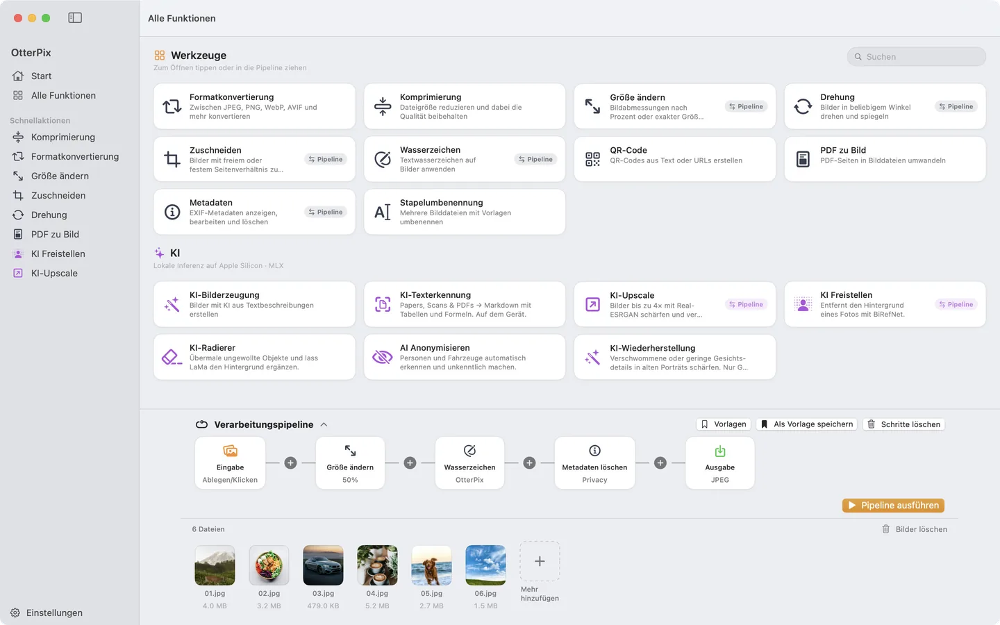

[English](README.md) | [简体中文](README.zh-Hans.md) | [繁體中文](README.zh-Hant.md) | **Deutsch**

---

# OtterPix

**Bildbearbeitung & AI, die deinen Mac nie verlässt**

**[Im Mac App Store laden](https://apps.apple.com/app/id6772468615)**

macOS 14+, Apple Silicon, Gratis-Download mit Pro per In-App-Kauf, 18 Sprachen

## Was ist OtterPix

OtterPix ist ein Bild-Werkzeugkasten für den Mac, bei dem jede Operation – von der Formatkonvertierung bis zur AI-Bearbeitung – vollständig auf deinem Rechner läuft. Zehn Ein-Klick-Basiswerkzeuge, eine visuelle Pipeline für Stapel-Workflows und ein Satz lokaler AI-Funktionen decken die täglichen Aufgaben ab: konvertieren, komprimieren, skalieren, Wasserzeichen setzen, umbenennen, Metadaten prüfen, Hintergründe entfernen, Objekte wegretuschieren, Gesichter wiederherstellen, Text erkennen und Bilder generieren. Die AI-Funktionen sind für Apple Silicon beschleunigt; ihre Modelle werden bei Bedarf geladen, und die Inferenz arbeitet offline, sobald die benötigten Dateien vorhanden sind. Pro ergänzt Ordnerautomatisierung; unterstützte Werkzeuge und gespeicherte Voreinstellungen lassen sich auch über Kurzbefehle/App Intents und AppleScript aufrufen.

Bilder, Generierungs-Prompts, OCR-Inhalte und Nutzungs-Telemetrie werden nie hochgeladen. OtterPix verbindet sich für StoreKit, eine Cloudflare-Abfrage des Edge-Landes beim Start, die ausschließlich den Modell-Downloadspiegel auswählt, eine kleine Aktualisierung des ausschließlich Download-URLs enthaltenden Modell-Manifests bei der ersten Nutzung der Modellverwaltung sowie von dir gestartete Modell-Downloads.

## Funktionen

### Kostenlos

| Werkzeug | Was es macht |
|---|---|
| [Formatkonvertierung](docs/de/tools/convert-and-compress.md) | Zwischen JPEG, PNG, WebP, AVIF und mehr konvertieren |
| [Komprimierung](docs/de/tools/convert-and-compress.md) | Dateigröße reduzieren und dabei die Qualität beibehalten |
| [Größe ändern](docs/de/tools/resize-crop-rotate.md) | Bildabmessungen nach Prozent oder exakter Größe ändern |
| [Zuschneiden](docs/de/tools/resize-crop-rotate.md) | Bilder mit freiem oder festem Seitenverhältnis zuschneiden |
| [Drehung](docs/de/tools/resize-crop-rotate.md) | Bilder in beliebigem Winkel drehen und spiegeln |
| [Wasserzeichen](docs/de/tools/watermark.md) | Textwasserzeichen auf Bilder anwenden |
| [Stapelumbenennung](docs/de/tools/batch-rename.md) | Mehrere Bilddateien mit Vorlagen umbenennen |
| [Metadaten](docs/de/tools/metadata.md) | EXIF-Metadaten anzeigen, bearbeiten und löschen |
| [PDF zu Bild](docs/de/tools/pdf-and-qr.md) | PDF-Seiten in Bilddateien umwandeln |
| [QR-Code](docs/de/tools/pdf-and-qr.md) | QR-Codes aus Text oder URLs erstellen |
| [Pipeline](docs/de/pipeline.md) | Mehrere Werkzeuge zu einem Batch-Workflow verketten |
| [AI Texterkennung](docs/de/ai/ai-ocr.md) | Papers, Scans & PDFs → Markdown mit Tabellen und Formeln. Auf dem Gerät. |
| [AI Bilderzeugung](docs/de/ai/ai-generation.md) | Bilder mit AI aus Textbeschreibungen erstellen |

### Pro-AI

| Werkzeug | Was es macht |
|---|---|
| [AI Upscale](docs/de/ai/ai-upscale.md) | Bilder bis zu 4× schärfen und vergrößern |
| [AI Freistellen](docs/de/ai/ai-cutout.md) | Den Hintergrund eines Fotos entfernen |
| [AI Radierer](docs/de/ai/ai-eraser.md) | Unerwünschte Objekte übermalen und den Hintergrund von der AI ergänzen lassen |
| [AI Anonymisieren](docs/de/ai/ai-anonymize.md) | Personen und Fahrzeuge automatisch erkennen und unkenntlich machen |
| [AI Wiederherstellung](docs/de/ai/ai-restore.md) | Verschwommene oder detailarme Gesichter in alten Porträts schärfen |

Gratis-Plan: eine Gratis-Nutzung jedes Pro-AI-Werkzeugs pro Tag.

## Über dieses Repository

OtterPix ist eine kommerzielle Closed-Source-App, die über den Mac App Store vertrieben wird – dieses Repository enthält keinen Quellcode, und das ist auch nicht geplant. Stattdessen ist es das öffentliche Zuhause der App:

- **Handbücher** auf English, 简体中文, 繁體中文 und Deutsch
- **Bug-Tracker** – Fehler melden und sehen, was bekannt, bestätigt und behoben ist
- **Feature-Wünsche & Diskussionen**
- **Versionshinweise** zu jeder Version

Offen zu arbeiten schlägt jedes private Support-Postfach: Alle sehen, was bekannt ist, können ergänzen und zuschauen, wie Fixes ausgeliefert werden.

Closed Source heißt nicht „glaub uns einfach“: Die App läuft in der macOS-Sandbox, enthält kein Analytics-SDK und sendet weder Bilder noch Prompts, OCR-Inhalte oder Nutzungs-Telemetrie. Der begrenzte Netzwerkverkehr ist in der [Datenschutzerklärung](https://otterpix.app/de/privacy) vollständig aufgeführt.

## Hilfe bekommen

| Du möchtest … | Anlaufstelle |
|---|---|
| Einen Fehler melden | [Issue eröffnen](https://github.com/nanguoyu/OtterPix-app/issues/new/choose) |
| „Wie mache ich …?“ fragen | [Discussions → Q&A](https://github.com/nanguoyu/OtterPix-app/discussions/categories/q-a) |
| Eine Idee einbringen | [Discussions → Ideas](https://github.com/nanguoyu/OtterPix-app/discussions/categories/ideas) |
| Eine Rückerstattung, ein Abo verwalten | Alle Käufe wickelt Apple ab: [reportaproblem.apple.com](https://reportaproblem.apple.com), [Abos verwalten](https://apps.apple.com/account/subscriptions) |
| Etwas Privates oder Sensibles ansprechen | hello@otterpix.app |

## Dokumentation

**Erste Schritte**

- [Erste Schritte](docs/de/getting-started.md) – Voraussetzungen, Installation, Fensterrundgang, Automatisierung und deine erste Bearbeitung

**Werkzeuge**

- [Formatkonvertierung & Komprimierung](docs/de/tools/convert-and-compress.md)
- [Größe ändern, Zuschneiden & Drehung](docs/de/tools/resize-crop-rotate.md)
- [Wasserzeichen](docs/de/tools/watermark.md)
- [Stapelumbenennung](docs/de/tools/batch-rename.md)
- [Metadaten](docs/de/tools/metadata.md)
- [PDF zu Bild & QR-Code](docs/de/tools/pdf-and-qr.md)

**AI**

- [AI Upscale](docs/de/ai/ai-upscale.md)
- [AI Freistellen](docs/de/ai/ai-cutout.md)
- [AI Radierer](docs/de/ai/ai-eraser.md)
- [AI Anonymisieren](docs/de/ai/ai-anonymize.md)
- [AI Wiederherstellung](docs/de/ai/ai-restore.md)
- [AI Texterkennung](docs/de/ai/ai-ocr.md)
- [AI Bilderzeugung](docs/de/ai/ai-generation.md)

**Pipeline**

- [Pipeline](docs/de/pipeline.md) – Schritte verketten, Vorlagen speichern, Ordner im Stapel verarbeiten

**FAQ & Releases**

- [FAQ](docs/de/faq.md)
- [Changelog](docs/de/changelog.md)

## Releases

Jede Version wird hier mit ihren Versionshinweisen getaggt – **Watch → Custom → Releases** benachrichtigt dich bei neuen Versionen. Die vollständige Historie steht im [Changelog](docs/de/changelog.md).

## Danksagungen

Die AI-Funktionen von OtterPix bauen auf herausragender Open-Source-Forschung und offenen Modellen auf:

- [FLUX.2 Klein](https://huggingface.co/black-forest-labs/FLUX.2-klein-4B) – Black Forest Labs
- [Qwen3-4B](https://huggingface.co/Qwen/Qwen3-4B) – Text-Encoder
- [Real-ESRGAN](https://github.com/xinntao/Real-ESRGAN)
- [BiRefNet](https://github.com/ZhengPeng7/BiRefNet)
- [LaMa](https://github.com/advimman/lama)
- [RF-DETR](https://github.com/roboflow/rf-detr)
- [RestoreFormer++](https://github.com/wzhouxiff/RestoreFormerPlusPlus)
- [Unlimited-OCR](https://huggingface.co/baidu/Unlimited-OCR)
- [Apple MLX](https://github.com/ml-explore/mlx)

… sowie den Open-Source-Bibliotheken, die in der App aufgeführt sind: **OtterPix → Einstellungen → Open-Source-Lizenzen**, auch unter [otterpix.app/de/licenses](https://otterpix.app/de/licenses).

---

© 2026 OtterPix (nanguoyu). Die OtterPix-App ist proprietäre Software. Dokumentation und Screenshots in diesem Repository dürfen mit Quellenangabe geteilt werden.

[Datenschutz](https://otterpix.app/de/privacy) | [Nutzungsbedingungen](https://otterpix.app/de/terms)
