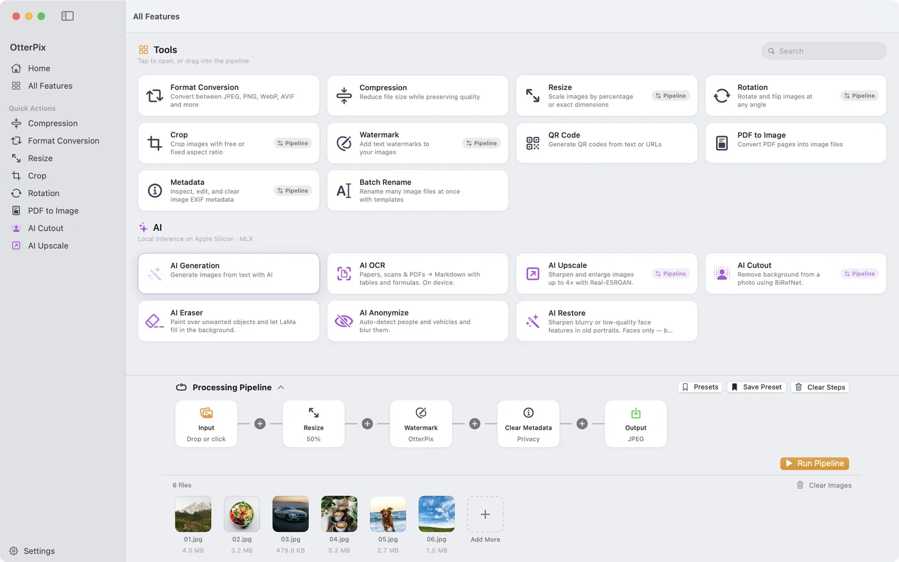

**English** | [简体中文](README.zh-Hans.md) | [繁體中文](README.zh-Hant.md) | [Deutsch](README.de.md)

---

# OtterPix

**Image processing & AI that never leaves your Mac**

**[Download on the Mac App Store](https://apps.apple.com/app/id6772468615)**

macOS 14+, Apple silicon, free download with Pro as an in-app purchase, 18 languages

## What is OtterPix

OtterPix is an image toolkit for the Mac where every operation — from format conversion to AI-powered editing — runs entirely on your machine. Ten one-click basic tools, a visual Pipeline for batch workflows, and a set of on-device AI features cover the everyday jobs: convert, compress, resize, watermark, rename, inspect metadata, remove backgrounds, erase objects, restore faces, recognize text, and generate images. The AI features are accelerated by Apple silicon; their models download on demand, and inference works offline once the required files are present. Pro also adds folder automation, while supported tools and saved presets can be invoked from Shortcuts/App Intents and AppleScript.

User images, generation prompts, OCR content, and usage telemetry are never uploaded. OtterPix does make limited service requests for StoreKit, a startup Cloudflare edge-country lookup used only to select a model-download mirror, a small URL-only model-manifest refresh when the model store is first used, and model downloads that the user initiates.

## Features

### Free

| Tool | What it does |
|---|---|
| [Format Conversion](docs/en/tools/convert-and-compress.md) | Convert between JPEG, PNG, WebP, AVIF and more |
| [Compression](docs/en/tools/convert-and-compress.md) | Reduce file size while preserving quality |
| [Resize](docs/en/tools/resize-crop-rotate.md) | Scale images by percentage or exact dimensions |
| [Crop](docs/en/tools/resize-crop-rotate.md) | Crop images with free or fixed aspect ratio |
| [Rotation](docs/en/tools/resize-crop-rotate.md) | Rotate and flip images at any angle |
| [Watermark](docs/en/tools/watermark.md) | Add text watermarks to your images |
| [Batch Rename](docs/en/tools/batch-rename.md) | Rename many image files at once with templates |
| [Metadata](docs/en/tools/metadata.md) | Inspect, edit, and clear image EXIF metadata |
| [PDF to Image](docs/en/tools/pdf-and-qr.md) | Convert PDF pages into image files |
| [QR Code](docs/en/tools/pdf-and-qr.md) | Generate QR codes from text or URLs |
| [Pipeline](docs/en/pipeline.md) | Chain multiple tools into one batch workflow |
| [AI OCR](docs/en/ai/ai-ocr.md) | Papers, scans & PDFs → Markdown with tables and formulas. On device. |
| [AI Generation](docs/en/ai/ai-generation.md) | Generate images from text with AI |

### Pro AI

| Tool | What it does |
|---|---|
| [AI Upscale](docs/en/ai/ai-upscale.md) | Sharpen and enlarge images up to 4× |
| [AI Cutout](docs/en/ai/ai-cutout.md) | Remove the background from a photo |
| [AI Eraser](docs/en/ai/ai-eraser.md) | Paint over unwanted objects and let AI fill in the background |
| [AI Anonymize](docs/en/ai/ai-anonymize.md) | Auto-detect people and vehicles and blur them |
| [AI Restore](docs/en/ai/ai-restore.md) | Sharpen blurry or low-quality face features in old portraits |

Free plan: one free use of each Pro AI tool per day.

## About this repository

OtterPix is a commercial, closed-source app distributed through the Mac App Store — there is no source code in this repo, and none is planned. This repo is the app's public home instead:

- **User guides** in English, 简体中文, 繁體中文, and Deutsch
- **Bug tracker** — report issues and see what's known, confirmed, and fixed
- **Feature requests & discussions**
- **Release notes** for every version

Working in the open beats a private support inbox: everyone can see what's known, add to it, and watch fixes ship.

Closed source doesn't mean take-our-word-for-it: the app is sandboxed, ships no analytics SDK, and never sends your images, prompts, OCR content, or usage telemetry. Its limited network traffic is documented in the [privacy policy](https://otterpix.app/en/privacy).

## Get help

| You want to… | Go to |
|---|---|
| Report a bug | [Open an issue](https://github.com/nanguoyu/OtterPix-app/issues/new/choose) |
| Ask "how do I…?" | [Discussions → Q&A](https://github.com/nanguoyu/OtterPix-app/discussions/categories/q-a) |
| Share an idea | [Discussions → Ideas](https://github.com/nanguoyu/OtterPix-app/discussions/categories/ideas) |
| Get a refund, manage a subscription | Apple handles all purchases: [reportaproblem.apple.com](https://reportaproblem.apple.com), [manage subscriptions](https://apps.apple.com/account/subscriptions) |
| Raise something private or sensitive | hello@otterpix.app |

## Documentation

**Getting started**

- [Getting started](docs/en/getting-started.md) — requirements, install, window tour, automation, and your first edit

**Tools**

- [Format Conversion & Compression](docs/en/tools/convert-and-compress.md)
- [Resize, Crop & Rotation](docs/en/tools/resize-crop-rotate.md)
- [Watermark](docs/en/tools/watermark.md)
- [Batch Rename](docs/en/tools/batch-rename.md)
- [Metadata](docs/en/tools/metadata.md)
- [PDF to Image & QR Code](docs/en/tools/pdf-and-qr.md)

**AI**

- [AI Upscale](docs/en/ai/ai-upscale.md)
- [AI Cutout](docs/en/ai/ai-cutout.md)
- [AI Eraser](docs/en/ai/ai-eraser.md)
- [AI Anonymize](docs/en/ai/ai-anonymize.md)
- [AI Restore](docs/en/ai/ai-restore.md)
- [AI OCR](docs/en/ai/ai-ocr.md)
- [AI Generation](docs/en/ai/ai-generation.md)

**Pipeline**

- [Pipeline](docs/en/pipeline.md) — chain steps, save presets, batch-process folders

**FAQ & releases**

- [FAQ](docs/en/faq.md)
- [Changelog](CHANGELOG.md)

## Releases

Every version is tagged here with its release notes — **Watch → Custom → Releases** to get notified. The full history lives in the [changelog](CHANGELOG.md).

## Acknowledgements

OtterPix's AI features build on outstanding open-source research and models:

- [FLUX.2 Klein](https://huggingface.co/black-forest-labs/FLUX.2-klein-4B) — Black Forest Labs
- [Qwen3-4B](https://huggingface.co/Qwen/Qwen3-4B) — text encoder
- [Real-ESRGAN](https://github.com/xinntao/Real-ESRGAN)
- [BiRefNet](https://github.com/ZhengPeng7/BiRefNet)
- [LaMa](https://github.com/advimman/lama)
- [RF-DETR](https://github.com/roboflow/rf-detr)
- [RestoreFormer++](https://github.com/wzhouxiff/RestoreFormerPlusPlus)
- [Unlimited-OCR](https://huggingface.co/baidu/Unlimited-OCR)
- [Apple MLX](https://github.com/ml-explore/mlx)

…and the open-source libraries listed in the app: **OtterPix → Settings → Open-Source Licenses**, also at [otterpix.app/en/licenses](https://otterpix.app/en/licenses).

---

© 2026 OtterPix (nanguoyu). The OtterPix app is proprietary software. Documentation and screenshots in this repository may be shared with attribution.

[Privacy](https://otterpix.app/en/privacy) | [Terms](https://otterpix.app/en/terms)
