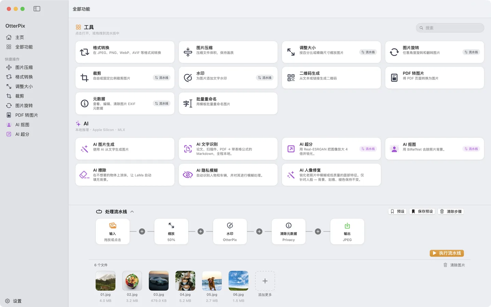

[English](README.md) | **简体中文** | [繁體中文](README.zh-Hant.md) | [Deutsch](README.de.md)

---

# OtterPix

**图像处理与 AI，全程不离开你的 Mac**

**[在 Mac App Store 下载](https://apps.apple.com/app/id6772468615)**

macOS 14+，Apple 芯片，免费下载，Pro 为应用内购买，支持 18 种语言

## OtterPix 是什么

OtterPix 是一款 Mac 图像工具箱：从格式转换到 AI 修图，每一项操作都完全在你自己的电脑上运行。十个一键式基础工具、一条可视化批量流水线，再加上一组本地 AI 功能，覆盖日常所需——转格式、压缩、缩放、加水印、批量重命名、查看元数据、抠图去背景、擦除物体、修复人脸、识别文字、生成图片。AI 功能由 Apple 芯片加速；模型按需下载，所需文件就绪后即可离线推理。Pro 还提供文件夹自动化，受支持的工具和已保存预设也可通过快捷指令（App Intents）和 AppleScript 调用。

图片、生成提示词、OCR 内容和使用情况遥测数据绝不会上传。OtterPix 会为 StoreKit、启动时仅用于选择模型下载镜像的 Cloudflare 边缘国家代码查询、首次使用模型商店时刷新只包含下载 URL 的小型清单，以及你主动发起的模型下载而联网。

## 功能

### 免费

| 工具 | 功能 |
|---|---|
| [格式转换](docs/zh-Hans/tools/convert-and-compress.md) | 在 JPEG、PNG、WebP、AVIF 等格式间转换 |
| [图片压缩](docs/zh-Hans/tools/convert-and-compress.md) | 压缩文件体积，保持画质 |
| [调整大小](docs/zh-Hans/tools/resize-crop-rotate.md) | 按百分比或精确尺寸缩放图片 |
| [裁剪](docs/zh-Hans/tools/resize-crop-rotate.md) | 自由或固定比例裁剪图片 |
| [图片旋转](docs/zh-Hans/tools/resize-crop-rotate.md) | 任意角度旋转和翻转图片 |
| [水印](docs/zh-Hans/tools/watermark.md) | 为图片添加文字水印 |
| [批量重命名](docs/zh-Hans/tools/batch-rename.md) | 用模板批量重命名图片 |
| [元数据](docs/zh-Hans/tools/metadata.md) | 查看、编辑、清除图片 EXIF 元数据 |
| [PDF 转图片](docs/zh-Hans/tools/pdf-and-qr.md) | 将 PDF 页面转换为图片 |
| [二维码生成](docs/zh-Hans/tools/pdf-and-qr.md) | 从文本或链接生成二维码 |
| [流水线](docs/zh-Hans/pipeline.md) | 把多个工具串成一条批量工作流 |
| [AI 文字识别](docs/zh-Hans/ai/ai-ocr.md) | 论文、扫描件、PDF → 带表格公式的 Markdown，全程本地 |
| [AI 图片生成](docs/zh-Hans/ai/ai-generation.md) | 使用 AI 从文字生成图片 |

### Pro AI

| 工具 | 功能 |
|---|---|
| [AI 超分](docs/zh-Hans/ai/ai-upscale.md) | 把图像放大至 4 倍并锐化 |
| [AI 抠图](docs/zh-Hans/ai/ai-cutout.md) | 一键去除照片背景 |
| [AI 擦除](docs/zh-Hans/ai/ai-eraser.md) | 在不想要的物体上涂抹，让 AI 自动填充背景 |
| [AI 隐私模糊](docs/zh-Hans/ai/ai-anonymize.md) | 自动识别人物和车辆，并对其进行模糊处理 |
| [AI 人像修复](docs/zh-Hans/ai/ai-restore.md) | 锐化老照片中模糊或低质量的面部特征 |

免费版：每个 Pro AI 工具每天可免费使用 1 次。

## 关于本仓库

OtterPix 是一款通过 Mac App Store 分发的商业闭源应用——本仓库不包含源代码，也没有开源计划。这里是它面向用户的公开主页：

- **用户指南**：English、简体中文、繁體中文、Deutsch 四种语言
- **问题追踪**：报告 Bug，查看哪些问题已知、已确认、已修复
- **功能建议与讨论**
- **每个版本的更新说明**

公开协作胜过私下的客服信箱：每个人都能看到已知的问题、补充自己的信息、并亲眼看着修复发布上线。

闭源不等于“只能听我们的一面之词”：应用运行在沙盒中，不含任何统计分析 SDK，也绝不会发送你的图片、提示词、OCR 内容或使用情况遥测数据。有限的联网用途已完整列在[隐私政策](https://otterpix.app/zh/privacy)中。

## 获取帮助

| 你想… | 去这里 |
|---|---|
| 报告 Bug | [提交 Issue](https://github.com/nanguoyu/OtterPix-app/issues/new/choose) |
| 咨询“这个怎么做” | [Discussions → Q&A](https://github.com/nanguoyu/OtterPix-app/discussions/categories/q-a) |
| 提功能想法 | [Discussions → Ideas](https://github.com/nanguoyu/OtterPix-app/discussions/categories/ideas) |
| 退款、管理订阅 | 购买事务均由 Apple 处理：[reportaproblem.apple.com](https://reportaproblem.apple.com)，[管理订阅](https://apps.apple.com/account/subscriptions) |
| 涉及隐私或敏感内容 | hello@otterpix.app |

## 文档

**快速上手**

- [快速上手](docs/zh-Hans/getting-started.md) — 系统要求、安装、界面导览、自动化、第一次编辑

**工具**

- [格式转换与图片压缩](docs/zh-Hans/tools/convert-and-compress.md)
- [调整大小、裁剪与图片旋转](docs/zh-Hans/tools/resize-crop-rotate.md)
- [水印](docs/zh-Hans/tools/watermark.md)
- [批量重命名](docs/zh-Hans/tools/batch-rename.md)
- [元数据](docs/zh-Hans/tools/metadata.md)
- [PDF 转图片与二维码生成](docs/zh-Hans/tools/pdf-and-qr.md)

**AI**

- [AI 超分](docs/zh-Hans/ai/ai-upscale.md)
- [AI 抠图](docs/zh-Hans/ai/ai-cutout.md)
- [AI 擦除](docs/zh-Hans/ai/ai-eraser.md)
- [AI 隐私模糊](docs/zh-Hans/ai/ai-anonymize.md)
- [AI 人像修复](docs/zh-Hans/ai/ai-restore.md)
- [AI 文字识别](docs/zh-Hans/ai/ai-ocr.md)
- [AI 图片生成](docs/zh-Hans/ai/ai-generation.md)

**流水线**

- [流水线](docs/zh-Hans/pipeline.md) — 串联步骤、保存预设、批量处理整个文件夹

**常见问题与版本**

- [常见问题](docs/zh-Hans/faq.md)
- [更新日志](docs/zh-Hans/changelog.md)

## 版本发布

每个版本都会在这里打 tag 并附上更新说明——**Watch → Custom → Releases** 即可订阅新版本通知。完整历史见[更新日志](docs/zh-Hans/changelog.md)。

## 致谢

OtterPix 的 AI 功能建立在这些出色的开源研究与模型之上：

- [FLUX.2 Klein](https://huggingface.co/black-forest-labs/FLUX.2-klein-4B) — Black Forest Labs
- [Qwen3-4B](https://huggingface.co/Qwen/Qwen3-4B) — 文本编码器
- [Real-ESRGAN](https://github.com/xinntao/Real-ESRGAN)
- [BiRefNet](https://github.com/ZhengPeng7/BiRefNet)
- [LaMa](https://github.com/advimman/lama)
- [RF-DETR](https://github.com/roboflow/rf-detr)
- [RestoreFormer++](https://github.com/wzhouxiff/RestoreFormerPlusPlus)
- [Unlimited-OCR](https://huggingface.co/baidu/Unlimited-OCR)
- [Apple MLX](https://github.com/ml-explore/mlx)

……以及应用内列出的各个开源库：**OtterPix → 设置 → 开源许可证**，也可在 [otterpix.app/zh/licenses](https://otterpix.app/zh/licenses) 查看。

---

© 2026 OtterPix (nanguoyu)。OtterPix 应用为专有软件。本仓库中的文档与截图可在注明出处的前提下分享。

[隐私政策](https://otterpix.app/zh/privacy) | [服务条款](https://otterpix.app/zh/terms)
