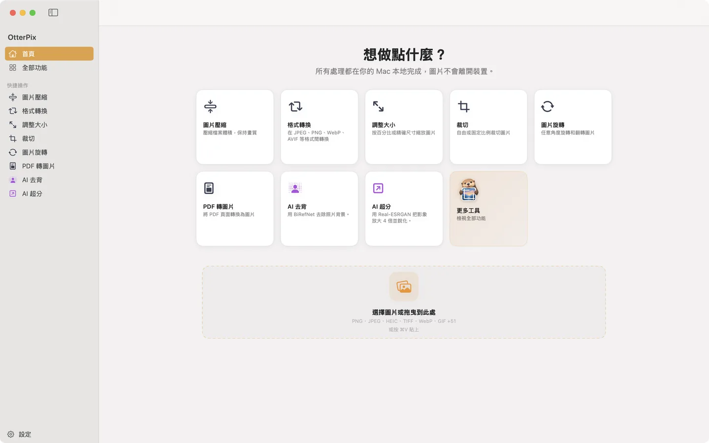

[English](README.md) · [简体中文](README.zh-Hans.md) · **繁體中文** · [Deutsch](README.de.md)

---

# OtterPix

**影像處理與 AI，全程不離開你的 Mac**

**[在 Mac App Store 下載](https://apps.apple.com/app/id6772468615)**

macOS 14+ · Apple 晶片 · 免費下載，Pro 為 App 內購買 · 18 種語言

## OtterPix 是什麼

OtterPix 是一款 Mac 影像工具箱：從格式轉換到 AI 修圖，每一項操作都完全在你自己的機器上執行。十個一鍵基本工具、可整批處理的視覺化流程，以及一組裝置端 AI 功能，涵蓋日常所需——轉檔、壓縮、調整大小、浮水印、重新命名、檢視後設資料、去背、消除物體、修復人臉、辨識文字、生成圖片。AI 功能由 Apple 晶片加速；每項功能在首次使用時下載模型，之後即可離線運作。所有處理都在你的 Mac 上完成，圖片不會被上傳——App 只在你主動下載 AI 模型和 App Store 購買驗證時連線。

## 功能

### 免費

| 工具 | 用途 |
|---|---|
| [格式轉換](docs/zh-Hant/tools/convert-and-compress.md) | 在 JPEG、PNG、WebP、AVIF 等格式間轉換 |
| [圖片壓縮](docs/zh-Hant/tools/convert-and-compress.md) | 壓縮檔案體積，保持畫質 |
| [調整大小](docs/zh-Hant/tools/resize-crop-rotate.md) | 按百分比或精確尺寸縮放圖片 |
| [裁切](docs/zh-Hant/tools/resize-crop-rotate.md) | 自由或固定比例裁切圖片 |
| [圖片旋轉](docs/zh-Hant/tools/resize-crop-rotate.md) | 任意角度旋轉和翻轉圖片 |
| [浮水印](docs/zh-Hant/tools/watermark.md) | 為圖片新增文字浮水印 |
| [批次重新命名](docs/zh-Hant/tools/batch-rename.md) | 用範本批次重新命名圖片 |
| [後設資料](docs/zh-Hant/tools/metadata.md) | 檢視、編輯、清除圖片 EXIF 後設資料 |
| [PDF 轉圖片](docs/zh-Hant/tools/pdf-and-qr.md) | 將 PDF 頁面轉換為圖片 |
| [QR Code 產生器](docs/zh-Hant/tools/pdf-and-qr.md) | 從文字或連結生成 QR Code |
| [處理流程](docs/zh-Hant/pipeline.md) | 把多個工具串成一個批次處理流程 |
| [AI 文字辨識](docs/zh-Hant/ai/ai-ocr.md) | 論文、掃描檔、PDF → 帶表格公式的 Markdown，全程本地 |
| [AI 圖片生成](docs/zh-Hant/ai/ai-generation.md) | 使用 AI 從文字生成圖片 |

### Pro AI

| 工具 | 用途 |
|---|---|
| [AI 超分](docs/zh-Hant/ai/ai-upscale.md) | 把圖片放大至 4 倍並銳化細節 |
| [AI 去背](docs/zh-Hant/ai/ai-cutout.md) | 一鍵去除照片背景 |
| [AI 消除](docs/zh-Hant/ai/ai-eraser.md) | 塗抹不想要的物體，由 AI 自動補回背景 |
| [AI 隱私模糊](docs/zh-Hant/ai/ai-anonymize.md) | 自動辨識人物和車輛，並對其進行模糊處理 |
| [AI 人像修復](docs/zh-Hant/ai/ai-restore.md) | 銳化老照片中模糊或低品質的臉部特徵 |

免費版：每個 Pro AI 工具每天各有 1 次免費使用。

## 關於這個儲存庫

OtterPix 是一款透過 Mac App Store 發行的商業閉源 App——這個儲存庫不含原始碼，未來也沒有開源的計畫。這裡是這款 App 的公開基地：

- **使用指南**——English、简体中文、繁體中文、Deutsch 四種語言
- **錯誤追蹤**——回報問題，並查看哪些已知、已確認、已修復
- **功能許願與討論**
- **每個版本的發行說明**

公開協作勝過私人客服信箱：每個人都能看到已知的問題、補充自己的發現，並看著修復一路上線。

閉源不代表「只能聽我們的一面之詞」：App 在沙盒中執行、不內建任何分析 SDK，僅有的網路存取是 App Store 購買驗證與你主動觸發的模型下載——詳見[隱私政策](https://otterpix.app/zh-Hant/privacy)。

## 取得協助

| 你想要… | 前往 |
|---|---|
| 回報錯誤 | [開一個 Issue](https://github.com/nanguoyu/OtterPix-app/issues/new/choose) |
| 詢問「這要怎麼做…？」 | [Discussions → Q&A](https://github.com/nanguoyu/OtterPix-app/discussions/categories/q-a) |
| 分享點子 | [Discussions → Ideas](https://github.com/nanguoyu/OtterPix-app/discussions/categories/ideas) |
| 退款、管理訂閱 | 所有購買皆由 Apple 處理：[reportaproblem.apple.com](https://reportaproblem.apple.com) · [管理訂閱](https://apps.apple.com/account/subscriptions) |
| 私人或敏感事項 | hello@otterpix.app |

## 文件

**快速上手**

- [快速上手](docs/zh-Hant/getting-started.md)——系統需求、安裝、視窗導覽、你的第一次編輯

**工具**

- [格式轉換與圖片壓縮](docs/zh-Hant/tools/convert-and-compress.md)
- [調整大小、裁切與圖片旋轉](docs/zh-Hant/tools/resize-crop-rotate.md)
- [浮水印](docs/zh-Hant/tools/watermark.md)
- [批次重新命名](docs/zh-Hant/tools/batch-rename.md)
- [後設資料](docs/zh-Hant/tools/metadata.md)
- [PDF 轉圖片與 QR Code 產生器](docs/zh-Hant/tools/pdf-and-qr.md)

**AI**

- [AI 超分](docs/zh-Hant/ai/ai-upscale.md)
- [AI 去背](docs/zh-Hant/ai/ai-cutout.md)
- [AI 消除](docs/zh-Hant/ai/ai-eraser.md)
- [AI 隱私模糊](docs/zh-Hant/ai/ai-anonymize.md)
- [AI 人像修復](docs/zh-Hant/ai/ai-restore.md)
- [AI 文字辨識](docs/zh-Hant/ai/ai-ocr.md)
- [AI 圖片生成](docs/zh-Hant/ai/ai-generation.md)

**處理流程**

- [處理流程](docs/zh-Hant/pipeline.md)——串接步驟、儲存預設、批次處理整個資料夾

**常見問題與版本**

- [常見問題](docs/zh-Hant/faq.md)
- [更新日誌](docs/zh-Hant/changelog.md)

## 發行版本

每個版本都會在這裡標記並附上發行說明——按 **Watch → Custom → Releases** 即可收到通知。完整歷史請見[更新日誌](docs/zh-Hant/changelog.md)。

## 致謝

OtterPix 的 AI 功能建立在傑出的開源研究與模型之上：

- [FLUX.2 Klein](https://huggingface.co/black-forest-labs/FLUX.2-klein-4B) — Black Forest Labs
- [Qwen3-4B](https://huggingface.co/Qwen/Qwen3-4B) — 文字編碼器
- [Real-ESRGAN](https://github.com/xinntao/Real-ESRGAN)
- [BiRefNet](https://github.com/ZhengPeng7/BiRefNet)
- [LaMa](https://github.com/advimman/lama)
- [RF-DETR](https://github.com/roboflow/rf-detr)
- [RestoreFormer++](https://github.com/wzhouxiff/RestoreFormerPlusPlus)
- [Unlimited-OCR](https://huggingface.co/baidu/Unlimited-OCR)
- [Apple MLX](https://github.com/ml-explore/mlx)

……以及 App 內列出的各個開放原始碼函式庫：**OtterPix → 設定 → 開放原始碼授權**，也可造訪 [otterpix.app/zh-Hant/licenses](https://otterpix.app/zh-Hant/licenses)。

---

© 2026 OtterPix (nanguoyu)。OtterPix App 為專有軟體。本儲存庫中的文件與截圖可在註明出處的前提下分享。

[隱私政策](https://otterpix.app/zh-Hant/privacy) · [服務條款](https://otterpix.app/zh-Hant/terms)
