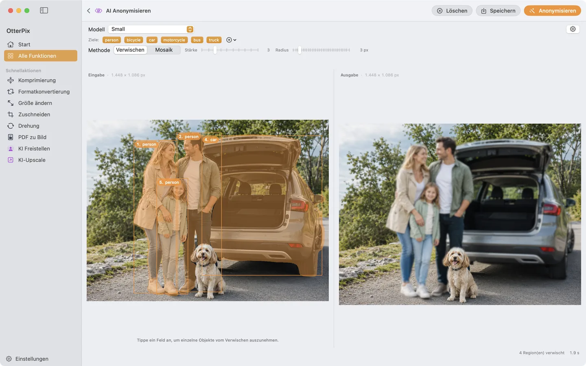

[English](../../en/ai/ai-anonymize.md) | [简体中文](../../zh-Hans/ai/ai-anonymize.md) | [繁體中文](../../zh-Hant/ai/ai-anonymize.md) | **Deutsch**

---

# AI Anonymisieren

**AI Anonymisieren** erkennt die Personen und Fahrzeuge in einem Foto und verdeckt sie in einem von fünf Stilen, Gesichter und Kennzeichen inklusive, während du bestimmst, wer und was sichtbar bleibt.

## Auf einen Blick

| | |
|---|---|
| **Verfügbarkeit** | Pro – im Gratis-Plan eine Gratis-Nutzung pro Tag |
| **Ausführung** | Auf dem Gerät; nach dem einmaligen Modell-Download offline (~138 MB) |
| **Eingabe** | Ein Bild |
| **Ausgabe** | Das Foto mit den gewählten Erkennungen, verdeckt im gewählten Stil |
| **Pipeline-Schritt** | Nein – wer sichtbar bleibt, entscheidest du interaktiv |

Bildverarbeitung und KI-Inferenz bleiben auf deinem Mac. Bilder, Generierungs-Prompts, OCR-Inhalte und Nutzungs-Telemetrie werden nie hochgeladen. OtterPix kann sich für StoreKit, eine beim Start ausschließlich für das Modell-Download-Routing genutzte Cloudflare-Abfrage des Edge-Landes, eine kleine Aktualisierung des ausschließlich Download-URLs enthaltenden Modell-Manifests bei der ersten Nutzung der Modellverwaltung sowie von dir gestartete Modell-Downloads verbinden.

## So anonymisierst du ein Foto

1. Öffne OtterPix und klicke im KI-Bereich des Werkzeugrasters auf **AI Anonymisieren**.
2. Leg dein Foto im Bereich **Eingabe** ab.
3. Klicke auf **Anonymisieren**. Die lokale KI findet die Personen und Fahrzeuge im Bild, nummeriert jede Erkennung und zeigt das verdeckte Ergebnis im Bereich **Ausgabe**.
4. Wähl eine **Methode**: **Verwischen**, **Mosaik**, **Hex-Mosaik**, **Volltonfarbe** oder **Regenbogenblöcke**. **Radius** erweitert die verdeckte Fläche um jede Erkennung; die übrigen Regler hängen vom Stil ab (siehe unten).
5. Klicke auf ein nummeriertes Feld in der Eingabe, um diese Person oder dieses Fahrzeug auszunehmen – die Ausgabe baut sich sofort neu auf, ohne neuen KI-Lauf. Ein weiterer Klick verdeckt wieder. Der Overlay-Hinweis sagt es so: „Klicke auf ein Feld, um dieses Objekt unverändert zu lassen.“
6. Klicke auf **Speichern** (⌘S) und wähl, wohin die anonymisierte Kopie kommt. Deine Originaldatei bleibt unangetastet.

## Optionen

### Methode

| Methode | Wirkung | Regler |
|---|---|---|
| **Verwischen** | Weich und fotografisch | **Stärke**, **Radius** |
| **Mosaik** | Klassische quadratische Verpixelung | **Stärke**, **Radius** |
| **Hex-Mosaik** | Verpixelung in sechseckigen Zellen | **Stärke**, **Radius** |
| **Volltonfarbe** | Eine flächige Füllung in der gewählten Farbe | **Farbe**, **Deckkraft**, **Radius** |
| **Regenbogenblöcke** | Ein Block aus regenbogenfarbenen Zellen über jeder Erkennung | **Radius** |

**Verwischen** hält das Bild ruhig; die Mosaik-Stile und **Volltonfarbe** sind unverkennbar absichtlich – das passt zu Kennzeichen und allem Dokumentartigen; **Regenbogenblöcke** ist die verspielte Variante. Ein Stilwechsel nutzt die vorhandenen Erkennungen weiter, deine Ziele und ausgenommenen Felder bleiben also erhalten. Wofür du dich auch entscheidest: Sorg dafür, dass Person oder Kennzeichen wirklich nicht mehr erkennbar sind – Anpassungen bauen sofort neu auf, Feintuning kostet also nichts.

### Ziele

Die Chip-Zeile **Ziele:** schaltet ganze Klassen auf einmal – Personen an, Fahrzeuge aus, oder umgekehrt. **Weitere Ziele …** öffnet die volle Auswahl, gegliedert in acht Gruppen: **Personen**, **Fahrzeuge**, **Tiere**, **Außenbereich**, **Accessoires**, **Sport**, **Elektronik**, **Innenbereich** – so lassen sich auch Laptops, Rucksäcke oder Haustiere verdecken, wenn ein Foto das verlangt.

### Kontrolle pro Erkennung

Klassen-Chips setzen die Regel; Klicks auf nummerierte Felder machen die Ausnahmen. „Alle außer mir“ oder „jedes Auto außer meinem“ dauert Sekunden: alles erkennen lassen, dann das eigene Feld anklicken und ausnehmen.

## Tipps und Grenzen

- **Auf vollen Fotos präzise klicken.** Bei sich überlappenden Personen ordnet OtterPix deinen Klick der Person zu, die tatsächlich unter dem Cursor liegt – klick die Person an, nicht nur in ihre Nähe.
- **Der Stil deckt die ganze Erkennung ab.** Eine verdeckte Person schließt ihr Gesicht ein; ein verdecktes Fahrzeug sein Kennzeichen.
- **Vor dem Veröffentlichen prüfen.** Die Erkennung ist ein starker erster Durchgang, kein Urteil – sehr kleine, angeschnittene oder stark verdeckte Motive können durchrutschen. Für einen übrig gebliebenen Rest ist der [KI-Radierer](ai-eraser.md) das Partnerwerkzeug: übermalen und ganz entfernen.
- **Nur Standbilder.** AI Anonymisieren arbeitet auf Bildern, nicht auf Video. Für einen Clip exportierst du die Frames, die du veröffentlichen willst, und anonymisierst diese.
- **Die Anzeige bestätigt die Abdeckung** – „3 Bereich(e) verdeckt“ nennt exakt, wie viele Erkennungen betroffen waren.

## Fehlerbehebung

| Du siehst | Ursache | Lösung |
|---|---|---|
| „Wähle mindestens eine Klasse zum Verwischen aus.“ | Alle Zielklassen sind abgeschaltet | Eine Klasse in der Zeile **Ziele:** wieder aktivieren (oder über **Weitere Ziele …**) |
| Ein Hinweis, dass das Modell fehlt | Das Erkennungsmodell (~138 MB) liegt nicht auf der Platte | Im Fehler auf **Einstellungen öffnen** klicken und es laden (auch unter **Einstellungen → KI**) |
| „Gratis-Nutzung dieses Werkzeugs heute aufgebraucht“ | „Jedes KI-Werkzeug hat täglich eine Gratis-Nutzung – diese wird um Mitternacht zurückgesetzt.“ | Auf den Reset warten oder upgraden. Das heutige Foto bleibt frei nachjustierbar |
| Eine Person oder ein Kennzeichen wurde nicht erkannt | Zu klein, am Rand angeschnitten oder stark verdeckt | Nichts ausnehmen und noch einmal prüfen; Reste mit dem [KI-Radierer](ai-eraser.md) beseitigen |
| Weiterhin Probleme | — | [Issue eröffnen](https://github.com/nanguoyu/OtterPix-app/issues/new/choose) |

## Siehe auch

- [KI-Radierer](ai-eraser.md) – ein Motiv entfernen statt verwischen
- [Metadaten](../tools/metadata.md) – vor dem Teilen auch GPS entfernen
- [FAQ – Datenschutz & Netzwerk](../faq.md#datenschutz--netzwerk)

---

**Feedback** – Fehler melden in den [Issues](https://github.com/nanguoyu/OtterPix-app/issues/new/choose), Fragen stellen in den [Discussions](https://github.com/nanguoyu/OtterPix-app/discussions).
