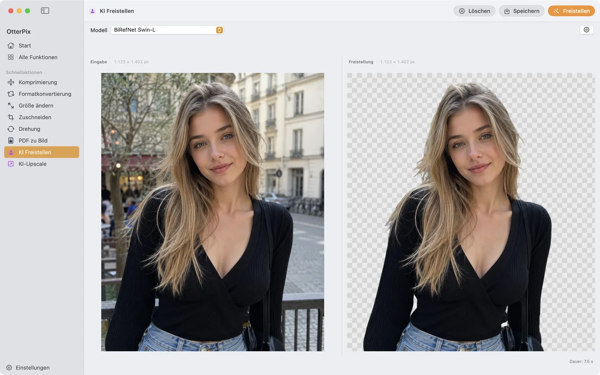

[English](../../en/ai/ai-cutout.md) · [简体中文](../../zh-Hans/ai/ai-cutout.md) · [繁體中文](../../zh-Hant/ai/ai-cutout.md) · **Deutsch**

---

# KI Freistellen

**KI Freistellen** entfernt den Hintergrund eines Fotos mit einem Klick und behält das Motiv – Haare und feine Kanten eingeschlossen – auf transparentem Grund, in der vollen Auflösung des Quellbilds.

## Auf einen Blick

| | |
|---|---|
| **Verfügbarkeit** | Pro – im Gratis-Plan eine Gratis-Nutzung pro Tag |
| **Ausführung** | Auf dem Gerät; die eingebaute Engine braucht keinen Download, die ladbaren Qualitätsstufen holen ihre Dateien einmalig (ca. 170 MB / ca. 795 MB) und laufen offline |
| **Eingabe** | Ein Bild |
| **Ausgabe** | Ein transparentes PNG in den vollen Pixelmaßen der Quelle |
| **Pipeline-Schritt** | Ja (Pro) – siehe [Pipeline](../pipeline.md) |

Alles läuft lokal auf deinem Mac. Bilder werden nie hochgeladen – die App nutzt das Netz nur für die Modell-Downloads, die du selbst anstößt, und die Kaufbestätigung über den App Store.

## So stellst du ein Motiv frei

1. Öffne OtterPix und klicke auf **KI Freistellen** – es sitzt in der KI-Sektion der Galerie **Alle Funktionen**.
2. Zieh ein Foto in die Ablagezone, oder klicke, um eine Datei zu wählen.
3. Wähl eine Qualitätsstufe im Menü **Modell** (siehe Optionen). Ladbare Stufen holen ihre Dateien einmalig beim ersten Einsatz; danach laufen Freistellungen ganz ohne Netz.
4. Klicke auf **Freistellen**. Wenige Sekunden später zeigt der Bereich **Freistellung** dein Motiv auf transparentem Schachbrettmuster.
5. Prüf die Kanten – Haare sind der härteste Test – und drücke dann **Speichern** (⌘S), um das transparente PNG abzulegen.

## Optionen

### Modell

| Stufe | Beschreibung |
|---|---|
| **Eingebaut** | „Kein Download · nutzt macOS Vision Framework“ – sofort verfügbar, gut für klare Motive |
| Lite | Ladbare Variante, ca. 170 MB – ein deutlicher Sprung bei schwierigen Kanten |
| Flaggschiff | Höchste Qualitätsstufe, ca. 795 MB – gebaut für die härtesten Fälle: fliegende Haare, Fell, halbtransparente Kanten |

Dasselbe Foto mit einer anderen Stufe erneut zu berechnen bleibt innerhalb derselben täglichen Gratis-Nutzung – fehlt eine Strähne, probier die nächsthöhere Stufe.

## Tipps und Grenzen

- **Die Ausgabe behält die volle Auflösung.** Die Freistellung wird in den Pixelmaßen der Quelle gespeichert, mit echtem Alphakanal – sie fügt sich sauber in jedes Design-Werkzeug, jede Präsentation, jeden Shop ein.
- **Als PNG speichern.** JPEG kennt keine Transparenz; das natürliche Ausgabeformat des Werkzeugs ist PNG.
- **In der Pipeline zählt die Reihenfolge.** Der Schritt **KI Freistellen** erzeugt RGBA-Ausgabe, und alle nachfolgenden Schritte müssen den Alphakanal erhalten – die [Pipeline](../pipeline.md) weist im Schritt selbst darauf hin. Stell den Ausgabe-Knoten auf PNG/WebP/AVIF und setz den Schritt ans Ende der Kette – ein JPEG-Ausgabeformat oder ein späterer KI-Upscale-Schritt entfernt die Transparenz.
- **Ein klares Motiv funktioniert am besten.** Das Modell sucht das dominante Motiv; unruhige Szenen mit mehreren gleichwertigen Motiven können seine Aufmerksamkeit teilen.

## Fehlerbehebung

| Du siehst | Ursache | Lösung |
|---|---|---|
| „Modell nicht geladen.“ | Die gewählte ladbare Stufe liegt nicht auf der Platte | Im Fehler auf **Einstellungen öffnen** klicken und sie laden (auch unter **Einstellungen → KI**) |
| „Kein Motiv im Bild gefunden.“ | Die Szene hat kein eindeutiges dominantes Motiv | Eine ladbare Qualitätsstufe probieren – genau das schlägt der Fehler vor – oder vorher enger aufs Motiv zuschneiden |
| „Gratis-Nutzung dieses Werkzeugs heute aufgebraucht“ | „Jedes KI-Werkzeug hat täglich eine Gratis-Nutzung – diese wird um Mitternacht zurückgesetzt.“ | Auf den Reset warten oder upgraden. Das heutige Foto bleibt frei nachjustierbar |
| Kanten wirken an Haaren/Fell grob | Die eingebaute oder die Lite-Stufe stößt an ihre Grenzen | Auf der Flaggschiff-Stufe neu rechnen – gleiches Foto, gleiche Gratis-Nutzung |
| Das Ergebnis verlor bei der Weiterverarbeitung seine Transparenz | Es wurde als JPEG gespeichert oder neu exportiert | Durchgängig bei PNG/WebP/AVIF bleiben |
| Weiterhin Probleme | — | [Issue eröffnen](https://github.com/nanguoyu/OtterPix-app/issues/new/choose) |

## Siehe auch

- [Pipeline](../pipeline.md) – Freistellen im Stapel (Pro) und die Transparenz-Regel
- [KI-Radierer](ai-eraser.md) – ein Objekt entfernen, den Hintergrund behalten
- [FAQ – Kostenlos & Pro](../faq.md#kostenlos--pro)

---

**Feedback** – Fehler melden in den [Issues](https://github.com/nanguoyu/OtterPix-app/issues/new/choose), Fragen stellen in den [Discussions](https://github.com/nanguoyu/OtterPix-app/discussions).
