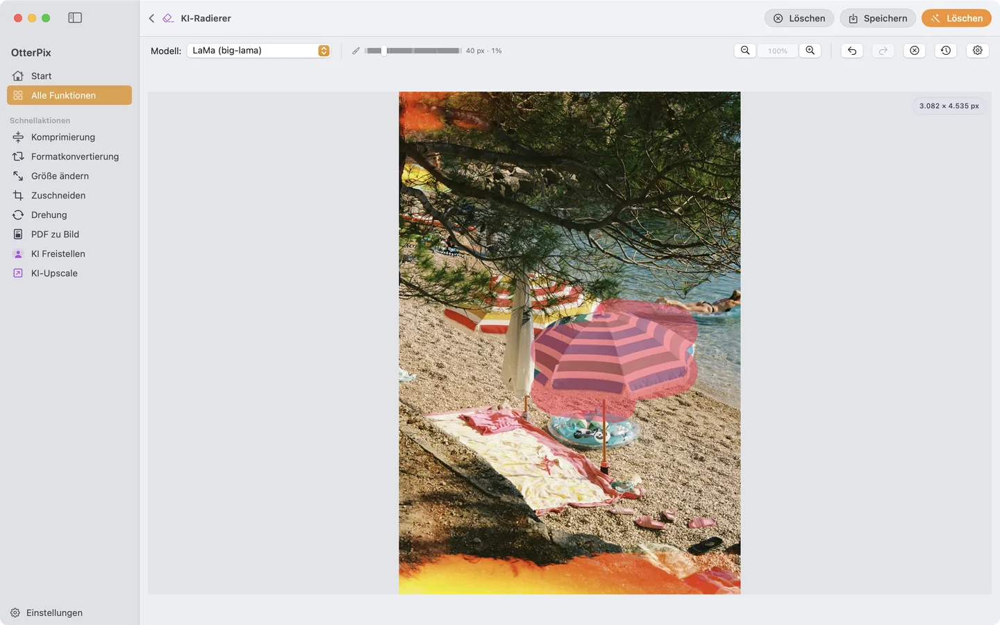

[English](../../en/ai/ai-eraser.md) · [简体中文](../../zh-Hans/ai/ai-eraser.md) · [繁體中文](../../zh-Hant/ai/ai-eraser.md) · **Deutsch**

---

# KI-Radierer

Der **KI-Radierer** entfernt unerwünschte Objekte aus Fotos: Übermale den Touristen, das Kabel, die Mülltonne – und die übermalte Fläche füllt sich mit passendem Hintergrund. Der Ablauf ist bewusst iterativ: löschen, prüfen, nachbessern, wieder löschen.

## Auf einen Blick

| | |
|---|---|
| **Verfügbarkeit** | Pro – im Gratis-Plan eine Gratis-Nutzung pro Tag (pro Foto – Iterieren am selben Foto bleibt frei) |
| **Ausführung** | Auf dem Gerät; nach dem einmaligen Modell-Download offline (rund 200 MB) |
| **Eingabe** | Ein Bild + die Maske, die du malst |
| **Ausgabe** | Das Foto mit aufgefüllten übermalten Flächen |
| **Pipeline-Schritt** | Nein – Löschen braucht deine Pinselarbeit pro Foto |

Bildverarbeitung und KI-Inferenz bleiben auf deinem Mac. Bilder, Generierungs-Prompts, OCR-Inhalte und Nutzungs-Telemetrie werden nie hochgeladen. OtterPix kann sich für StoreKit, eine beim Start ausschließlich für das Modell-Download-Routing genutzte Cloudflare-Abfrage des Edge-Landes, eine kleine Aktualisierung des ausschließlich Download-URLs enthaltenden Modell-Manifests bei der ersten Nutzung der Modellverwaltung sowie von dir gestartete Modell-Downloads verbinden.

## So löschst du ein Objekt

Der Hinweis der App ist der ganze Ablauf: *Markiere, was entfernt werden soll, dann „Löschen“ klicken (oder Cmd-Return).*

1. Öffne OtterPix und klicke auf **KI-Radierer**. Beim ersten Einsatz lädt die App ihr Radierer-Modell einmalig herunter (rund 200 MB) – danach arbeitet sie offline.
2. Zieh dein Foto ins Fenster, oder klicke, um eine Datei zu wählen.
3. Nimm den **Pinsel** (B) und stell die Pinselgröße ein – klein für ein Kabel, größer für eine Person. Übermale, was verschwinden soll; deck es vollständig ab, mit etwas Rand um die Kanten.
4. Klicke auf **Löschen** (oder drücke ⌘⏎). Einen Moment später ist die übermalte Fläche im Bereich **Ergebnis** mit passendem Hintergrund gefüllt.
5. Prüfen. Bleibt ein Schatten, ein Fuß oder ein blasser Umriss stehen, übermale nur diesen Rest und klicke erneut auf **Löschen** – jeder Durchgang baut auf dem vorherigen auf.
6. Wiederhol das fürs nächste Objekt, bis die Szene sauber ist. **Rückgängig** (⌘Z) nimmt einen missglückten Durchgang zurück; **Auf Original zurücksetzen** fängt von vorn an.
7. Drücke **Speichern** (⌘S) und wähl, wohin das bereinigte Foto kommt. Deine Originaldatei bleibt unangetastet.

## Optionen

- **Pinsel** (B) – ziehen, um die Maske zu malen; die Größenanzeige nennt die Pinselgröße in Bildpixeln.
- **Hand-Werkzeug** (H) – ziehen, um im vergrößerten Bild zu schwenken; **An Fenster anpassen** (⌘0) setzt die Ansicht zurück.
- **Maske leeren** – die aktuelle Malerei verwerfen und die Auswahl neu beginnen.
- **Rückgängig** (⌘Z) / **Wiederherstellen** (⇧⌘Z) – pro Lösch-Durchgang.
- **Auf Original zurücksetzen** – zurück zum unberührten Foto.

## Tipps und Grenzen

- **Iterieren ist frei.** Die tägliche Gratis-Nutzung zählt pro geladenem Foto, nicht pro Klick – malen, löschen, nachbessern und wieder löschen an einem Foto passiert innerhalb einer einzigen Gratis-Nutzung.
- **Nimm den Schatten mit.** Eine Person zu entfernen und ihren Schatten stehenzulassen ist der klassische Verräter – übermale beides.
- **Klar umrissene Objekte auf gleichmäßigem Grund löschen sich am besten.** Pflaster, Gras, Himmel, Wände: saubere Füllungen. Wo hinter dem Objekt präzise Details fehlen – Schrift, Gesichter, enge Muster – ist die Füllung erfunden und kann weich oder verzogen wirken. Arbeite in mehreren kleineren Durchgängen.
- **Der Rand zählt.** Etwas Abstand rund ums Objekt gibt der Füllung Raum zum Übergehen; eine zu knappe Maske hinterlässt Säume.

## Fehlerbehebung

| Du siehst | Ursache | Lösung |
|---|---|---|
| „Übermale zuerst den Bereich, der entfernt werden soll.“ | Die Maske ist leer | Erst das Objekt übermalen, dann auf **Löschen** klicken |
| Ein Hinweis, dass das Modell fehlt | Das Radierer-Modell liegt noch nicht auf der Platte | Den Download im Zahnrad-Menü des Werkzeugs nutzen, oder **Einstellungen → KI** |
| „Gratis-Nutzung dieses Werkzeugs heute aufgebraucht“ | „Jedes KI-Werkzeug hat täglich eine Gratis-Nutzung – diese wird um Mitternacht zurückgesetzt.“ | Auf den Reset warten oder upgraden. Das heutige Foto bleibt frei weiter verfeinerbar |
| Ein Geist oder Schleier, wo das Objekt war | Die Füllung hatte zu wenig Kontext, oder die Maske war zu knapp | **Rückgängig**, mit mehr Rand neu malen und in kleineren Durchgängen löschen |
| Weiterhin Probleme | — | [Issue eröffnen](https://github.com/nanguoyu/OtterPix-app/issues/new/choose) |

## Siehe auch

- [AI Anonymisieren](ai-anonymize.md) – Personen unkenntlich machen statt entfernen
- [KI Freistellen](ai-cutout.md) – das Motiv behalten, den Hintergrund entfernen
- [FAQ – Kostenlos & Pro](../faq.md#kostenlos--pro)

---

**Feedback** – Fehler melden in den [Issues](https://github.com/nanguoyu/OtterPix-app/issues/new/choose), Fragen stellen in den [Discussions](https://github.com/nanguoyu/OtterPix-app/discussions).
