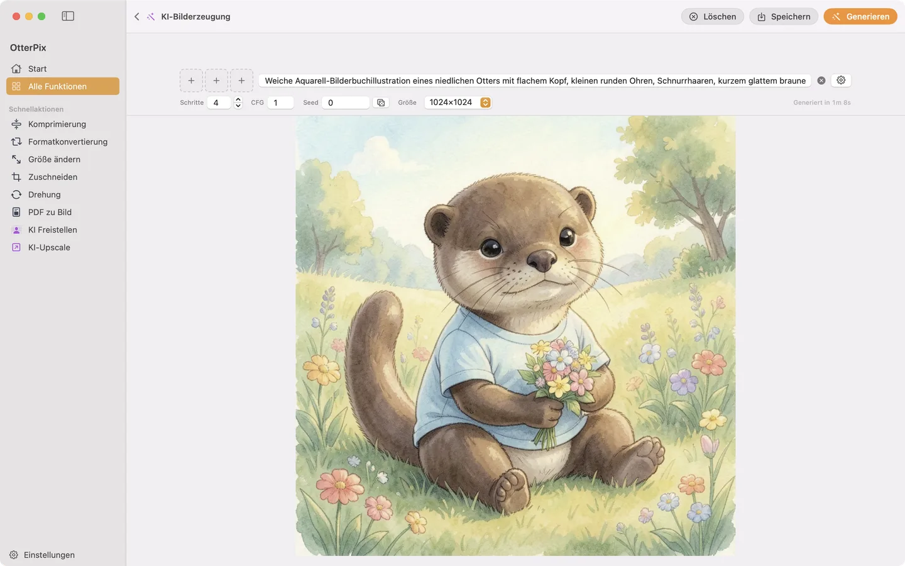

[English](../../en/ai/ai-generation.md) | [简体中文](../../zh-Hans/ai/ai-generation.md) | [繁體中文](../../zh-Hant/ai/ai-generation.md) | **Deutsch**

---

# KI-Bilderzeugung

**KI-Bilderzeugung** erstellt Bilder aus einer Textbeschreibung – vollständig auf deinem Mac. Optionale Referenzbilder lenken das Ergebnis in Richtung eines Looks, eines Motivs oder einer Komposition, die du schon hast.

## Auf einen Blick

| | |
|---|---|
| **Verfügbarkeit** | Kostenlos |
| **Ausführung** | Auf dem Gerät; nach dem Modell-Download offline – der größte Download der App, insgesamt mehrere Gigabyte |
| **Eingabe** | Ein Text-Prompt, dazu bis zu 3 optionale Referenzbilder |
| **Ausgabe** | Ein generiertes Bild in der Größe deiner Wahl |
| **Pipeline-Schritt** | Nein |
| **Empfohlen** | 16 GB RAM oder mehr |

Bildverarbeitung und KI-Inferenz bleiben auf deinem Mac. Bilder, Generierungs-Prompts, OCR-Inhalte und Nutzungs-Telemetrie werden nie hochgeladen. OtterPix kann sich für StoreKit, eine beim Start ausschließlich für das Modell-Download-Routing genutzte Cloudflare-Abfrage des Edge-Landes, eine kleine Aktualisierung des ausschließlich Download-URLs enthaltenden Modell-Manifests bei der ersten Nutzung der Modellverwaltung sowie von dir gestartete Modell-Downloads verbinden.

**Regionaler Hinweis:** In der über den Mac App Store für Festlandchina vertriebenen Version von OtterPix sind KI-Bilderzeugung und KI-Texterkennung nicht verfügbar. Alle anderen Funktionen – einschließlich der fünf Pro-KI-Werkzeuge – sind in jeder Region verfügbar, in der OtterPix erscheint. Details in den [Nutzungsbedingungen](https://otterpix.app/de/terms).

## So generierst du ein Bild

1. Öffne OtterPix und klicke auf **KI-Bilderzeugung**.
2. Tipp deinen Prompt – das Feld bittet dich: „Beschreibe das gewünschte Bild“. Konkret schlägt vage: Motiv, Stil, Licht, Umgebung. Eine **Beispiele**-Zeile liefert Startpunkte.
3. Füg optional **Referenzbilder** hinzu – „Bild ablegen oder klicken, um eine Referenz hinzuzufügen (max. 3, optional)“. Mit Referenzen beschreibt der Prompt, wie sie verwandelt oder kombiniert werden sollen.
4. Wähl im Arbeitsbereich **Modellpräzision** und **Textenkoder-Präzision**. Daneben siehst du die tatsächliche Größe der gewählten Konfiguration.
5. Wähl eine Ausgabegröße aus den Voreinstellungen, oder nimm **Benutzerdefinierte Größe** und trag **Breite** und **Höhe** ein – das Kettenglied-Symbol sperrt das Seitenverhältnis beim Tippen.
6. Klicke beim ersten Mal auf **Laden und generieren** (bei fertiger Konfiguration auf **Generieren**). Derselbe Download samt Steuerung erscheint unter **Einstellungen → KI**; an beiden Stellen kannst du pausieren, fortsetzen oder abbrechen. Nach dem Setup startet die Generierung automatisch.
7. Drücke **Speichern** (⌘S), um das Ergebnis zu behalten.

## Optionen

### Referenzbilder

Bis zu drei. Eine Referenz lenkt Stil oder Motiv; mehrere lassen sich kombinieren („Beschreibe, wie diese Bilder kombiniert werden sollen“). Die Plätze werden direkt im Werkzeug verwaltet – fahr mit der Maus über einen belegten Platz, um ihn zu leeren.

### Größe

Voreingestellte Größen decken die üblichen Fälle ab; **Benutzerdefinierte Größe** nimmt exakte Pixelmaße mit sperrbarem Seitenverhältnis.

### Modell und Präzision

Flux 2 Klein 4B ist das Generierungsmodell. Transformer- und Textenkoder-Präzision gehören zur aktuellen Aufgabe und stehen deshalb direkt im Arbeitsbereich; die gewählte Speichergröße wird daneben angezeigt. Das Zahnrad enthält nur die erweiterte VAE-Auswahl und **Modelle verwalten…**. Löschen und speicherübergreifende Pflege bleiben unter **Einstellungen → KI**.

### Erweiterte Parameter

Für die Feinsteuerung zeigt das Werkzeug Generierungsparameter mit verständlichen Erklärungen direkt in der Oberfläche – die Zahl der Verfeinerungsschritte (mehr Schritte: höhere Qualität, langsamer), wie streng der Prompt befolgt wird, und einen Seed (gleicher Seed, gleicher Prompt und gleiche Einstellungen reproduzieren dasselbe Bild; der Würfel-Knopf setzt ihn zufällig).

## Tipps und Grenzen

- **Sei konkret.** „Eine Aquarell-Illustration eines Leuchtturms in der Abenddämmerung, warmes Licht, weiche Papiertextur“ schlägt „schönes Leuchtturmbild“.
- **Minuten, nicht Sekunden.** Die Generierung ist die schwerste Arbeitslast der App und skaliert mit dem Chip deines Mac und der Ausgabegröße. Genau dafür sind 16 GB RAM oder mehr empfohlen.
- **Der Download ist der große.** Die gewählten Komponenten umfassen mehrere Gigabyte. Teilstände bleiben nach Pause, Abbruch, Netzverlust und Neustart erhalten; unvollständige Ordner erscheinen als fortsetzbar, nie als installiert. Löschen erfolgt unter **Einstellungen → KI**.
- **Seeds machen Ergebnisse reproduzierbar.** Lass den Seed stehen, um an einem Prompt zu iterieren; setz ihn zufällig, um zu erkunden.

## Fehlerbehebung

| Du siehst | Ursache | Lösung |
|---|---|---|
| Die Funktion fehlt in deiner App komplett | Download über den Mac App Store für Festlandchina | Siehe [FAQ](../faq.md#regionale-verfügbarkeit--support) – eine Frage der Storefront-Verfügbarkeit, kein Fehler |
| Das Setup wurde unterbrochen | Die gewählten Komponenten sind unvollständig | Auf der Generierungsseite oder unter **Einstellungen → KI** fortsetzen; vorhandene Daten werden weiterverwendet |
| Dein Mac wird während der Generierung träge | Generierung ist naturgemäß rechen- und speicherintensiv | Den Lauf zu Ende bringen oder **Abbrechen**; speicherhungrige Apps schließen; 16 GB+ RAM sind empfohlen |
| Weiterhin Probleme | — | [Issue eröffnen](https://github.com/nanguoyu/OtterPix-app/issues/new/choose) |

## Siehe auch

- [KI-Upscale](ai-upscale.md) – ein generiertes Bild auf 4× vergrößern
- [FAQ – Regionale Verfügbarkeit & Support](../faq.md#regionale-verfügbarkeit--support)
- [Erste Schritte](../getting-started.md) – Voraussetzungen

---

**Feedback** – Fehler melden in den [Issues](https://github.com/nanguoyu/OtterPix-app/issues/new/choose), Fragen stellen in den [Discussions](https://github.com/nanguoyu/OtterPix-app/discussions).
