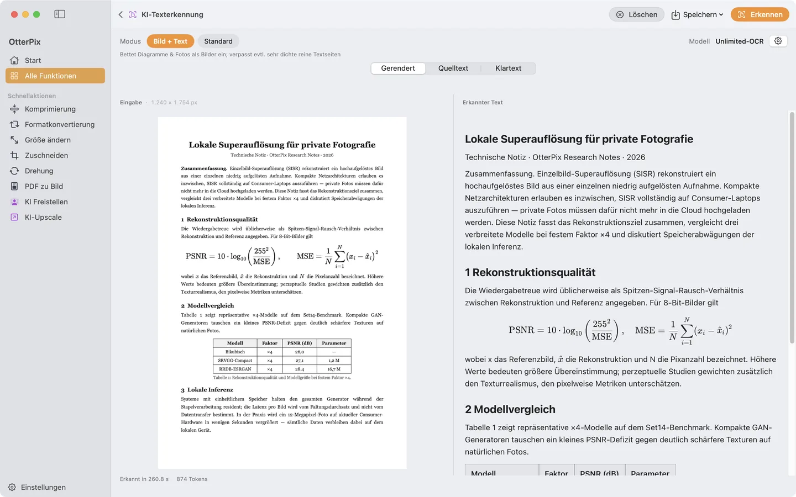

[English](../../en/ai/ai-ocr.md) · [简体中文](../../zh-Hans/ai/ai-ocr.md) · [繁體中文](../../zh-Hant/ai/ai-ocr.md) · **Deutsch**

---

# KI-Texterkennung

**KI-Texterkennung** – im App Store als „KI-Texterkennung (OCR)“ gelistet – macht aus Dokumenten Text, mit dem du arbeiten kannst. In den Worten der App: „Papers, Scans & PDFs → Markdown mit Tabellen und Formeln. Auf dem Gerät.“ Gib ihr eine gescannte Seite, ein abfotografiertes Dokument oder ein mehrseitiges PDF, und du bekommst strukturiertes Markdown zurück – Überschriften, Tabellen, Formeln und Abbildungen inklusive.

## Auf einen Blick

| | |
|---|---|
| **Verfügbarkeit** | Kostenlos |
| **Ausführung** | Auf dem Gerät; nach dem einmaligen Modell-Download offline |
| **Eingabe** | Dokumentbilder (Scans, abfotografierte Seiten) oder PDFs |
| **Ausgabe** | Markdown oder Reintext – kopieren oder exportieren |
| **Pipeline-Schritt** | Nein |

Alles läuft lokal auf deinem Mac. Bilder werden nie hochgeladen – die App nutzt das Netz nur für die Modell-Downloads, die du selbst anstößt, und die Kaufbestätigung über den App Store.

**Regionaler Hinweis:** In der über den Mac App Store für Festlandchina vertriebenen Version von OtterPix sind KI-Bilderzeugung und KI-Texterkennung nicht verfügbar. Alle anderen Funktionen – einschließlich der fünf Pro-KI-Werkzeuge – sind in jeder Region verfügbar, in der OtterPix erscheint. Details in den [Nutzungsbedingungen](https://otterpix.app/de/terms).

## So erkennst du ein Dokument

1. Öffne OtterPix und klicke auf **KI-Texterkennung**. Der Leerzustand sagt alles: „Dokument oder PDF ablegen, um zu beginnen.“
2. Leg ein Dokumentbild oder ein PDF ab. Bei PDFs zeigt das Werkzeug die Seitenzahl („PDF mit 12 Seiten“) und die Auswahl **Seiten** – alle Seiten erkennen oder einen Bereich.
3. Wähl einen **Modus** (siehe Optionen).
4. Klicke auf **Erkennen**. Der Fortschritt läuft pro Seite („Seite 3 von 12 wird verarbeitet“), mit **Pause** und **Fortsetzen** für lange Dokumente.
5. Prüf das Ergebnis in drei Ansichten: **Gerendert** (das formatierte Dokument, Abbildungen inklusive), **Quelltext** (das rohe Markdown) und **Klartext**.
6. Nimm den Text mit: **Alles kopieren**, **Als Markdown (.md) exportieren** oder **Als Reintext (.txt) exportieren**. Aus der Ansicht **Gerendert** kopiert fügt sich ein eigenständiges Dokument ein, Abbildungen inklusive.

## Optionen

### Modus

| Modus | Am besten für |
|---|---|
| **Markdown · Layout** | Der Standard. Behält das Layout des Dokuments und bettet Abbildungen ein – die richtige Wahl für Papers, Berichte und gemischte Text-Bild-Seiten |
| **Dokument** | Sehr dichte Seiten – Prüfungsbögen, eng gepackte Formulare |
| **Reintext** | Wenn du nur die Wörter willst, ohne Struktur |

### PDF-Seitenauswahl

Die Auswahl **Seiten** nimmt alle Seiten oder einen Von/Bis-Bereich – praktisch, um ein einzelnes Kapitel aus einem langen PDF zu ziehen.

### Einstellungen

Die Einstellungen des Werkzeugs enthalten die **Modell**-Zeile (in den Worten der App: „Dokumenterkennung auf dem Gerät. Einmal herunterladen, läuft komplett auf deinem Mac.“) und **Max. Tokens** – die Obergrenze, wie viel Text pro Seite generiert wird; erhöh sie für lange, dichte Dokumente.

## Tipps und Grenzen

- **Für Dokumente gebaut.** Papers, Scans, Text-Screenshots, PDFs. Es ist kein allgemeiner Foto-Text-Leser – Straßenschilder, Memes und Produktfotos liegen außerhalb des Einsatzzwecks und können unzuverlässige Ausgabe liefern.
- **Tabellen und Formeln kommen als Markdown heraus**, bereit zum Einfügen in Notiz-Apps, Wikis oder Editoren.
- **Die App prüft ihre eigene Arbeit.** Kommen manche Seiten verdächtig leer zurück, erscheint ein Warnbanner: „Einige Seiten sind fast leer — evtl. besser im anderen Modus.“ – mit einem Ein-Klick-Neustart in diesem Modus.
- **Lange Seiten können ans Ausgabelimit stoßen.** Meldet die App, dass die Ausgabe das Token-Limit erreicht hat („… erhöhe es in den Einstellungen“), erhöh **Max. Tokens** in den Einstellungen des Werkzeugs und lass die Erkennung erneut laufen.

## Fehlerbehebung

| Du siehst | Ursache | Lösung |
|---|---|---|
| „Das OCR-Modell ist noch nicht heruntergeladen.“ | Erste Nutzung – das Erkennungsmodell liegt nicht auf der Platte | Im Fehler auf **Einstellungen öffnen** klicken und es laden (auch unter **Einstellungen → KI**) |
| „Einige Seiten sind fast leer — evtl. besser im anderen Modus.“ | Der gewählte Modus kam mit dem Layout dieser Seiten nicht zurecht | Über den Knopf im Banner den anderen Modus auf demselben Dokument laufen lassen |
| Die Ausgabe bricht mitten im Dokument ab | Die Token-Obergrenze pro Seite wurde erreicht | **Max. Tokens** in den Einstellungen des Werkzeugs erhöhen, dann erneut **Erkennen** |
| Wirre Ausgabe bei einem Foto | Die Eingabe ist kein Dokument, sondern ein Szenenfoto oder Meme | Dokumentartige Eingaben verwenden – dafür ist das Werkzeug gebaut |
| Der erste Lauf ist langsam | Das Modell wird einmal pro Sitzung geladen („Modell wird geladen…“) | Folgende Läufe sind schneller |
| Weiterhin Probleme | — | [Issue eröffnen](https://github.com/nanguoyu/OtterPix-app/issues/new/choose) |

## Siehe auch

- [PDF zu Bild](../tools/pdf-and-qr.md) – PDF-Seiten als Bilder rendern statt Text zu extrahieren
- [FAQ – Regionale Verfügbarkeit & Support](../faq.md#regionale-verfügbarkeit--support)
- [Erste Schritte](../getting-started.md)

---

**Feedback** – Fehler melden in den [Issues](https://github.com/nanguoyu/OtterPix-app/issues/new/choose), Fragen stellen in den [Discussions](https://github.com/nanguoyu/OtterPix-app/discussions).
