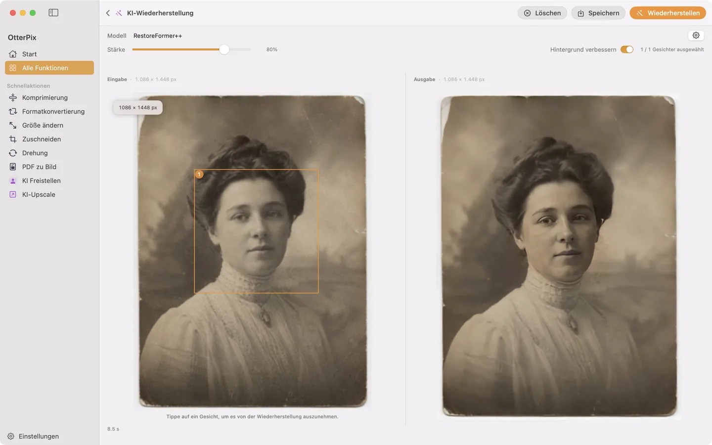

[English](../../en/ai/ai-restore.md) · [简体中文](../../zh-Hans/ai/ai-restore.md) · [繁體中文](../../zh-Hant/ai/ai-restore.md) · **Deutsch**

---

# KI-Wiederherstellung

**KI-Wiederherstellung** – im App Store als KI-Gesichtswiederherstellung geführt – holt verschwommene, detailarme Gesichter in alten Fotos zurück in die Schärfe. Sie arbeitet mit Absicht nur an Gesichtern: Alles außerhalb der erkannten Gesichter bleibt exakt wie eingescannt, du weißt also immer, was sich geändert hat.

## Auf einen Blick

| | |
|---|---|
| **Verfügbarkeit** | Pro – im Gratis-Plan eine Gratis-Nutzung pro Tag |
| **Ausführung** | Auf dem Gerät; nach dem einmaligen Modell-Download offline (rund 280 MB) |
| **Eingabe** | Ein Foto mit sichtbaren Gesichtern |
| **Ausgabe** | Das Foto mit geschärften Gesichtszügen; der Rest unangetastet |
| **Pipeline-Schritt** | Nein – Gesichtsauswahl und Stärke sind interaktiv |

Alles läuft lokal auf deinem Mac. Bilder werden nie hochgeladen – die App nutzt das Netz nur für die Modell-Downloads, die du selbst anstößt, und die Kaufbestätigung über den App Store.

## Was es tut – und bewusst nicht tut

Die App benennt ihren Rahmen in den Einstellungen des Werkzeugs unmissverständlich: „Schärft nur Gesichtsmerkmale. Behebt KEINE Kratzer, Stockflecken, Verblassen oder Hintergründe. Läuft nach dem Download offline.“ Ist das Problem des Fotos physischer Schaden statt weicher Gesichter, ist das hier das falsche Werkzeug – für den klassischen Fall aber (ein Scan, auf dem du das Gesicht eines Großelternteils kaum noch erkennst) genau das richtige.

## So stellst du Gesichter wieder her

1. Öffne OtterPix und klicke im KI-Bereich auf **KI-Wiederherstellung**.
2. Zieh dein eingescanntes Foto in die Ablagezone, oder klicke, um eine Datei zu wählen.
3. OtterPix erkennt jedes Gesicht automatisch und markiert es mit einem nummerierten Rahmen – dieser Rahmen ist die Region, an der die KI arbeitet. Die Kopfzeile zählt mit („3 / 3 Gesichter ausgewählt“); ein Klick auf einen Rahmen nimmt das Gesicht aus („Tippe auf ein Gesicht, um es von der Wiederherstellung auszunehmen.“), ein weiterer Klick nimmt es wieder auf.
4. Klicke auf **Wiederherstellen**. Beim ersten Einsatz lädt OtterPix sein Gesichtsmodell einmalig herunter (rund 280 MB); danach läuft jeder Durchgang offline.
5. Sobald das Ergebnis erscheint, zieh den **Stärke**-Regler, bis die Mischung stimmt. Die Vorschau folgt sofort – die Wiederherstellung muss nicht neu laufen.
6. Drücke **Speichern** (⌘S) und wähl, wohin die wiederhergestellte Kopie kommt. Dein Original-Scan wird nie verändert.

## Optionen

### Stärke

Wie kräftig die wiederhergestellten Gesichter über die Originale gelegt werden. Volle Stärke liefert die schärfsten Züge; niedrigere Werte bewahren mehr vom ursprünglichen Charakter. Das Anpassen ist sofortig – das Modell läuft nicht neu.

### Hintergrund verbessern

Standardmäßig aus. Ist die Option an, läuft vor der Gesichtswiederherstellung ein allgemeiner Verbesserungsdurchgang übers ganze Bild – nützlich bei unscharfen oder niedrig aufgelösten Vorlagen. Zwei Dinge solltest du wissen, direkt aus der Erklärung der App: Bei Fotos mit physischen Schäden (Kratzer, Stockflecken) kann der Durchgang die Schäden *deutlicher* hervortreten lassen statt sie zu mildern, und er braucht ein eigenes kleines Modell (~5 MB), ladbar in den Einstellungen dieses Werkzeugs.

## Tipps und Grenzen

- **Gruppenfotos sind der gedachte Fall.** Alle Gesichter werden in einem Lauf wiederhergestellt, jedes mit eigenem nummeriertem Rahmen – nimm die aus, die unangetastet bleiben sollen.
- **Scann hoch aufgelöst.** Je mehr Details die Wiederherstellung vorfindet, desto natürlicher das Ergebnis. Hast du nur eine kleine Datei, stell erst wieder her und vergrößere dann mit [KI-Upscale](ai-upscale.md).
- **Haare, Kleidung und Hintergrund bleiben wie gescannt** – der nummerierte Rahmen zeigt die bearbeitete Region; außerhalb ändert sich nichts (außer **Hintergrund verbessern** ist an).
- **Iterieren am selben Foto ist frei.** **Stärke** anpassen, Gesichter an- und abwählen und dasselbe Foto neu berechnen passiert innerhalb einer einzigen täglichen Gratis-Nutzung.

## Fehlerbehebung

| Du siehst | Ursache | Lösung |
|---|---|---|
| „Auf diesem Bild wurden keine Gesichter erkannt. Versuche ein Foto mit klar sichtbaren Gesichtern.“ | Seitenprofile, Sonnenbrillen, starke Verdeckung oder sehr kleine Gesichter überfordern die Erkennung | Ein Foto mit klar sichtbaren, halbwegs frontalen Gesichtern verwenden; bei winzigen Gesichtern vorher enger zuschneiden |
| Ein Hinweis, dass ein Modell fehlt | Das Gesichtsmodell (rund 280 MB) – oder, mit **Hintergrund verbessern**, sein separates ~5-MB-Modell – liegt nicht auf der Platte | Im Fehler auf **Einstellungen öffnen** klicken; beide Modelle haben Download-Knöpfe im Einstellungsdialog dieses Werkzeugs |
| „Gratis-Nutzung dieses Werkzeugs heute aufgebraucht“ | „Jedes KI-Werkzeug hat täglich eine Gratis-Nutzung – diese wird um Mitternacht zurückgesetzt.“ | Auf den Reset warten oder upgraden. Das heutige Foto bleibt frei weiter verfeinerbar |
| Kratzer wirken mit Hintergrund verbessern schlimmer | Die Verbesserung schärft physische Schäden mit | **Hintergrund verbessern** ausschalten – die Beschreibung der App warnt genau davor |
| Ein Gesicht kommt zu glatt zurück | Volle Stärke auf einer sehr schwachen Vorlage | Den **Stärke**-Regler senken – die Vorschau baut sofort neu auf |
| Weiterhin Probleme | — | [Issue eröffnen](https://github.com/nanguoyu/OtterPix-app/issues/new/choose) |

## Siehe auch

- [KI-Upscale](ai-upscale.md) – den wiederhergestellten Scan vergrößern
- [KI-Radierer](ai-eraser.md) – Staubflecken oder Objekte anderswo im Bild entfernen
- [FAQ – KI-Modelle](../faq.md#ki-modelle)

---

**Feedback** – Fehler melden in den [Issues](https://github.com/nanguoyu/OtterPix-app/issues/new/choose), Fragen stellen in den [Discussions](https://github.com/nanguoyu/OtterPix-app/discussions).
