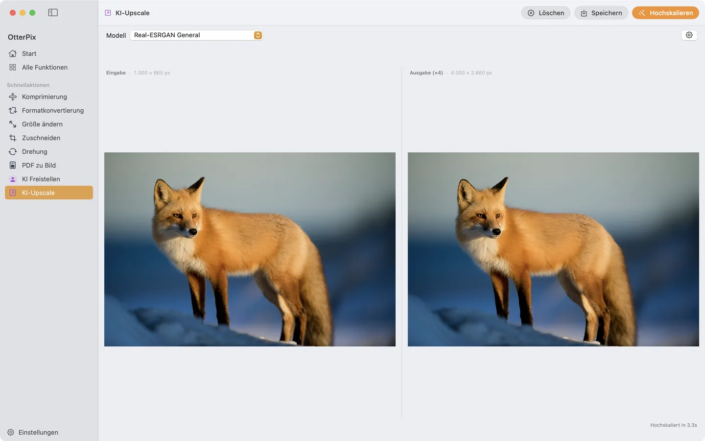

[English](../../en/ai/ai-upscale.md) | [简体中文](../../zh-Hans/ai/ai-upscale.md) | [繁體中文](../../zh-Hant/ai/ai-upscale.md) | **Deutsch**

---

# AI Upscale

**AI Upscale** vergrößert ein Bild auf das Vierfache seiner Breite und Höhe – das Sechzehnfache der Pixelzahl – und rekonstruiert dabei Details, statt bloß Pixel zu strecken.

## Auf einen Blick

| | |
|---|---|
| **Verfügbarkeit** | Pro – im Gratis-Plan eine Gratis-Nutzung pro Tag |
| **Ausführung** | Auf dem Gerät; nach dem einmaligen Modell-Download offline (2,5–67 MB je Modell) |
| **Eingabe** | Ein Bild |
| **Ausgabe** | Das Bild in 4× Breite und Höhe |
| **Pipeline-Schritt** | Ja (Pro) – siehe [Pipeline](../pipeline.md) |

Bildverarbeitung und AI-Inferenz bleiben auf deinem Mac. Bilder, Generierungs-Prompts, OCR-Inhalte und Nutzungs-Telemetrie werden nie hochgeladen. OtterPix kann sich für StoreKit, eine beim Start ausschließlich für das Modell-Download-Routing genutzte Cloudflare-Abfrage des Edge-Landes, eine kleine Aktualisierung des ausschließlich Download-URLs enthaltenden Modell-Manifests bei der ersten Nutzung der Modellverwaltung sowie von dir gestartete Modell-Downloads verbinden.

## So skalierst du hoch

1. Öffne OtterPix und klicke auf **AI Upscale**.
2. Zieh ein Foto in die Ablagezone, oder klicke, um eine Datei zu wählen.
3. Wähl einen Modus im Menü **Modell**. Beim ersten Einsatz lädt OtterPix die Datei dieses Modus einmalig herunter – sie sind klein, zwischen 2,5 MB und 67 MB – und läuft von da an offline.
4. Klicke auf **Hochskalieren**. Das Ergebnis erscheint im Bereich **Ausgabe (×4)**, zusammen mit der Laufzeit.
5. Vergleich die beiden Bereiche – die Pixelmaß-Badges über **Eingabe** und **Ausgabe** beziffern den Zugewinn: 1.000 × 665 px rein, 4.000 × 2.660 px raus.
6. Drücke **Speichern** (⌘S) und wähl, wohin die vergrößerte Kopie kommt. Dein Original bleibt unangetastet.

## Optionen

### Modell

Vier Modi, jeder ein eigener kleiner Download. Das Menü beschreibt sie so, wie die App es tut:

| Modus | In den Worten der App |
|---|---|
| Alltagsfotos | „5 MB, schneller, gut für Alltagsfotos“ |
| Höchste Qualität | „67 MB, höchste Qualität, größerer Download“ |
| Anime / Illustration | „18 MB, für Anime / Illustrationen abgestimmt“ |
| Anime-Videoframes | „2,5 MB, kleinstes Modell, für Anime-Videoframes“ |

Starte mit dem Alltags-Modus für gewöhnliche Aufnahmen; wechsle für Drucke auf den Modus mit der höchsten Qualität, und für Lineart, Flächenfarben und Frames aus Animationsmaterial auf die Anime-Modi. Dasselbe Foto mit einem anderen Modus erneut zu berechnen bleibt innerhalb derselben täglichen Gratis-Nutzung.

## Tipps und Grenzen

- **Die Badges sind der Beleg.** Die Pixelmaß-Badges über den Bereichen zeigen exakte Ein- und Ausgabegrößen – praktisch für die Druckrechnung (bei ~300 DPI wächst die druckbare Breite eines 1.000 px breiten Bilds durch das 4×-Upscale von rund 8,5 cm auf etwa 34 cm).
- **Große Bilder dauern länger.** Große Eingaben werden in Kacheln verarbeitet, und die Fortschrittsanzeige zählt sie mit; alles läuft weiterhin lokal.
- **Fotografisches glänzt, winziger Text nicht.** Hochskalieren ist am stärksten bei Fell, Haut, Stoff, Landschaften. Kleiner oder bereits unleserlicher Text wird nicht lesbar.
- **Transparenz:** Hochskalieren entfernt den Alphakanal – brauchst du ein transparentes Ergebnis, lass [AI Freistellen](ai-cutout.md) *nach* dem Hochskalieren laufen.

## Fehlerbehebung

| Du siehst | Ursache | Lösung |
|---|---|---|
| „Modell noch nicht heruntergeladen.“ | Das Modell des gewählten Modus liegt nicht auf der Platte | Im Fehler auf **Einstellungen öffnen** klicken und es laden (auch über **Einstellungen → AI** erreichbar) |
| „Gratis-Nutzung dieses Werkzeugs heute aufgebraucht“ | „Jedes AI-Werkzeug hat täglich eine Gratis-Nutzung – diese wird um Mitternacht zurückgesetzt.“ | Auf den Reset warten oder auf Pro upgraden. Das heute bereits berechnete Foto bleibt frei verfeinerbar |
| Das Ergebnis wirkt überglättet | Modus passt nicht zum Inhalt (z. B. Foto-Modus auf Lineart) | Einen anderen **Modell**-Modus probieren – gleiches Foto, gleiche Gratis-Nutzung |
| Weiterhin Probleme | — | [Issue eröffnen](https://github.com/nanguoyu/OtterPix-app/issues/new/choose) |

## Siehe auch

- [AI Wiederherstellung](ai-restore.md) – erst Gesichter schärfen, dann vergrößern
- [Pipeline](../pipeline.md) – AI Upscale als Stapel-Schritt (Pro)
- [FAQ – Kostenlos & Pro](../faq.md#kostenlos--pro)

---

**Feedback** – Fehler melden in den [Issues](https://github.com/nanguoyu/OtterPix-app/issues/new/choose), Fragen stellen in den [Discussions](https://github.com/nanguoyu/OtterPix-app/discussions).
