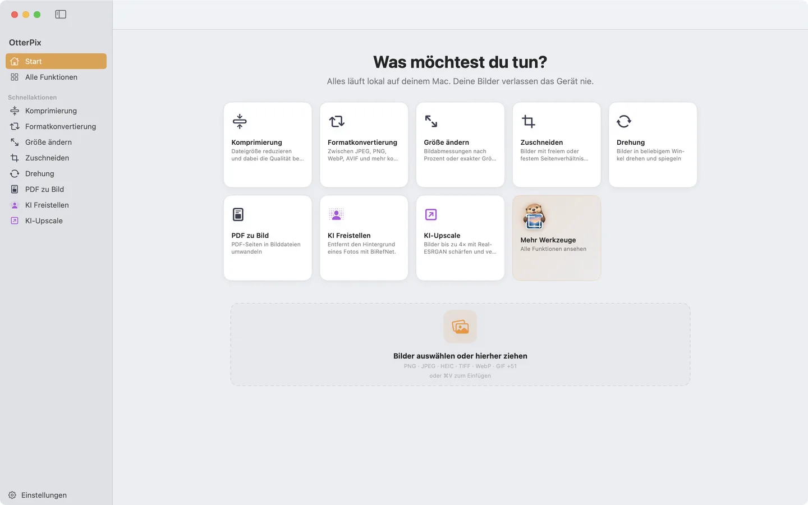

[English](../en/getting-started.md) | [简体中文](../zh-Hans/getting-started.md) | [繁體中文](../zh-Hant/getting-started.md) | **Deutsch**

---

# Erste Schritte

Alles, was du vom Download bis zur ersten fertigen Bearbeitung brauchst.

## Läuft OtterPix auf meinem Mac?

- **macOS 14 (Sonoma) oder neuer.**
- **Apple Silicon (M1 oder neuer).** Intel-Macs werden nicht unterstützt – die AI-Funktionen sind für die Unified-Memory-Architektur von Apple Silicon gebaut.
- **Speicherplatz für AI-Modelle, falls du sie nutzt.** Die AI-Funktionen laden ihre Modelle bei der ersten Nutzung herunter – von wenigen Megabyte für das kleinste Upscale-Modell bis zu mehreren Gigabyte für die Bilderzeugung. Die Basiswerkzeuge brauchen gar keine Downloads.
- **16 GB RAM oder mehr empfohlen für die AI Bilderzeugung.** Alle anderen Funktionen laufen auf jedem Apple-Silicon-Mac entspannt.

## Installation

[OtterPix im Mac App Store laden](https://apps.apple.com/app/id6772468615). Der Download ist kostenlos, und alle zehn Basiswerkzeuge plus AI Texterkennung und AI Bilderzeugung sind frei nutzbar – kein Konto, keine Registrierung.

## Ein Rundgang durchs Fenster

**Seitenleiste.** Die festen Ziele sind **Start**, **Alle Funktionen** und **Automatisierung**. Darunter stehen deine anpassbaren **Schnellaktionen**; **Einstellungen** bleibt unten angeheftet.

- **Start** begrüßt dich mit „Was möchtest du tun?“ – Aufgabenkarten für die häufigsten Werkzeuge plus eine Ablagezone.
- **Alle Funktionen** ist die vollständige Galerie: jedes Werkzeug als Karte, ein **Suchen**-Feld zum Filtern und die **Verarbeitungspipeline** unten angedockt. Pro-AI-Karten tragen ein bernsteinfarbenes **Heute gratis**-Abzeichen, solange deine tägliche Gratis-Nutzung des Werkzeugs noch verfügbar ist.
- **Automatisierung** ist der Pro-Arbeitsbereich für überwachte Ordner: Gib einen Eingabeordner frei, wähl eine gespeicherte Pipeline-Voreinstellung, und neue Dateien können automatisch verarbeitet werden.
- **Schnellaktionen** sind deine eigenen Kurzbefehle. In den **Einstellungen** wählst du aus, welche Funktionen dort erscheinen – die App formuliert es so: „Wählen, welche Funktionen als Schnellaktionen in der Seitenleiste und auf der Startseite erscheinen.“
- **Einstellungen** hat vier Tabs: **Allgemein**, **Exportieren**, **AI** (Modell-Downloads und Speicher) und **Über**.

**Ablagezone.** Fast jedes Werkzeug beginnt gleich: „**Bilder auswählen oder hierher ziehen**“ – „oder ⌘V zum Einfügen“. Die Ablagezone auf **Start** nennt die wichtigsten Formate – PNG, JPEG, HEIC, TIFF, WebP, GIF +51 – und leitet abgelegte Bilder zum passenden Werkzeug weiter.

## Deine erste Bearbeitung: ein Foto komprimieren

1. Klicke unter **Start** auf **Komprimierung**.
2. Zieh ein Foto in die Ablagezone (oder füge eins mit ⌘V ein).
3. Wähl eine **Voreinstellung** – **Kleine Größe**, **Ausgewogen** oder **Hohe Qualität**. Die Anzeige über der Vorschau zeigt das Ergebnis, bevor du etwas festschreibst: Originalgröße → neue Größe, dazu der Prozentwert „der Originalgröße“.
4. Klicke auf **Speichern** (⌘S) und wähl, wohin die komprimierte Kopie kommt. Deine Originaldatei bleibt unangetastet.

Das ist das ganze Muster der App: ablegen, einstellen, speichern. Jedes Werkzeug folgt ihm.

## Die AI-Funktionen

Die AI-Werkzeuge (Upscale, Freistellen, Radierer, Anonymisieren, Wiederherstellung, Texterkennung, Bilderzeugung) laden beim ersten Einsatz die gewählten Modellkomponenten und arbeiten danach offline. Aufgabenbezogene Modell- und Qualitätswahlen stehen direkt in der jeweiligen Funktion. **Einstellungen → AI** zeigt dieselben fortsetzbaren Downloads und übernimmt Löschen sowie Speicherverwaltung. Die Größen reichen von wenigen Megabyte bis zu mehreren Gigabyte.

## Automatisierung

Mit Pro kann **Automatisierung** einen freigegebenen Ordner überwachen und bei neuen Dateien eine gespeicherte Pipeline-Voreinstellung ausführen. Unterstützte Werkzeuge und Voreinstellungen lassen sich außerdem über Kurzbefehle/App Intents oder AppleScript aufrufen. Unabhängig vom Einstieg gelten dieselben Pro- und Regionsregeln.

**Aktivität** listet die letzten Läufe, nur auf deinem Mac gespeichert (bis zu 100), samt den Dateien, die fehlgeschlagen sind, und dem Grund. Ist **Symbol in der Menüleiste anzeigen** unter **Einstellungen → Allgemein** eingeschaltet, läuft OtterPix nach dem Schließen des Fensters über die Menüleiste weiter, und überwachte Ordner werden weiter verarbeitet; ist das Symbol ausgeblendet, beendet das Schließen des letzten Fensters OtterPix und stoppt die Ordnerautomatisierung.

## Kostenlos und Pro

| | Enthalten |
|---|---|
| **Kostenlos** | Alle zehn Basiswerkzeuge, die Pipeline, AI Texterkennung und AI Bilderzeugung – plus eine Gratis-Nutzung jedes Pro-AI-Werkzeugs pro Tag |
| **Pro** | Unbegrenzt AI Upscale, AI Freistellen, AI Radierer, AI Anonymisieren und AI Wiederherstellung, dazu Pipeline-Stapel ohne Bildlimit bei AI-Schritten |

Die tägliche Gratis-Nutzung zählt pro geladenem Foto, nicht pro Klick – dasselbe Bild kannst du innerhalb der Nutzung eines Tages beliebig oft verfeinern. Ist die Gratis-Nutzung eines Werkzeugs verbraucht, führt seine Karte zur Pro-Freischaltung, bis der Zähler um Mitternacht zurückgesetzt wird.

Pro gibt es als Monats- oder Jahresabo oder als einmaligen Lifetime-Kauf. Aktuelle Preise stehen im [Mac App Store](https://apps.apple.com/app/id6772468615); Abos verwaltest oder kündigst du jederzeit in deinen [Apple-Account-Abos](https://apps.apple.com/account/subscriptions).

## Datenschutz

Bildverarbeitung und AI-Inferenz laufen auf deinem Mac. Bilder, Generierungs-Prompts, OCR-Inhalte und Nutzungs-Telemetrie werden nie hochgeladen. OtterPix verbindet sich für StoreKit, eine Cloudflare-Abfrage des Edge-Landes beim Start, die ausschließlich den Modell-Downloadspiegel auswählt, eine kleine Aktualisierung des ausschließlich Download-URLs enthaltenden Modell-Manifests bei der ersten Nutzung der Modellverwaltung sowie von dir gestartete Modell-Downloads. Details: [Datenschutzerklärung](https://otterpix.app/de/privacy).

## Wo es Hilfe gibt

- Die [FAQ](faq.md) beantwortet die häufigsten Fragen auf einer Seite.
- Etwas ist kaputt → [Issue eröffnen](https://github.com/nanguoyu/OtterPix-app/issues/new/choose).
- Unsicher, wie etwas geht → [Discussions → Q&A](https://github.com/nanguoyu/OtterPix-app/discussions/categories/q-a).

## Siehe auch

- [Formatkonvertierung & Komprimierung](tools/convert-and-compress.md)
- [Pipeline](pipeline.md)
- [FAQ](faq.md)

---

**Feedback** – Fehler melden in den [Issues](https://github.com/nanguoyu/OtterPix-app/issues/new/choose), Fragen stellen in den [Discussions](https://github.com/nanguoyu/OtterPix-app/discussions).
