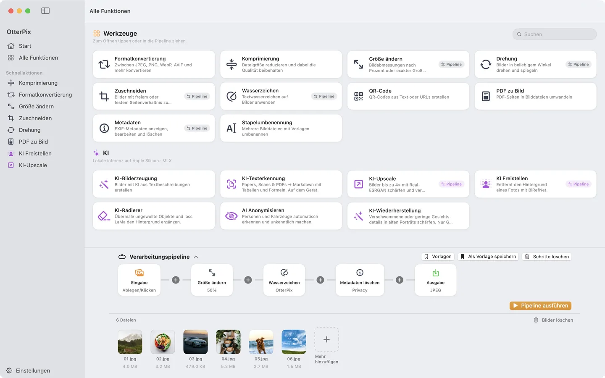

[English](../en/pipeline.md) | [简体中文](../zh-Hans/pipeline.md) | [繁體中文](../zh-Hant/pipeline.md) | **Deutsch**

---

# Pipeline

Die **Verarbeitungspipeline** verkettet mehrere Werkzeuge zu einem Workflow und lässt ihn über einen ganzen Bilderstapel laufen – einen Ordner Fotos in einem Durchgang skalieren, wasserzeichnen und von Metadaten befreien, und die Kette anschließend als Vorlage fürs nächste Mal speichern.

## Auf einen Blick

| | |
|---|---|
| **Verfügbarkeit** | Kostenlos. Gratis-Plan: ein Pro-Schritt pro Pipeline, ein Bild, solange ein Pro-Schritt enthalten ist |
| **Ausführung** | Auf deinem Mac – offline, nichts wird hochgeladen |
| **Eingabe** | Beliebig viele Bilder |
| **Ausgabe** | Verarbeitete Kopien am Zielort deiner Wahl; Originale bleiben liegen |
| **Ort** | **Alle Funktionen** – die Pipeline ist unten an der Galerie angedockt |

## Was eine Pipeline ist

Eine Pipeline ist eine Kette von links nach rechts: ein **Eingabe**-Knoten, deine Verarbeitungsschritte und ein **Ausgabe**-Knoten. Jeder aktivierte Schritt läuft der Reihe nach über jedes Bild. Der **Ausgabe**-Knoten – kein Schritt – bestimmt **Ausgabeformat** (PNG, JPEG, TIFF, BMP, HEIC, WebP, AVIF) und **Qualität** für den ganzen Stapel; Konvertierung und Komprimierung sind also immer Teil des Laufs, ohne einen Platz in der Kette zu belegen.

## Verfügbare Schritte

| Schritt | Hinweise |
|---|---|
| **Größe ändern** | Prozentual oder exakte Abmessungen – siehe [Größe ändern](tools/resize-crop-rotate.md) |
| **Drehen** | Feste Winkel und Spiegelungen – siehe [Drehung](tools/resize-crop-rotate.md) |
| **Zuschneiden** | Nach Seitenverhältnis und Ausrichtung – siehe [Zuschneiden](tools/resize-crop-rotate.md) |
| **Wasserzeichen** | Textwasserzeichen mit Schrift, Farbe, Winkel, Deckkraft, Dichte – siehe [Wasserzeichen](tools/watermark.md) |
| **Metadaten löschen** | Entfernt EXIF/GPS – siehe [Metadaten](tools/metadata.md) |
| **AI Upscale** | Pro – siehe [AI Upscale](ai/ai-upscale.md) |
| **AI Freistellen** | Pro – siehe [AI Freistellen](ai/ai-cutout.md) |

Das ist die vollständige Liste. AI Radierer, AI Anonymisieren, AI Wiederherstellung, AI Texterkennung und AI Bilderzeugung sind interaktive Werkzeuge – sie brauchen pro Bild dein Malen, Klicken oder Tippen – und daher keine Pipeline-Schritte. Ausgabeformat und Kompressionsqualität werden am **Ausgabe**-Knoten eingestellt, nicht als Schritte.

## Eine Pipeline bauen

1. Klicke in der Seitenleiste auf **Alle Funktionen**. Die **Verarbeitungspipeline** ist unten angedockt – ein Klick auf ihre Kopfzeile klappt sie aus.
2. Zieh deine Bilder auf den **Eingabe**-Knoten („Ablegen/Klicken“). Für einen ganzen Ordner öffnest du ihn im Finder, wählst seine Bilder aus und ziehst sie hinein, oder du legst den Ordner auf dem OtterPix-Symbol in der Menüleiste ab (die Bilder der obersten Ebene, bis zu 500). Jedes Bild erscheint im Streifen unter der Kette, samt Zähler („6 Dateien“; eingeklappt fasst die Leiste zusammen: „3 Schritte, 6 Bilder“).
3. Füge Schritte hinzu: Klicke auf ein **+** zwischen den Knoten, oder zieh eine Galerie-Karte mit dem **Pipeline**-Abzeichen direkt nach unten in die Kette. Die leere Pipeline sagt es selbst: „Zieh ein Werkzeug aus der Galerie hierher oder tippe auf +, um einen Schritt hinzuzufügen.“
4. Klicke auf einen Schritt, um seine Parameter zu setzen – dieselben Optionen wie im eigenständigen Werkzeug. Schritte lassen sich umsortieren (**Nach links** / **Nach rechts**), vorübergehend abschalten (**Deaktivieren**) oder entfernen (**Löschen**).
5. Wähl am **Ausgabe**-Knoten **Ausgabeformat** und **Qualität** für den ganzen Stapel.
6. Klicke auf **Pipeline ausführen**. Der Fortschritt liest sich als „Bild 3 von 6…“, und am Ende steht „Fertig: 6 von 6 erfolgreich“. Die verarbeiteten Kopien landen am Zielort; Originale werden nie überschrieben.

## Vorlagen

Klicke auf **Als Vorlage speichern**, gib der Kette im Feld **Vorlagenname** einen Namen, und sie liegt unter **Vorlagen** bereit. Nächste Woche: **Vorlagen** → **Laden**, die neuen Bilder auf den Eingabe-Knoten ziehen, **Pipeline ausführen**. So wird aus einer Fünf-Schritte-Routine ein Ein-Klick-Job.

## Stapelverhalten

Es gibt kein festes Bildlimit – die Pipeline ist für ganze Ordner gebaut. Alles läuft lokal, ein größerer Stapel dauert einfach entsprechend länger. Schlägt ein einzelnes Bild fehl, läuft der Rest weiter, und die Zusammenfassung nennt die Zahl der erfolgreichen Bilder.

## Transparenz-Tipp

**AI Freistellen** erzeugt Transparenz, und die App warnt vor dem einen Weg, sie zu verlieren: Der Schritt liefert RGBA-Ausgabe, und alle nachfolgenden Schritte müssen den Alphakanal erhalten – PNG/WebP/AVIF statt JPEG, und kein AI Upscale danach. Also: Stell das **Ausgabeformat** auf PNG (oder WebP/AVIF) und setz den Schritt **AI Freistellen** ans Ende der Kette.

## Grenzen im Gratis-Plan

- Der Hinweis in der App: „Gratis: ein Bild pro Pipeline mit Pro-Schritt. Upgrade für Stapel.“ Eine Gratis-Pipeline darf **einen** Pro-Schritt enthalten (**AI Upscale** oder **AI Freistellen**), und solange ein Pro-Schritt enthalten ist, ist der Stapel auf ein einzelnes Bild begrenzt.
- Der Lauf dieses Pro-Schritts verbraucht dieselbe tägliche Gratis-Nutzung wie das eigenständige Werkzeug.
- Beim Laden einer gespeicherten Vorlage überspringt der Gratis-Plan enthaltene Pro-Schritte – füg den Pro-Schritt manuell hinzu, wenn du deine tägliche Nutzung dafür einsetzen willst.
- Für Abonnenten gibt es weder Schritt- noch Stapelgrenzen.

## Fehlerbehebung

| Du siehst | Ursache | Lösung |
|---|---|---|
| Ein AI-Schritt meldet, dass das Modell nicht geladen ist | Das Modell des Schritts wurde noch nicht heruntergeladen | Öffne das zugehörige Werkzeug (AI Upscale / AI Freistellen) und lade das Modell dort, oder nutze **Einstellungen → AI** |
| „Gratis: ein Bild pro Pipeline mit Pro-Schritt.“ | Gratis-Plan-Grenze, solange ein Pro-Schritt in der Kette ist | Ein Bild pro Lauf verarbeiten, den Pro-Schritt entfernen oder upgraden |
| Ein Wasserzeichen ist abgeschnitten oder unscharf | Der Wasserzeichen-Schritt steht vor einem Zuschneiden- oder Größe-ändern-Schritt | Wasserzeichen hinter Zuschneiden/Größe ändern schieben – die App warnt genau in diesem Fall („Wasserzeichen vor Größenänderung kann unscharf werden“) |
| Das Ergebnis hat seine Transparenz verloren | Ein JPEG-Ausgabeformat oder ein AI-Upscale-Schritt nach AI Freistellen hat sie entfernt | Als PNG/WebP/AVIF ausgeben und AI Freistellen ans Ende der Kette setzen |
| Weiterhin Probleme | — | [Issue eröffnen](https://github.com/nanguoyu/OtterPix-app/issues/new/choose) |

## Siehe auch

- [AI Upscale](ai/ai-upscale.md)
- [AI Freistellen](ai/ai-cutout.md)
- [Erste Schritte](getting-started.md)

---

**Feedback** – Fehler melden in den [Issues](https://github.com/nanguoyu/OtterPix-app/issues/new/choose), Fragen stellen in den [Discussions](https://github.com/nanguoyu/OtterPix-app/discussions).
