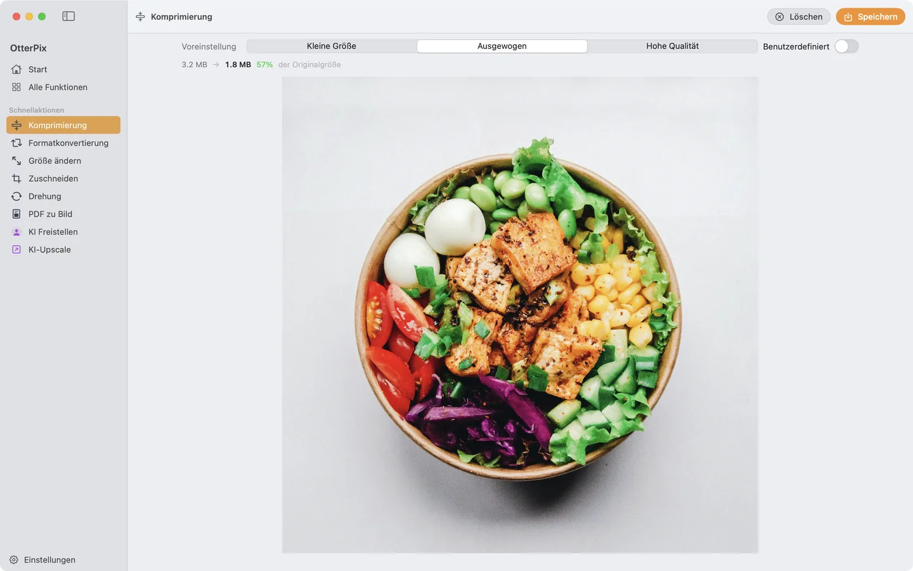
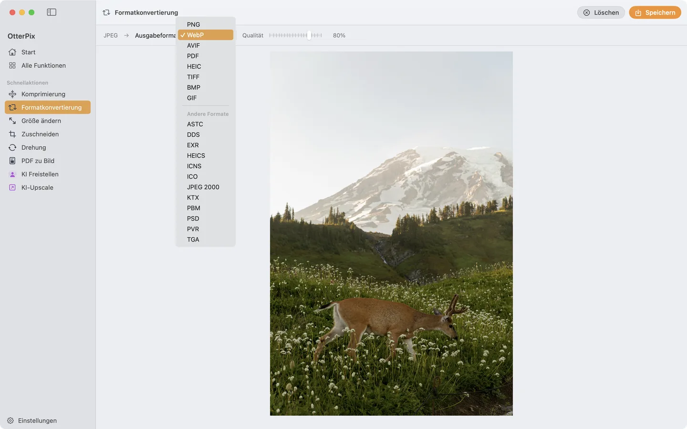

[English](../../en/tools/convert-and-compress.md) · [简体中文](../../zh-Hans/tools/convert-and-compress.md) · [繁體中文](../../zh-Hant/tools/convert-and-compress.md) · **Deutsch**

---

# Formatkonvertierung & Komprimierung

Zwei der meistgenutzten OtterPix-Werkzeuge, hier gemeinsam behandelt, weil sie dasselbe Alltagsproblem von zwei Seiten lösen: **Formatkonvertierung** ändert, was eine Datei *ist* (HEIC → JPEG, PNG → WebP), **Komprimierung** ändert, wie viel Platz sie braucht. Beide sind kostenlos, beide verarbeiten Stapel, und beide lassen deine Originale unangetastet.

## Auf einen Blick

| | |
|---|---|
| **Verfügbarkeit** | Kostenlos |
| **Ausführung** | Auf deinem Mac – offline, nichts wird hochgeladen |
| **Eingabe** | Ein Bild oder ein ganzer Stapel (PNG, JPEG, HEIC, TIFF, WebP, GIF und mehr) |
| **Ausgabe** | Konvertierte / komprimierte Kopien an einem Zielort deiner Wahl |
| **Pipeline** | Format und Qualität setzt der **Ausgabe**-Knoten der Pipeline – siehe [Pipeline](../pipeline.md) |

## HEIC in JPEG umwandeln

Der Klassiker: iPhone-Fotos im `.heic`-Format, die ein Windows-PC, ein Upload-Formular oder ein Fotodienst nicht annimmt.

1. Öffne OtterPix und klicke auf **Formatkonvertierung**.
2. Zieh deine HEIC-Fotos in die Ablagezone – eine Datei oder gleich einen Stapel. Du kannst auch klicken, um Dateien auszuwählen, oder mit ⌘V einfügen.
3. Wähl **JPEG** als Ausgabeformat. Der Picker listet JPEG, PNG, WebP, AVIF, HEIC, TIFF und BMP direkt auf; unter **Andere Formate** stehen die selteneren Formate, die dein Mac schreiben kann.
4. Stell den **Qualität**s-Regler ein, der bei verlustbehafteten Formaten wie JPEG erscheint – höher behält mehr Details, niedriger macht kleinere Dateien.
5. Drücke **Speichern** (⌘S) und wähl, wohin die konvertierten Kopien kommen. Deine HEIC-Originale bleiben exakt, wie sie waren.

### Formate

- **Schreiben:** JPEG, PNG, WebP, AVIF, HEIC, TIFF, BMP – plus die Sektion **Andere Formate** für alles Weitere, was dein Mac kodieren kann.
- **Lesen:** deutlich mehr – die Ablagezone auf **Start** nennt PNG · JPEG · HEIC · TIFF · WebP · GIF +51; GIFs und die meisten anderen Formate funktionieren als Konvertierungs-*Eingabe* also problemlos.
- Die meisten Operationen erhalten Farbprofile und EXIF-Orientierung.

## Bilder komprimieren

1. Klicke auf **Komprimierung** und leg ein Foto ab – oder einen ganzen Stapel, der als Filmstreifen am unteren Rand erscheint.
2. Wähl eine **Voreinstellung**: **Kleine Größe**, **Ausgewogen** oder **Hohe Qualität**. Sie sind von links nach rechts von der kleinsten Datei zur feinsten Qualität geordnet und passen sich jedem Bild an, statt eine fixe Zahl anzuwenden.
3. Für einen exakten Wert wechselst du auf **Benutzerdefiniert** und ziehst den **Qualität**s-Regler.
4. Prüf die Anzeige über der Vorschau: Originalgröße → neue Größe plus der Prozentwert „der Originalgröße“. Ist ein Bild schon so klein, wie es sinnvoll geht, sagt OtterPix das – „Bereits optimal · Original behalten“ – statt es aufzublähen.
5. Klicke auf **Speichern** (⌘S) – oder bei einem Stapel auf **Alle verarbeiten** – und wähl, wohin die komprimierten Dateien kommen.

### Optionen

- **Voreinstellung vs. Benutzerdefiniert** – Voreinstellungen passen sich pro Bild an; **Benutzerdefiniert** legt einen festen **Qualität**s-Wert über den ganzen Stapel.
- **PNG-Eingabe** – „PNG verwendet verlustfreie Kompression – keine Qualitätsanpassung nötig“: PNGs werden neu gepackt, ohne Pixel zu verändern, darum gibt es für sie keinen Qualitätsregler.

## Tipps und Grenzen

- **Qualität gegen Größe ist ein echter Tausch.** Bei verlustbehafteten Formaten entscheidet die Qualitätseinstellung, wie viel Feindetail verworfen wird. Die Anzeige existiert, damit du die tatsächliche Zahl vor dem Speichern prüfst statt zu raten.
- **Transparenz: JPEG plättet.** JPEG hat keinen Alphakanal – ein transparentes PNG nach JPEG konvertiert bekommt einen gefüllten Hintergrund. Bleib bei PNG, WebP oder AVIF, wenn Transparenz zählt.
- **WebP/AVIF schlagen JPEG bei der Größe meist** bei vergleichbarer Qualität. WebP wird breit unterstützt; AVIF komprimiert oft noch stärker, aber manche älteren Apps öffnen es nicht.
- **Wie viel kleiner es wird, hängt vom Bild ab.** Detailreiche Fotos komprimieren anders als schlichte Grafiken, und bereits optimierte Dateien schrumpfen kaum – die Anzeige zeigt die Wahrheit pro Bild.
- **Komprimieren ist kein Metadaten-Entfernen.** Sollen GPS oder EXIF verschwinden, nimm das [Metadaten](metadata.md)-Werkzeug – Entfernen sollte ein bewusster Schritt sein, kein Nebeneffekt.
- **Beides im Stapel:** Die [Pipeline](../pipeline.md) setzt Format und Qualität am **Ausgabe**-Knoten – ein Ordner lässt sich also in einem Lauf skalieren, wasserzeichnen, konvertieren und komprimieren.

## Fehlerbehebung

| Du siehst | Ursache | Lösung |
|---|---|---|
| „Qualitätseinstellung hat keine Wirkung auf …-Format“ | Das gewählte Ausgabeformat ist verlustfrei | Erwartet – wähl ein verlustbehaftetes Format (JPEG/WebP/HEIC/AVIF), wenn du einen Qualitätsregler willst |
| „Bereits optimal · Original behalten“ | Neu komprimieren hätte die Datei vergrößert | Nichts zu tun – OtterPix hat das kleinere Original behalten |
| Das Ergebnis ist größer als das Original | Sehr hohe Qualitätseinstellung auf einer bereits optimierten Datei | **Kleine Größe** wählen oder die **Benutzerdefiniert**-Qualität senken |
| Transparente Flächen wurden weiß/schwarz | Das Ausgabeformat war JPEG | Stattdessen nach PNG, WebP oder AVIF konvertieren |
| Weiterhin Probleme | — | [Issue eröffnen](https://github.com/nanguoyu/OtterPix-app/issues/new/choose) |

## Siehe auch

- [Pipeline](../pipeline.md) – Konvertieren + Komprimieren im Stapel über den Ausgabe-Knoten
- [Größe ändern, Zuschneiden & Drehung](resize-crop-rotate.md)
- [FAQ](../faq.md)

---

**Feedback** – Fehler melden in den [Issues](https://github.com/nanguoyu/OtterPix-app/issues/new/choose), Fragen stellen in den [Discussions](https://github.com/nanguoyu/OtterPix-app/discussions).
