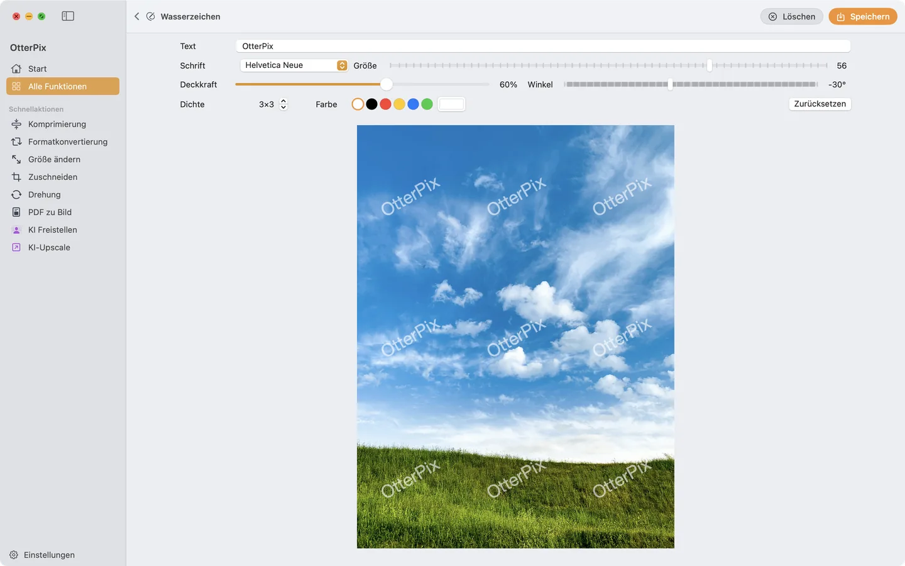

[English](../../en/tools/watermark.md) · [简体中文](../../zh-Hans/tools/watermark.md) · [繁體中文](../../zh-Hant/tools/watermark.md) · **Deutsch**

---

# Wasserzeichen

**Wasserzeichen** legt Text – einen Namen, eine Marke, einen Copyright-Vermerk – über ein Foto oder einen ganzen Stapel, mit Live-Vorschau jeder Änderung.

## Auf einen Blick

| | |
|---|---|
| **Verfügbarkeit** | Kostenlos |
| **Ausführung** | Auf deinem Mac – offline, nichts wird hochgeladen |
| **Eingabe** | Ein Bild oder ein Stapel |
| **Ausgabe** | Kopien mit Wasserzeichen an einem Zielort deiner Wahl; Originale unangetastet |
| **Pipeline-Schritt** | Ja – siehe [Pipeline](../pipeline.md) |

## Ein Textwasserzeichen hinzufügen

1. Öffne OtterPix und klicke auf **Wasserzeichen**.
2. Zieh ein Foto – oder gleich einen Stapel – in die Ablagezone.
3. Tipp deinen Namen, deine Marke oder dein Handle ins Feld **Text**.
4. Wähl eine Schrift im Menü **Schrift**. Die Sektion **Häufig verwendet** hält verlässliche, gut lesbare Schriften einen Klick entfernt; **Alle Schriften** listet jede auf deinem Mac installierte Schrift.
5. Setz die **Farbe** über die eingebauten Farbfelder – Weiß oder Schwarz passt zu fast jedem Foto – oder öffne daneben den vollen Farbwähler für einen exakten Markenton. Stell dann **Größe**, **Deckkraft**, **Winkel** und **Dichte** ein; die Vorschau folgt live.
6. Drücke **Speichern** (⌘S) und wähl, wohin die Kopien mit Wasserzeichen kommen. Bei geladenem Stapel exportiert **Alle verarbeiten** jedes Foto mit denselben Einstellungen.

## Optionen

### Text und Schrift

Die Sektion **Häufig verwendet** im **Schrift**-Menü enthält neben lateinischen auch CJK-Schriften – hat dein Mac eine Schrift für eine Sprache, kannst du in ihr wasserzeichnen. **Alle Schriften** zeigt alles Installierte.

### Farbe

Sechs eingebaute Farbfelder decken die üblichen Fälle ab; der Farbwähler-Chip daneben öffnet das volle macOS-Farbpanel für exakte Markenfarben.

### Platzierung und Abdeckung

- **Deckkraft** – wie kräftig das Zeichen erscheint. Um die 50–60 % bleibt Text über hellen wie dunklen Flächen lesbar, ohne das Foto zu erdrücken.
- **Winkel** – neigt den Text; eine Diagonale wie −30° liest sich klar und lässt sich schlechter wegschneiden.
- **Dichte** – wechselt zwischen einem einzelnen Zeichen und einem gekachelten Muster, das sich über den ganzen Rahmen wiederholt.

## Tipps und Grenzen

- **Einzelzeichen vs. Kachelmuster:** zwei verschiedene Jobs. Ein einzelnes Zeichen ist dezent, aber leicht wegzuschneiden; ein diagonales Kachelmuster deckt den ganzen Rahmen ab – ein weggeschnittenes Zeichen lässt den Rest stehen. Besser zum Schutz.
- **Kontrast entscheidet über Lesbarkeit.** Justier die Deckkraft pro Foto – unruhige Fotos vertragen kräftigere Zeichen als ruhige, und die Live-Vorschau zeigt das Ergebnis sofort.
- **Im Stapel über die Pipeline.** Für wiederkehrende Abläufe füg einer [Pipeline](../pipeline.md) einen **Wasserzeichen**-Schritt hinzu und verarbeite ganze Ordner – mit Skalieren und Formatkonvertierung im selben Lauf. Setz den Wasserzeichen-Schritt *hinter* Zuschneiden und Größe ändern; die App warnt, wenn er davor steht („Wasserzeichen vor Größenänderung kann unscharf werden“).
- **Nur Textwasserzeichen.** Das Werkzeug rendert Text; Bild-/Logodateien stempelt es nicht auf.

## Fehlerbehebung

| Du siehst | Ursache | Lösung |
|---|---|---|
| Das Wasserzeichen ist auf hellen Fotos kaum sichtbar | Niedrige Deckkraft + helle Farbe auf hellem Grund | **Deckkraft** erhöhen oder die **Farbe** auf Schwarz stellen |
| Das Wasserzeichen fehlt auf einem Teil der Stapelbilder | Ein Einzelzeichen skaliert mit den Maßen und dem Ausschnitt jedes Bilds | Vorschau pro Foto prüfen, oder eine gekachelte **Dichte** für gleichmäßige Abdeckung nutzen |
| In einer Pipeline kommt das Zeichen abgeschnitten oder unscharf heraus | Der Wasserzeichen-Schritt läuft vor Zuschneiden/Größe ändern | Den Wasserzeichen-Schritt ans Ende der Kette schieben |
| Weiterhin Probleme | — | [Issue eröffnen](https://github.com/nanguoyu/OtterPix-app/issues/new/choose) |

## Siehe auch

- [Pipeline](../pipeline.md) – ganze Ordner in einem Lauf wasserzeichnen
- [Größe ändern, Zuschneiden & Drehung](resize-crop-rotate.md)
- [Metadaten](metadata.md) – EXIF vor dem Teilen entfernen

---

**Feedback** – Fehler melden in den [Issues](https://github.com/nanguoyu/OtterPix-app/issues/new/choose), Fragen stellen in den [Discussions](https://github.com/nanguoyu/OtterPix-app/discussions).
