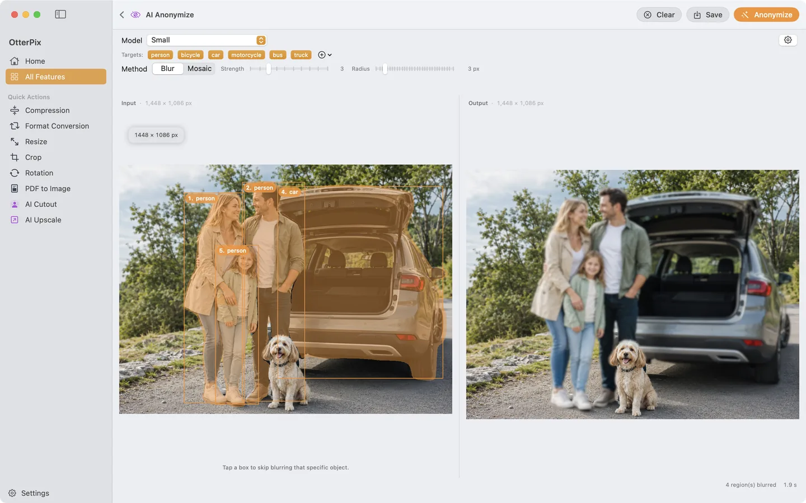

**English** · [简体中文](../../zh-Hans/ai/ai-anonymize.md) · [繁體中文](../../zh-Hant/ai/ai-anonymize.md) · [Deutsch](../../de/ai/ai-anonymize.md)

---

# AI Anonymize

**AI Anonymize** detects the people and vehicles in a photo and blurs or pixelates them — faces and license plates covered in one pass — while you pick exactly who and what stays sharp.

## At a glance

| | |
|---|---|
| **Availability** | Pro — one free use per day on the free plan |
| **Runs** | On device; offline after a one-time model download (~138 MB) |
| **Input** | One image |
| **Output** | The photo with the selected detections blurred or mosaicked |
| **Pipeline step** | No — choosing who stays sharp is interactive |

All processing runs on your Mac. Images are never uploaded — the app's only network use is the model downloads you explicitly trigger and App Store purchase verification.

## How to anonymize a photo

1. Open OtterPix and click **AI Anonymize** in the AI section of the tools grid.
2. Drop your photo into the **Input** pane.
3. Click **Anonymize**. On-device AI finds the people and vehicles in the shot, numbers each detection, and shows the blurred result in the **Output** pane.
4. Pick a **Method**: **Blur** for a soft, photographic look, or **Mosaic** for classic pixelation. The **Strength** and **Radius** sliders control how heavy the effect is.
5. Click any numbered box in the input to exempt that person or vehicle — the output recomposes instantly, with no re-run. Click again to blur it again. As the overlay hint puts it: "Tap a box to skip blurring that specific object."
6. Click **Save** (⌘S) and choose where the anonymized copy goes. Your original file stays untouched.

## Options

### Method, Strength, Radius

**Blur** keeps the image calm and photographic; **Mosaic** is unmistakably deliberate, which suits license plates and anything document-like. Whichever you pick, set the strength high enough that the person or plate is genuinely unrecognizable — adjustments recompose instantly, so tuning costs nothing.

### Targets

The **Targets:** chip row switches whole classes at once — people on, vehicles off, or the reverse. **More targets…** opens the full picker, organized into eight groups: **People**, **Vehicles**, **Animals**, **Outdoor**, **Accessories**, **Sports**, **Electronics**, **Indoor** — so you can also blur laptops, backpacks, or pets when a photo calls for it.

### Per-detection control

Class chips set the rule; clicking numbered boxes makes the exceptions. "Everyone except me" or "every car except mine" takes seconds: detect all, then click your own box to exempt it.

## Tips and limits

- **On crowded photos, click precisely.** With overlapping people, OtterPix resolves your click to the subject actually under the cursor — click the person, not just near them.
- **Blurring covers the whole detection.** A blurred person includes their face; a blurred vehicle includes its plate.
- **Review before publishing.** Detection is a strong first pass, not a verdict — very small, cut-off, or heavily obscured subjects can slip through. For a stray leftover, [AI Eraser](ai-eraser.md) is the companion tool: paint over it and remove it entirely.
- **Stills only.** AI Anonymize works on images, not video. For a clip, export the frames you plan to publish and anonymize those.
- **The readout confirms coverage** — "3 region(s) blurred" tells you exactly how many detections were affected.

## Troubleshooting

| You see | Why | Fix |
|---|---|---|
| "Select at least one class to blur." | Every target class is toggled off | Re-enable a class in the **Targets:** row (or via **More targets…**) |
| A model-not-downloaded error | The detection model (~138 MB) isn't on disk | Click **Open Settings** in the error and download it (also under **Settings → AI**) |
| "Today's free use for this tool is up" | "Each AI tool gets one free use a day — this one resets at midnight." | Wait for the reset or upgrade. Today's photo stays free to keep adjusting |
| A person or plate wasn't detected | Too small, cut off at the edge, or heavily obscured | Exclude nothing and re-check; clean up leftovers with [AI Eraser](ai-eraser.md) |
| First run is slower than later ones | Model weights load once per session | Subsequent runs are faster |
| Still stuck | — | [Open an issue](https://github.com/nanguoyu/OtterPix-app/issues/new/choose) |

## See also

- [AI Eraser](ai-eraser.md) — remove a subject instead of blurring it
- [Metadata](../tools/metadata.md) — strip GPS before sharing, too
- [FAQ — Privacy & network](../faq.md#privacy--network)

---

**Feedback** — report bugs in [Issues](https://github.com/nanguoyu/OtterPix-app/issues/new/choose); ask questions in [Discussions](https://github.com/nanguoyu/OtterPix-app/discussions).
