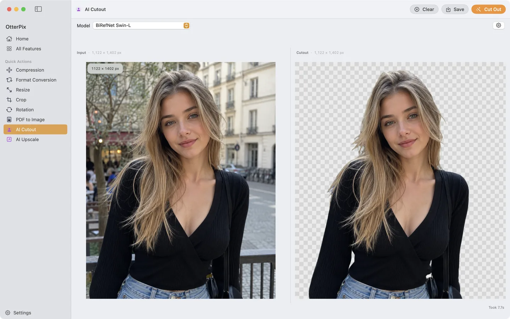

**English** | [简体中文](../../zh-Hans/ai/ai-cutout.md) | [繁體中文](../../zh-Hant/ai/ai-cutout.md) | [Deutsch](../../de/ai/ai-cutout.md)

---

# AI Cutout

**AI Cutout** removes the background from a photo in one click, keeping the subject — hair and fine edges included — on a transparent background at the source image's full resolution.

## At a glance

| | |
|---|---|
| **Availability** | Pro — one free use per day on the free plan |
| **Runs** | On device; the built-in engine needs no download, the downloadable quality tiers fetch once (~170 MB / ~795 MB) and run offline |
| **Input** | One image |
| **Output** | A transparent PNG at the source's full pixel dimensions |
| **Pipeline step** | Yes (Pro) — see [Pipeline](../pipeline.md) |

Image processing and AI inference stay on your Mac. Your images, generation prompts, OCR content, and usage telemetry are never uploaded. OtterPix may connect for StoreKit, a startup Cloudflare edge-country lookup used only for model-download routing, a small URL-only model-manifest refresh when the model store is first used, and model downloads you initiate.

## How to cut out a subject

1. Open OtterPix and click **AI Cutout** — it sits in the AI section of the **All Features** gallery.
2. Drag a photo onto the drop zone, or click to browse.
3. Pick a quality tier from the **Model** menu (see Options). Downloadable tiers fetch once on first use; after that, cutouts run without any network.
4. Click **Cut Out**. A few seconds later the **Cutout** pane shows your subject on a transparent checkerboard.
5. Inspect the edges — hair is the acid test — then press **Save** (⌘S) and choose where the transparent PNG lands.

## Options

### Model

| Tier | In the app's words |
|---|---|
| **Built-in** | "No download, uses the macOS Vision framework" — instant availability, good for clean subjects |
| Lite | "Lite variant, ~170 MB combined." — a strong step up on tricky edges |
| Flagship | "Flagship quality, ~795 MB." — built for the hardest cases: flyaway hair, fur, semi-transparent edges |

Re-running the same photo on another tier stays within the same daily free use — if a strand goes missing, try the next tier up.

## Tips and limits

- **The output keeps full resolution.** The cutout is saved at the source image's pixel dimensions with a real alpha channel — it composites cleanly in any design tool, deck, or storefront.
- **Save as PNG.** JPEG has no transparency; the tool's natural output is PNG.
- **In a Pipeline, output a format with transparency.** Set the Output node of the [Pipeline](../pipeline.md) to PNG, WebP, or AVIF. Every step keeps the transparency, AI Upscale included; only a JPEG output flattens it.
- **One clear subject works best.** The model finds the salient subject; busy scenes with several equal subjects can split its attention.

## Troubleshooting

| You see | Why | Fix |
|---|---|---|
| "Model not downloaded." | The selected downloadable tier isn't on disk | Click **Open Settings** in the error and download it (also under **Settings → AI**) |
| "No subject found in the image." | The scene has no obvious salient subject | Try a downloadable quality tier — the error suggests exactly that — or crop closer to the subject first |
| "Today's free use for this tool is up" | "Each AI tool gets one free use a day — this one resets at midnight." | Wait for the reset or upgrade. Re-running today's photo stays free |
| Edges look rough around hair/fur | The built-in or lite tier hit its limits | Re-run on the flagship tier — same photo, same free use |
| Result lost transparency after further processing | It was saved or re-exported as JPEG | Keep PNG/WebP/AVIF end-to-end |
| Still stuck | — | [Open an issue](https://github.com/nanguoyu/OtterPix-app/issues/new/choose) |

## See also

- [Pipeline](../pipeline.md) — batch cutouts (Pro) and the transparency rule
- [AI Eraser](ai-eraser.md) — remove an object but keep the background
- [FAQ — Free & Pro](../faq.md#free--pro)

---

**Feedback** — report bugs in [Issues](https://github.com/nanguoyu/OtterPix-app/issues/new/choose); ask questions in [Discussions](https://github.com/nanguoyu/OtterPix-app/discussions).
