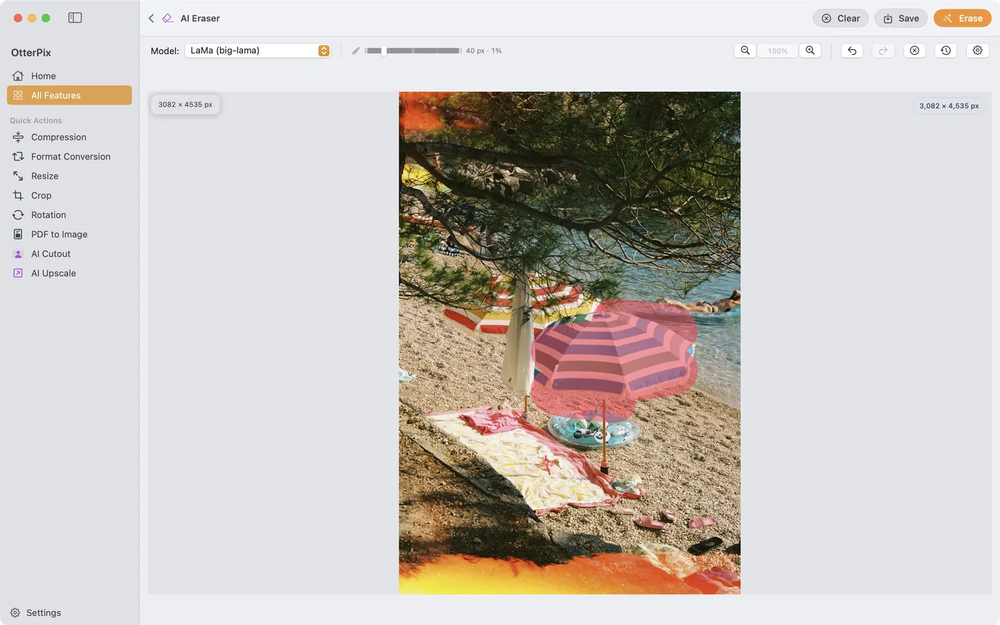

**English** | [简体中文](../../zh-Hans/ai/ai-eraser.md) | [繁體中文](../../zh-Hant/ai/ai-eraser.md) | [Deutsch](../../de/ai/ai-eraser.md)

---

# AI Eraser

**AI Eraser** removes unwanted objects from photos: paint over the tourist, the wire, the trash can — and the painted area fills in with matching background. The workflow is iterative by design: erase, inspect, refine, erase again.

## At a glance

| | |
|---|---|
| **Availability** | Pro — one free use per day on the free plan (per photo — iterating on the same photo stays free) |
| **Runs** | On device; offline after a one-time model download (about 200 MB) |
| **Input** | One image + the mask you paint |
| **Output** | The photo with the painted areas filled in |
| **Pipeline step** | No — erasing needs your brushwork per photo |

Image processing and AI inference stay on your Mac. Your images, generation prompts, OCR content, and usage telemetry are never uploaded. OtterPix may connect for StoreKit, a startup Cloudflare edge-country lookup used only for model-download routing, a small URL-only model-manifest refresh when the model store is first used, and model downloads you initiate.

## How to erase an object

The tool's own hint is the whole workflow: "Paint over what you want to erase, then click Erase (or press Cmd-Return)."

1. Open OtterPix and click **AI Eraser**. On first use the app downloads its eraser model once (about 200 MB) — after that it works offline.
2. Drag your photo into the window, or click to browse.
3. Pick the **Brush tool** (B) and set the brush size — small for a wire, bigger for a person. Paint over the thing you want gone; cover it completely, with a little margin around the edges.
4. Click **Erase** (or press ⌘⏎). After a moment, the painted area fills in with matching background in the **Result** pane.
5. Inspect. If a shadow, a foot, or a faint outline remains, paint over just that remainder and click **Erase** again — each pass builds on the previous one.
6. Repeat for the next object until the scene is clean. **Undo** (⌘Z) takes back a pass that went wrong; **Revert to original** starts you over.
7. Press **Save** (⌘S) and choose where the cleaned-up photo goes. Your original file stays untouched.

## Options

- **Brush tool** (B) — drag to paint the mask; the size readout shows brush size in image pixels.
- **Hand tool** (H) — drag to pan while zoomed in; **Fit to window** (⌘0) resets the view.
- **Clear mask** — wipe the current painting and start the selection over.
- **Undo** (⌘Z) / **Redo** (⇧⌘Z) — per erase pass.
- **Revert to original** — back to the untouched photo.

## Tips and limits

- **Iterating is free.** The daily free use is charged per loaded photo, not per click — paint, erase, refine, and erase again on one photo within a single free use.
- **Include the shadow.** Removing a person but leaving their shadow is the classic giveaway — brush over both.
- **Distinct objects on even backgrounds erase best.** Pavement, grass, sky, walls: clean fills. Where precise detail is missing behind the object — lettering, faces, tight patterns — the fill is invented and can look soft or warped. Work in several smaller passes.
- **Margin matters.** A little padding around the object gives the fill room to blend; a too-tight mask leaves halos.

## Troubleshooting

| You see | Why | Fix |
|---|---|---|
| "Paint over the area you want to remove before running." | The mask is empty | Paint the object first, then click **Erase** |
| A model-not-downloaded error | The eraser model isn't on disk yet | Use the download in the tool's gear menu, or **Settings → AI** |
| "Today's free use for this tool is up" | "Each AI tool gets one free use a day — this one resets at midnight." | Wait for the reset or upgrade. Today's photo stays free to keep refining |
| A ghost or smear where the object was | The fill had too little context, or the mask was too tight | **Undo**, repaint with more margin, and erase in smaller passes |
| Still stuck | — | [Open an issue](https://github.com/nanguoyu/OtterPix-app/issues/new/choose) |

## See also

- [AI Anonymize](ai-anonymize.md) — hide people rather than remove them
- [AI Cutout](ai-cutout.md) — keep the subject, remove the background
- [FAQ — Free & Pro](../faq.md#free--pro)

---

**Feedback** — report bugs in [Issues](https://github.com/nanguoyu/OtterPix-app/issues/new/choose); ask questions in [Discussions](https://github.com/nanguoyu/OtterPix-app/discussions).
