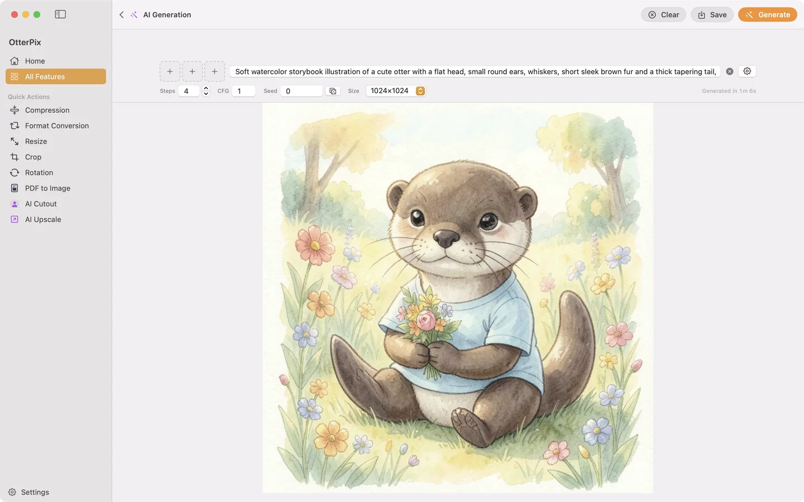

**English** · [简体中文](../../zh-Hans/ai/ai-generation.md) · [繁體中文](../../zh-Hant/ai/ai-generation.md) · [Deutsch](../../de/ai/ai-generation.md)

---

# AI Generation

**AI Generation** — listed on the App Store as AI Image Generation — creates images from a text prompt, entirely on your Mac. Optional reference images steer the result toward a look, a subject, or a composition you already have.

## At a glance

| | |
|---|---|
| **Availability** | Free |
| **Runs** | On device; offline after the model download — the largest in the app, several gigabytes in total |
| **Input** | A text prompt, plus up to 3 optional reference images |
| **Output** | A generated image at the size you choose |
| **Pipeline step** | No |
| **Recommended** | 16 GB RAM or more |

All processing runs on your Mac. Images are never uploaded — the app's only network use is the model downloads you explicitly trigger and App Store purchase verification.

**Regional note:** In the version of OtterPix distributed through the mainland-China Mac App Store, AI Generation and AI OCR are not available. Every other feature — including all five Pro AI tools — is available in every region OtterPix ships to. See the [Terms of Service](https://otterpix.app/en/terms) for details.

## How to generate an image

1. Open OtterPix and click **AI Generation**.
2. Type your prompt — the field asks you to "Describe the image you want to create". Concrete beats vague: subject, style, lighting, setting. A "Try a prompt" row supplies starting points.
3. Optionally add **Reference images** — "Drop or click to add a reference image (up to 3, optional)". With references, the prompt describes how to transform or combine them.
4. Pick an output size from the presets, or choose **Custom Size** and enter **Width** and **Height** — the chain-link icon locks the aspect ratio while you type.
5. Click **Generate**. On-device generation takes minutes depending on your Mac; a progress readout tracks the run, and the duration is reported when it lands.
6. Press **Save** (⌘S) to keep the result.

## Options

### Reference images

Up to three. One reference steers style or subject; several can be combined ("Describe how to combine these images"). Slots are managed inline — hover a filled slot to remove it.

### Size

Preset sizes cover the common cases; **Custom Size** takes exact pixel dimensions with a lock-aspect toggle.

### Advanced parameters

For fine control the tool exposes generation parameters with plain-language explanations in the UI — the number of refinement steps (more steps: higher quality, slower), how strictly the prompt is followed, and a seed (the same seed, prompt, and settings reproduce the same image; a dice button randomizes it).

## Tips and limits

- **Be concrete.** "A watercolor illustration of a lighthouse at dusk, warm light, soft paper texture" outperforms "nice lighthouse picture".
- **Minutes, not seconds.** Generation is the heaviest workload in the app and scales with your Mac's chip and the output size. 16 GB or more of RAM is recommended for exactly this workload.
- **The download is the big one.** The generation model comes in several parts totaling several gigabytes — all managed (and deletable) under **Settings → AI**.
- **Seeds make results reproducible.** Keep the seed fixed to iterate on a prompt; randomize it to explore.

## Troubleshooting

| You see | Why | Fix |
|---|---|---|
| The feature isn't in your app at all | Downloaded from the mainland-China Mac App Store | See the [FAQ](../faq.md#regional-availability--support) — this is a storefront-availability matter, not a bug |
| A model-missing error before the first run | The generation model's parts aren't all downloaded | Open **Settings → AI** and complete the downloads for the generation components |
| First generation is much slower than later ones | The model loads into memory once per session | Subsequent runs are faster |
| Your Mac slows during generation | Generation is compute- and memory-intensive by nature | Let the run finish or **Cancel**; close memory-hungry apps; 16 GB+ RAM is recommended |
| Still stuck | — | [Open an issue](https://github.com/nanguoyu/OtterPix-app/issues/new/choose) |

## See also

- [AI Upscale](ai-upscale.md) — enlarge a generated image to 4×
- [FAQ — Regional availability & support](../faq.md#regional-availability--support)
- [Getting started](../getting-started.md) — requirements

---

**Feedback** — report bugs in [Issues](https://github.com/nanguoyu/OtterPix-app/issues/new/choose); ask questions in [Discussions](https://github.com/nanguoyu/OtterPix-app/discussions).
