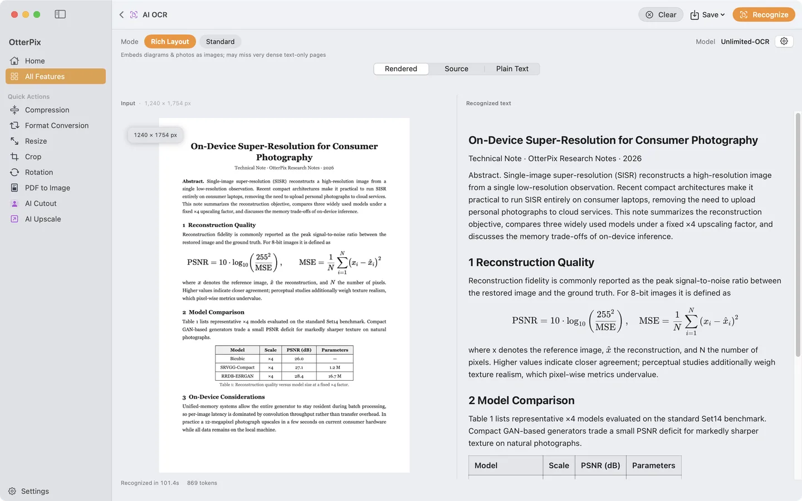

**English** | [简体中文](../../zh-Hans/ai/ai-ocr.md) | [繁體中文](../../zh-Hant/ai/ai-ocr.md) | [Deutsch](../../de/ai/ai-ocr.md)

---

# AI OCR

**AI OCR** — listed on the App Store as AI Text Recognition — turns documents into text you can use. In the app's own words: "Papers, scans & PDFs → Markdown with tables and formulas. On device." Feed it a scanned page, a photographed document, or a multi-page PDF, and get back structured Markdown — headings, tables, formulas, and figures preserved.

## At a glance

| | |
|---|---|
| **Availability** | Free |
| **Runs** | On device; offline after a one-time model download |
| **Input** | Document images (scans, photos of pages) or PDFs |
| **Output** | Markdown or plain text — copy or export |
| **Pipeline step** | No |

Image processing and AI inference stay on your Mac. Your images, generation prompts, OCR content, and usage telemetry are never uploaded. OtterPix may connect for StoreKit, a startup Cloudflare edge-country lookup used only for model-download routing, a small URL-only model-manifest refresh when the model store is first used, and model downloads you initiate.

**Regional note:** In the version of OtterPix distributed through the mainland-China Mac App Store, AI Generation and AI OCR are not available. Every other feature — including all five Pro AI tools — is available in every region OtterPix ships to. See the [Terms of Service](https://otterpix.app/en/terms) for details.

## How to recognize a document

1. Open OtterPix and click **AI OCR**. The empty state says it all: "Drop a document or PDF to start."
2. Drop in a document image or a PDF. For PDFs, the tool shows the page count ("12-page PDF") and a **Pages** control — recognize all pages or a range.
3. Choose a **Mode** (see Options below).
4. Click **Recognize**. Progress is per page ("Parsing page 3 of 12"), with **Pause** and **Resume** available on long documents.
5. Review the result in three views: **Rendered** (the formatted document, figures included), **Source** (the raw Markdown), and **Plain Text**.
6. Take the text with you: **Copy all**, **Export as Markdown (.md)**, or **Export as plain text (.txt)**. Copying from the Rendered view pastes a self-contained document, figures included.

## Options

### Mode

| Mode | Best for |
|---|---|
| **Rich Layout** | The default. Embeds diagrams and photos as images — best for papers, reports, and mixed text-and-image pages; may miss an unusually dense text-only page |
| **Standard** | Text, tables, and formulas on dense pages — the fallback for exam sheets and forms; complex figures may be skipped |

Recognition mode and output view are separate. **Rendered**, **Source**, and
**Plain Text** change how the completed result is displayed/exported; switching
those views does not run the model again.

### PDF page selection

The **Pages** control accepts all pages or a From/To range — useful for pulling one chapter out of a long PDF.

### Settings

The tool's settings hold the **Model** row (as the app puts it: "On-device document recognition. Downloaded once, runs entirely on your Mac.") and **Max tokens**, which caps how much text is generated per page — raise it for long, dense documents.

## Tips and limits

- **Built for documents.** Papers, scans, screenshots of text, PDFs. It is not a general photo-text reader — street signs, memes, and product shots are outside its design and can produce unreliable output.
- **Tables and formulas come out as Markdown**, ready to paste into notes apps, wikis, or editors.
- **The app checks its own work.** If some pages come back suspiciously empty, a warning banner appears: "Some pages came out nearly blank — they may suit the other mode." — with a one-click re-run in that mode.
- **Long pages can hit the output cap.** If you see "Output reached the token limit — raise it in Settings for more.", increase **Max tokens** in the tool's settings and re-run.

## Troubleshooting

| You see | Why | Fix |
|---|---|---|
| "The OCR model is not downloaded yet." | First use — the recognition model isn't on disk | Click **Open Settings** in the error and download it (also under **Settings → AI**) |
| "Some pages came out nearly blank — they may suit the other mode." | The chosen mode struggled with those pages' layout | Use the banner's re-run button to try the other mode on the same document |
| Output cuts off mid-document | The per-page token cap was reached | Raise **Max tokens** in the tool's settings, then **Recognize** again |
| Garbled output from a photo | The input isn't a document — it's a scene photo or meme | Use document-style input; that's what the tool is built for |
| Still stuck | — | [Open an issue](https://github.com/nanguoyu/OtterPix-app/issues/new/choose) |

## See also

- [PDF to Image](../tools/pdf-and-qr.md) — render PDF pages as images instead of extracting text
- [FAQ — Regional availability & support](../faq.md#regional-availability--support)
- [Getting started](../getting-started.md)

---

**Feedback** — report bugs in [Issues](https://github.com/nanguoyu/OtterPix-app/issues/new/choose); ask questions in [Discussions](https://github.com/nanguoyu/OtterPix-app/discussions).
