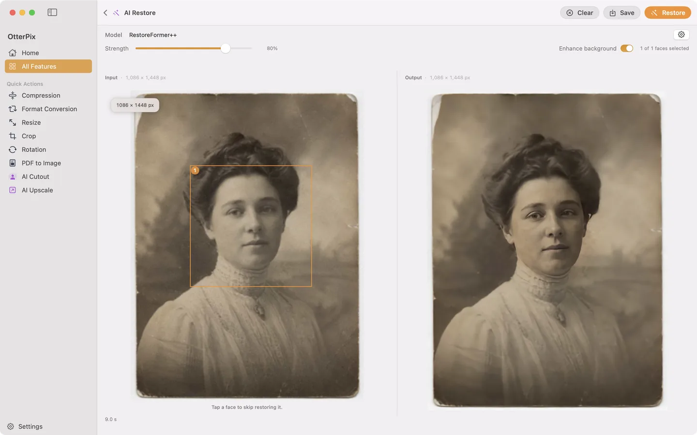

**English** · [简体中文](../../zh-Hans/ai/ai-restore.md) · [繁體中文](../../zh-Hant/ai/ai-restore.md) · [Deutsch](../../de/ai/ai-restore.md)

---

# AI Restore

**AI Restore** — listed on the App Store as AI Face Restore — brings blurry, low-quality faces in old photos back into sharp focus. It works on faces only, on purpose: everything outside the detected faces stays exactly as scanned, so you always know what changed.

## At a glance

| | |
|---|---|
| **Availability** | Pro — one free use per day on the free plan |
| **Runs** | On device; offline after a one-time model download (about 280 MB) |
| **Input** | One photo with visible faces |
| **Output** | The photo with face features sharpened; the rest untouched |
| **Pipeline step** | No — face selection and strength are interactive |

Image processing and AI inference stay on your Mac. Your images, generation prompts, OCR content, and usage telemetry are never uploaded. OtterPix may connect for StoreKit, a startup Cloudflare edge-country lookup used only for model-download routing, a small URL-only model-manifest refresh when the model store is first used, and model downloads you initiate.

## What it does — and deliberately doesn't

The app states its scope plainly in the tool's settings: "Sharpens face features only. Does NOT repair scratches, mold, fading, or backgrounds. Runs offline once downloaded." If the photo's problem is physical damage rather than soft faces, this is the wrong tool — but for the classic case (a scan where you can no longer quite make out a grandparent's face), it is exactly the right one.

## How to restore faces

1. Open OtterPix and click **AI Restore** in the AI section.
2. Drag your scanned photo onto the drop zone, or click to browse.
3. OtterPix detects every face automatically and marks each with a numbered box — that box is the region the AI will work on. The header counts them ("3 of 3 faces selected"); click any box to leave that face out ("Tap a face to skip restoring it."), click again to include it.
4. Click **Restore**. On first use, OtterPix downloads its face-restoration model once (about 280 MB); after that, every run works offline.
5. When the result appears, drag the **Strength** slider until the blend looks right. The preview updates instantly — no need to run the restoration again.
6. Press **Save** (⌘S) and choose where the restored copy goes. Your original scan is never modified.

## Options

### Strength

How strongly the restored faces blend over the originals. Full strength gives the crispest features; lower values keep more of the original character. Adjusting it is instant — the model doesn't re-run.

### Enhance background

Off by default. When on, an overall enhancement pass runs on the whole image before face restoration — useful for blurry or low-resolution originals. Two things to know, straight from the app's own explanation: on photos with physical damage (scratches, mold) it can make the damage *more* visible rather than less, and it needs its own small model (~5 MB), downloadable from this tool's settings.

## Tips and limits

- **Group photos are the intended case.** All faces restore in one run, each with its own numbered box — exclude the ones you want left alone.
- **Scan high.** The more detail the restoration has to work with, the more natural the result. If all you have is a small file, restore first, then enlarge with [AI Upscale](ai-upscale.md).
- **Hair, clothing, and background stay as scanned** — the numbered box shows the region being processed; outside it, nothing changes (unless **Enhance background** is on).
- **Same-photo iteration is free.** Adjusting **Strength**, toggling faces, and re-running the same photo all happen within one daily free use.

## Troubleshooting

| You see | Why | Fix |
|---|---|---|
| "No faces detected in this image. Try a photo with clearly visible faces." | Side profiles, sunglasses, heavy occlusion, or very small faces defeat detection | Use a photo where faces are clearly visible and roughly frontal; crop in closer if the faces are tiny |
| A model-not-downloaded error | The face model (~280 MB) — or, with **Enhance background** on, its separate ~5 MB model — isn't on disk | Click **Open Settings** in the error; both models have download buttons in this tool's settings sheet |
| "Today's free use for this tool is up" | "Each AI tool gets one free use a day — this one resets at midnight." | Wait for the reset or upgrade. Today's photo stays free to keep refining |
| Scratches look worse with Enhance background on | Enhancement sharpens physical damage along with everything else | Turn **Enhance background** off — the app's description warns about exactly this |
| A face came back looking too smooth | Full strength on a very low-quality source | Lower the **Strength** slider — it recomposites instantly |
| Still stuck | — | [Open an issue](https://github.com/nanguoyu/OtterPix-app/issues/new/choose) |

## See also

- [AI Upscale](ai-upscale.md) — enlarge the restored scan
- [AI Eraser](ai-eraser.md) — remove dust spots or objects elsewhere in the frame
- [FAQ — AI models](../faq.md#ai-models)

---

**Feedback** — report bugs in [Issues](https://github.com/nanguoyu/OtterPix-app/issues/new/choose); ask questions in [Discussions](https://github.com/nanguoyu/OtterPix-app/discussions).
