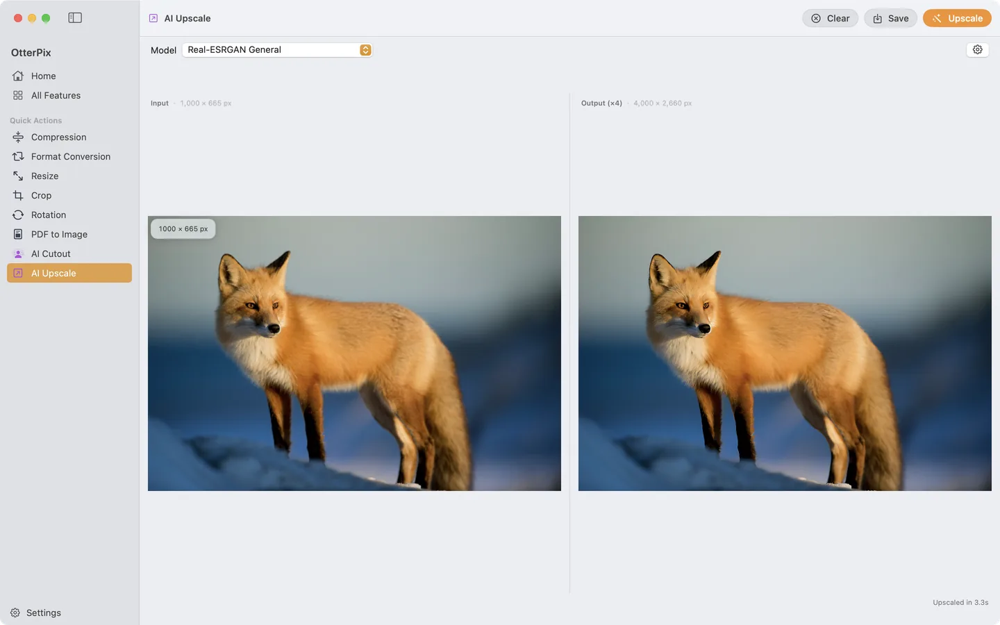

**English** | [简体中文](../../zh-Hans/ai/ai-upscale.md) | [繁體中文](../../zh-Hant/ai/ai-upscale.md) | [Deutsch](../../de/ai/ai-upscale.md)

---

# AI Upscale

**AI Upscale** enlarges an image to 4× its original width and height — sixteen times the pixel count — reconstructing detail as it goes rather than just stretching pixels.

## At a glance

| | |
|---|---|
| **Availability** | Pro — one free use per day on the free plan |
| **Runs** | On device; offline after a one-time model download (2.5–67 MB per model) |
| **Input** | One image |
| **Output** | The image at 4× width and height |
| **Pipeline step** | Yes (Pro) — see [Pipeline](../pipeline.md) |

Image processing and AI inference stay on your Mac. Your images, generation prompts, OCR content, and usage telemetry are never uploaded. OtterPix may connect for StoreKit, a startup Cloudflare edge-country lookup used only for model-download routing, a small URL-only model-manifest refresh when the model store is first used, and model downloads you initiate.

## How to upscale

1. Open OtterPix and click **AI Upscale**.
2. Drop a photo onto the drop zone, or click to choose a file.
3. Pick a mode from the **Model** menu. On first use, OtterPix downloads that mode's file once — they're small, between 2.5 MB and 67 MB — and from then on it runs offline.
4. Click **Upscale**. The result appears in the **Output (×4)** pane along with how long the run took.
5. Compare the two panes — the pixel-dimension badges above **Input** and **Output** spell out the gain: 1,000 × 665 px in, 4,000 × 2,660 px out.
6. Press **Save** (⌘S) and choose where the enlarged copy goes. Your original stays untouched.

## Options

### Model

Four modes, each its own small download. The menu describes them the way the app does:

| Mode | In the app's words |
|---|---|
| General photo | "5 MB, faster, best for everyday photos" |
| Highest quality | "67 MB, highest quality, larger download" |
| Anime / illustration | "18 MB, tuned for anime / illustration stills" |
| Anime video frames | "2.5 MB, smallest, for anime video frames" |

Start with the general mode for everyday shots; switch to the highest-quality mode for prints, and the anime modes for line art, flat colors, and frames exported from animated footage. Re-running the same photo with a different mode stays within the same daily free use.

## Tips and limits

- **The badges are the receipt.** The pixel-dimension badges above the panes show exact input and output sizes — useful for print math (at ~300 DPI, a 4× upscale takes a 1,000-px-wide image from about 3.3 inches printable to roughly 13).
- **Large images take longer.** Big inputs are processed in tiles and the progress readout counts them; everything still runs locally.
- **Photographic content shines; tiny text doesn't.** Upscaling is strongest on fur, skin, fabric, landscapes. Small or already-illegible text won't become readable.
- **Transparency is kept.** A transparent image comes out transparent, with its alpha scaled to the new size.

## Troubleshooting

| You see | Why | Fix |
|---|---|---|
| "Model not downloaded yet." | The selected mode's model isn't on disk | Click **Open Settings** in the error and download it (also reachable via **Settings → AI**) |
| "Today's free use for this tool is up" | "Each AI tool gets one free use a day — this one resets at midnight." | Wait for the reset, or upgrade to Pro. The photo you already ran today stays free to refine |
| Result looks over-smoothed | Mode mismatch (e.g. photo mode on line art) | Try another **Model** mode — same photo, same free use |
| Still stuck | — | [Open an issue](https://github.com/nanguoyu/OtterPix-app/issues/new/choose) |

## See also

- [AI Restore](ai-restore.md) — sharpen faces first, then enlarge
- [Pipeline](../pipeline.md) — AI Upscale as a batch step (Pro)
- [FAQ — Free & Pro](../faq.md#free--pro)

---

**Feedback** — report bugs in [Issues](https://github.com/nanguoyu/OtterPix-app/issues/new/choose); ask questions in [Discussions](https://github.com/nanguoyu/OtterPix-app/discussions).
