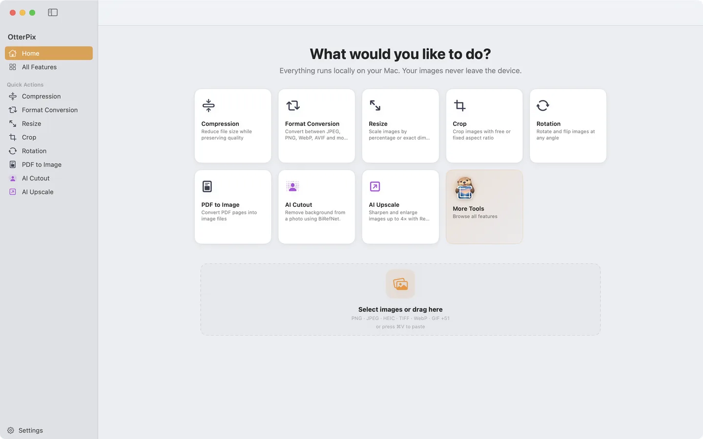

**English** · [简体中文](../zh-Hans/getting-started.md) · [繁體中文](../zh-Hant/getting-started.md) · [Deutsch](../de/getting-started.md)

---

# Getting started

Everything you need to go from download to your first finished edit.

## Can my Mac run it?

- **macOS 14 (Sonoma) or later.**
- **Apple silicon (M1 or newer).** Intel Macs are not supported — the AI features are built for Apple silicon's unified-memory architecture.
- **Disk space for AI models, if you use them.** The AI features download their models on first use — from a few megabytes for the smallest upscale model up to several gigabytes for image generation. Basic tools need no downloads at all.
- **16 GB RAM or more recommended for AI Generation.** Every other feature is comfortable on any Apple silicon Mac.

## Install

[Download OtterPix on the Mac App Store](https://apps.apple.com/app/id6772468615). The download is free, and all ten basic tools plus AI OCR and AI Generation are free to use — no account, no sign-up.

## A tour of the window

**Sidebar.** The fixed destinations are **Home**, **All Features**, and **Automation**. Your customizable **Quick Actions** sit below them, and **Settings** stays pinned at the bottom.

- **Home** greets you with "What would you like to do?" — task cards for the most common tools plus a drop zone.
- **All Features** is the full gallery: every tool as a card, a **Search** field to filter them, and the **Processing Pipeline** docked at the bottom. Pro AI cards wear an amber **Free today** badge while your daily free use of that tool is still available.
- **Automation** is the Pro folder-watching workspace: authorize an input folder, choose a saved Pipeline preset, and new files can be processed automatically.
- **Quick Actions** are your own shortcuts. In **Settings** you can pick which features appear — as the app puts it: "Choose which features appear as shortcuts in the sidebar and on Home."
- **Settings** holds four tabs: **General**, **Export**, **AI** (model downloads and storage), and **About**.

**Drop zone.** Almost every tool starts the same way: "**Select images or drag here**" — "or press ⌘V to paste". Home's drop zone lists the headline formats — PNG · JPEG · HEIC · TIFF · WebP · GIF +51 — and routes what you drop to the right tool.

## Your first edit: compress a photo

1. On **Home**, click **Compression**.
2. Drop a photo onto the drop zone (or press ⌘V to paste one).
3. Pick a **Preset** — **Small Size**, **Balanced**, or **High Quality**. The readout above the preview shows the result before you commit: original size → new size, and the percentage "of original size".
4. Click **Save** (⌘S) and choose where the compressed copy goes. Your original file stays untouched.

That's the whole shape of the app: drop, adjust, save. Every tool follows it.

## The AI features

The AI tools (Upscale, Cutout, Eraser, Anonymize, Restore, OCR, Generation) download their selected model components on first use, then work offline. Task-specific model and quality choices are visible in each feature. **Settings → AI** shows the same resumable downloads and handles deletion and storage. Sizes range from a few megabytes for the smallest upscale model to several gigabytes for image generation.

## Automation

With Pro, **Automation** can watch an authorized folder and run a saved Pipeline preset whenever new files arrive. Supported tools and saved presets can also be invoked through Shortcuts/App Intents or AppleScript. The same Pro and regional availability rules apply whichever entry point you use.

## Free and Pro

| | What you get |
|---|---|
| **Free** | All ten basic tools, the Pipeline, AI OCR, and AI Generation — plus one free use of each Pro AI tool per day |
| **Pro** | Unlimited AI Upscale, AI Cutout, AI Eraser, AI Anonymize, and AI Restore, and uncapped Pipeline batches with AI steps |

The free daily use is charged per loaded photo, not per click — you can refine the same image as often as you like within one day's use. When a tool's free use is spent, its card shows the paywall until the counter resets at midnight.

Pro is a monthly or yearly subscription, or a one-time lifetime purchase. See current pricing on the [Mac App Store](https://apps.apple.com/app/id6772468615); manage or cancel a subscription any time in your [Apple Account subscriptions](https://apps.apple.com/account/subscriptions).

## Privacy

All image processing and AI inference run on your Mac. Your images, generation prompts, OCR content, and usage telemetry are never uploaded. OtterPix does connect for StoreKit, a startup Cloudflare edge-country lookup used only to select a model-download mirror, a small URL-only model-manifest refresh when the model store is first used, and model downloads you initiate. Details: [privacy policy](https://otterpix.app/en/privacy).

## Where to get help

- The [FAQ](faq.md) answers the common questions in one page.
- Something broken → [open an issue](https://github.com/nanguoyu/OtterPix-app/issues/new/choose).
- Not sure how to do something → [Discussions → Q&A](https://github.com/nanguoyu/OtterPix-app/discussions/categories/q-a).

## See also

- [Format Conversion & Compression](tools/convert-and-compress.md)
- [Pipeline](pipeline.md)
- [FAQ](faq.md)

---

**Feedback** — report bugs in [Issues](https://github.com/nanguoyu/OtterPix-app/issues/new/choose); ask questions in [Discussions](https://github.com/nanguoyu/OtterPix-app/discussions).
