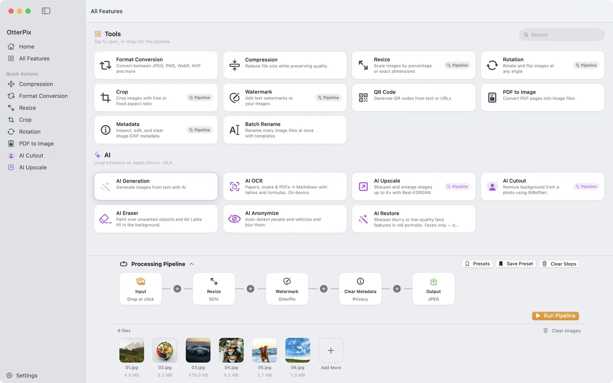

**English** | [简体中文](../zh-Hans/pipeline.md) | [繁體中文](../zh-Hant/pipeline.md) | [Deutsch](../de/pipeline.md)

---

# Pipeline

The **Processing Pipeline** chains several tools into one workflow and runs it over a whole batch of images — resize, watermark, and strip metadata from a folder of photos in a single pass, then save the chain as a preset for next time.

## At a glance

| | |
|---|---|
| **Availability** | Free. Free plan: one Pro step per pipeline, one image while a Pro step is present |
| **Runs** | On your Mac — offline, nothing uploaded |
| **Input** | Any number of images |
| **Output** | Processed copies in the destination you choose; originals stay in place |
| **Where** | **All Features** — the pipeline is docked at the bottom of the gallery |

## What a pipeline is

A pipeline is a left-to-right chain: an **Input** node, your processing steps, and an **Output** node. Every enabled step runs on every image, in order. The **Output** node — not a step — decides the **Output Format** (PNG, JPEG, TIFF, BMP, HEIC, WebP, AVIF) and **Quality** for the whole batch, so conversion and compression are always part of the run without occupying a slot in the chain.

## Available steps

| Step | Notes |
|---|---|
| **Resize** | Percentage or exact dimensions — see [Resize](tools/resize-crop-rotate.md) |
| **Rotate** | Fixed angles and flips — see [Rotation](tools/resize-crop-rotate.md) |
| **Crop** | Aspect-ratio and alignment based — see [Crop](tools/resize-crop-rotate.md) |
| **Watermark** | Text watermark with font, color, angle, opacity, density — see [Watermark](tools/watermark.md) |
| **Clear Metadata** | Strips EXIF/GPS — see [Metadata](tools/metadata.md) |
| **AI Upscale** | Pro — see [AI Upscale](ai/ai-upscale.md) |
| **AI Cutout** | Pro — see [AI Cutout](ai/ai-cutout.md) |

That's the complete list. AI Eraser, AI Anonymize, AI Restore, AI OCR, and AI Generation are interactive tools — they need you to paint, click, or type per image — so they are not pipeline steps. Output format and compression quality are set on the **Output** node rather than as steps.

## Build a pipeline

1. Click **All Features** in the sidebar. The **Processing Pipeline** is docked at the bottom — click its header to expand it.
2. Drag your images onto the **Input** node ("Drop or click"). To take a whole folder, open it in Finder, select its images, and drag them in, or drop the folder on the OtterPix menu bar icon (its top-level images, up to 500). Every image appears in the strip under the chain, and the bar counts them ("3 steps, 6 images").
3. Add steps: click a **+** between the nodes, or drag any gallery card bearing the **Pipeline** badge straight down into the chain. As the empty pipeline itself suggests: "Drag a tool down from the gallery, or click + between nodes".
4. Click a step to set its parameters — the same options as the standalone tool. Steps can be reordered (**Move Left** / **Move Right**), temporarily disabled (**Disable**), or removed (**Delete**).
5. On the **Output** node, choose the **Output Format** and **Quality** for the whole batch.
6. Click **Run Pipeline**. Progress reads "Image 3 of 6…" while it works, and finishes with "Completed: 6 of 6 succeeded". Processed copies land in the output destination; originals are never overwritten.

## Presets

Click **Save Preset**, give the chain a **Preset Name**, and it's stored under **Presets**. Next week: **Presets** → **Load**, drop the new images on the Input node, **Run Pipeline**. Presets are how a five-step routine becomes a one-click job.

## Batch behavior

There is no fixed image limit — the pipeline is built for whole folders. Everything runs locally, so a bigger batch simply takes proportionally longer. If a single image fails, the run continues and the summary tells you how many succeeded.

## Transparency tip

**AI Cutout** produces transparency, and every step after it keeps it, AI Upscale included. The one way to lose it is a JPEG output, so set the **Output Format** to PNG (or WebP/AVIF).

## Free-plan limits

- The hint in the app: "Free plan: one image when a Pro step is used. Upgrade for batches." A free pipeline may contain **one** Pro step (**AI Upscale** or **AI Cutout**), and while a Pro step is present the batch is limited to a single image.
- Running that Pro step consumes the same daily free use as the standalone tool.
- Loading a saved preset on the free plan skips any Pro steps it contains — add the Pro step manually if you want to spend your daily use on it.
- Subscribers have no step or batch caps.

## Troubleshooting

| You see | Why | Fix |
|---|---|---|
| An AI step shows "Model not downloaded" | The step's model hasn't been fetched yet | Open the tool it refers to (AI Upscale / AI Cutout) and download the model there, or use **Settings → AI** |
| "Free plan: one image when a Pro step is used." | Free-plan cap while a Pro step is in the chain | Run one image at a time, remove the Pro step, or upgrade |
| A watermark comes out cropped or blurry | The Watermark step sits before a Crop or Resize step | Move Watermark after Crop/Resize — the app shows a warning in exactly this case |
| Result lost its transparency | The **Output Format** is JPEG, which has no transparency | Output as PNG/WebP/AVIF |
| Still stuck | — | [Open an issue](https://github.com/nanguoyu/OtterPix-app/issues/new/choose) |

## See also

- [AI Upscale](ai/ai-upscale.md)
- [AI Cutout](ai/ai-cutout.md)
- [Getting started](getting-started.md)

---

**Feedback** — report bugs in [Issues](https://github.com/nanguoyu/OtterPix-app/issues/new/choose); ask questions in [Discussions](https://github.com/nanguoyu/OtterPix-app/discussions).
