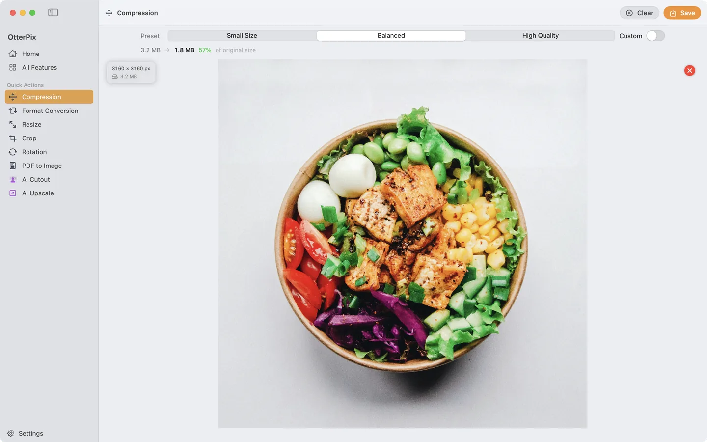
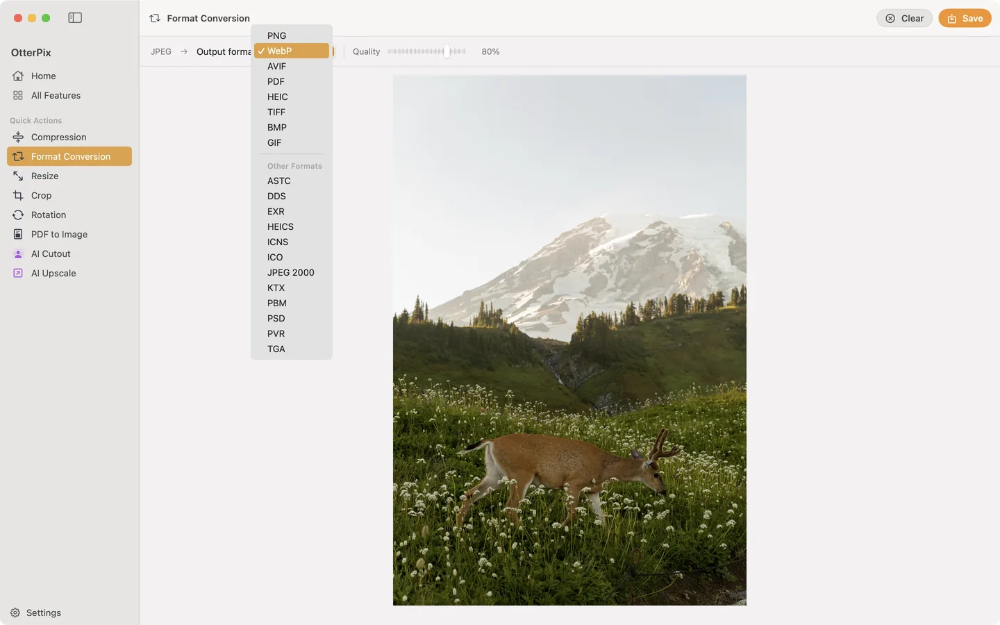

**English** | [简体中文](../../zh-Hans/tools/convert-and-compress.md) | [繁體中文](../../zh-Hant/tools/convert-and-compress.md) | [Deutsch](../../de/tools/convert-and-compress.md)

---

# Format Conversion & Compression

Two of OtterPix's most-used tools, covered together because they solve the same everyday problem from two sides: **Format Conversion** changes what a file *is* (HEIC → JPEG, PNG → WebP), **Compression** changes how much space it takes. Both are free, both handle batches, and both leave your originals untouched.

## At a glance

| | |
|---|---|
| **Availability** | Free |
| **Runs** | On your Mac — offline, nothing uploaded |
| **Input** | One image or a whole batch (PNG, JPEG, HEIC, TIFF, WebP, GIF and more) |
| **Output** | Converted / compressed copies in a destination you choose |
| **Pipeline** | Format and quality are set on the Pipeline's **Output** node — see [Pipeline](../pipeline.md) |

## Convert HEIC to JPEG

The classic case: iPhone photos saved as `.heic` that a Windows PC, an upload form, or a print service won't accept.

1. Open OtterPix and click **Format Conversion**.
2. Drag your HEIC photos onto the drop zone — one file or a whole batch. You can also click to browse, or press ⌘V to paste.
3. Choose **JPEG** as the output format. The picker lists JPEG, PNG, WebP, AVIF, HEIC, TIFF, and BMP up front; **Other Formats** holds the less common formats your Mac can write.
4. Set the **Quality** slider, which appears for lossy formats like JPEG — higher keeps more detail, lower makes smaller files.
5. Press **Save** (⌘S) and choose where the converted copies go. Your original HEIC files stay exactly as they were.

### Formats

- **Write:** JPEG, PNG, WebP, AVIF, HEIC, TIFF, BMP — plus the **Other Formats** section for everything else your Mac can encode.
- **Read:** far more — the Home drop zone advertises PNG, JPEG, HEIC, TIFF, WebP, GIF +51, so GIFs and most anything else open fine as conversion *input*.
- Exports keep the source's capture date, camera details, location, copyright, and color profile, and come out upright. WebP and AVIF carry no metadata.
- From an animated GIF or a multi-page file such as a PDF, only the first frame or page is used. To convert every page of a PDF, use [PDF to Image](pdf-and-qr.md).

## Compress images

1. Click **Compression** and drop in a photo — or a whole batch, which adds a filmstrip along the bottom.
2. Pick a **Preset**: **Small Size**, **Balanced**, or **High Quality**. They run from smallest file to finest quality, left to right, and adapt to each image rather than applying one fixed number.
3. For an exact level, switch to **Custom** and drag the **Quality** slider.
4. Check the readout above the preview: original size → new size, plus the percentage "of original size". If an image is already as small as it can usefully get, OtterPix says so — "Already optimal, original kept" — instead of inflating it.
5. Click **Save** (⌘S) — or **Process All** for a batch — and choose where the compressed files land.

### Options

- **Preset vs Custom** — presets adapt per image; **Custom** pins one **Quality** value across the batch.
- **PNG input** — "PNG uses lossless compression — no quality adjustment needed": PNGs are repacked without altering pixels, so there is no quality slider for them.

## Tips and limits

- **Quality vs size is a real trade.** For lossy formats, the quality setting decides how much fine detail is discarded. The readout exists so you can check the actual number before saving, not guess.
- **Transparency: JPEG flattens.** JPEG has no alpha channel — converting a transparent PNG to JPEG fills the background. Keep PNG, WebP, or AVIF when transparency matters.
- **WebP/AVIF usually beat JPEG on size** at similar quality. WebP enjoys broad support; AVIF often compresses further but some older apps won't open it.
- **How much smaller depends on the image.** Detail-rich photos compress differently from simple graphics, and already-optimized files may barely shrink — the readout shows the truth per image.
- **Compression is not metadata removal.** If GPS or EXIF must be gone, use the [Metadata](metadata.md) tool — removal should be an explicit step, not a side effect.
- **Batches of both at once:** the [Pipeline](../pipeline.md) sets format and quality on its **Output** node, so a folder can be resized, watermarked, converted, and compressed in one run.

## Troubleshooting

| You see | Why | Fix |
|---|---|---|
| "Quality setting has no effect on … format" | The chosen output format is lossless | Expected — pick a lossy format (JPEG/WebP/HEIC/AVIF) if you want a quality dial |
| "Already optimal, original kept" | Recompressing would have made the file larger | Nothing to fix — OtterPix kept the smaller original |
| Result is larger than the original | Very high quality setting on an already-optimized file | Choose **Small Size** or lower the **Custom** quality |
| Transparent areas turned white/black | Output format was JPEG | Convert to PNG, WebP, or AVIF instead |
| Still stuck | — | [Open an issue](https://github.com/nanguoyu/OtterPix-app/issues/new/choose) |

## See also

- [Pipeline](../pipeline.md) — batch conversion + compression via the Output node
- [Resize, Crop & Rotation](resize-crop-rotate.md)
- [FAQ](../faq.md)

---

**Feedback** — report bugs in [Issues](https://github.com/nanguoyu/OtterPix-app/issues/new/choose); ask questions in [Discussions](https://github.com/nanguoyu/OtterPix-app/discussions).
