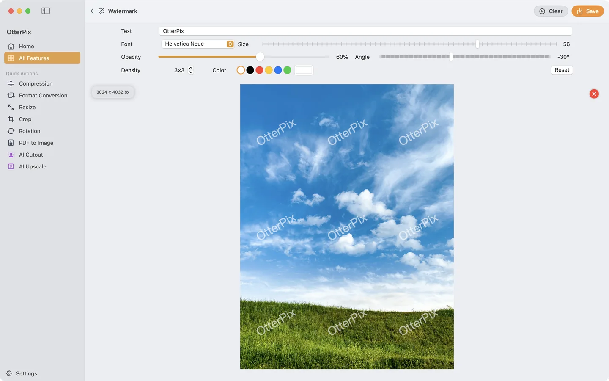

**English** · [简体中文](../../zh-Hans/tools/watermark.md) · [繁體中文](../../zh-Hant/tools/watermark.md) · [Deutsch](../../de/tools/watermark.md)

---

# Watermark

**Watermark** adds text — a name, brand, or copyright line — across one photo or a whole batch, with live preview of every change.

## At a glance

| | |
|---|---|
| **Availability** | Free |
| **Runs** | On your Mac — offline, nothing uploaded |
| **Input** | One image or a batch |
| **Output** | Watermarked copies in a destination you choose; originals untouched |
| **Pipeline step** | Yes — see [Pipeline](../pipeline.md) |

## How to add a text watermark

1. Open OtterPix and click **Watermark**.
2. Drag one photo — or a whole batch — onto the drop zone.
3. Type your name, brand, or handle into the **Text** field.
4. Pick a typeface from the **Font** menu. The **Common** section keeps reliable, legible choices one click away; **All Fonts** lists every font installed on your Mac.
5. Set the **Color** with the inline swatches — white or black suits almost any photo — or open the full color picker beside them for an exact brand tone. Then adjust **Size**, **Opacity**, **Angle**, and **Density**; the preview updates live.
6. Press **Save** (⌘S) and choose where the watermarked copies go. With a batch loaded, **Process All** exports every photo with the same settings.

## Options

### Text and typeface

The **Font** menu's **Common** section includes CJK fonts alongside Latin ones — if your Mac has a font for a language, you can watermark in it. **All Fonts** exposes everything installed.

### Color

Six inline swatches cover the common cases; the color-picker chip beside them opens the full macOS color panel for exact brand colors.

### Placement and coverage

- **Opacity** — how strongly the mark shows. Around 50–60% keeps text legible over both bright and dark areas without overpowering the photo.
- **Angle** — tilt the text; a diagonal like −30° reads clearly and is harder to remove by cropping.
- **Density** — switches between a single mark and a tiled pattern that repeats across the whole frame.

## Tips and limits

- **Single mark vs tiled:** they do different jobs. A single mark is subtle but easy to crop out; a tiled diagonal pattern covers the whole frame, so cropping one mark away still leaves the rest — better for protection.
- **Contrast decides legibility.** Fine-tune opacity per photo — busy photos tolerate stronger marks than clean ones, and the live preview shows the result instantly.
- **Batch it in the Pipeline.** For a recurring workflow, add a **Watermark** step to a [Pipeline](../pipeline.md) and run entire folders — with resizing and format conversion in the same pass. Keep the Watermark step *after* Crop and Resize; the app warns if it sits before them ("Watermark placed before Resize may become blurry").
- **Text watermarks only.** The tool renders text; it does not stamp image/logo files.

## Troubleshooting

| You see | Why | Fix |
|---|---|---|
| Watermark is barely visible on bright photos | Low opacity + light color over light background | Raise **Opacity** or switch the **Color** to black |
| Watermark missing from part of a batch's images | A single mark scales with each image's dimensions and framing | Check the preview per photo, or use a tiled **Density** for uniform coverage |
| In a pipeline, the mark comes out cropped or blurry | The Watermark step runs before Crop/Resize | Move the Watermark step to the end of the chain |
| Still stuck | — | [Open an issue](https://github.com/nanguoyu/OtterPix-app/issues/new/choose) |

## See also

- [Pipeline](../pipeline.md) — watermark whole folders in one run
- [Resize, Crop & Rotation](resize-crop-rotate.md)
- [Metadata](metadata.md) — strip EXIF before sharing

---

**Feedback** — report bugs in [Issues](https://github.com/nanguoyu/OtterPix-app/issues/new/choose); ask questions in [Discussions](https://github.com/nanguoyu/OtterPix-app/discussions).
