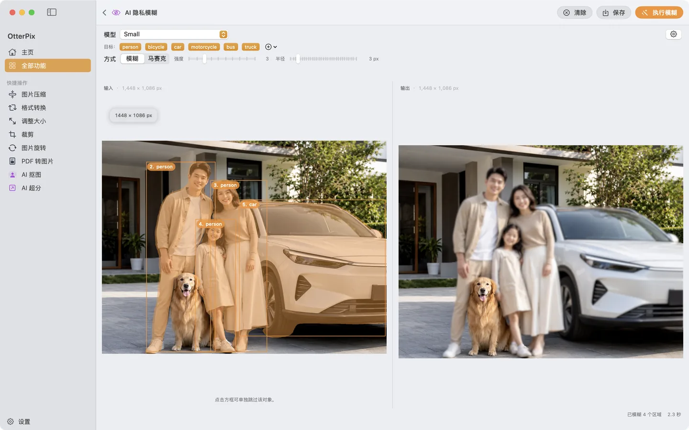

[English](../../en/ai/ai-anonymize.md) · **简体中文** · [繁體中文](../../zh-Hant/ai/ai-anonymize.md) · [Deutsch](../../de/ai/ai-anonymize.md)

---

# AI 隐私模糊

**AI 隐私模糊**——App Store 商品页上称“AI 打码”——自动检测照片里的人物和车辆并加上模糊或马赛克——人脸和车牌一次盖住——由你精确决定谁保持清晰。

## 一览

| | |
|---|---|
| **可用性** | Pro——免费版每天 1 次免费使用 |
| **运行方式** | 设备端；一次性下载模型（约 138 MB）后离线运行 |
| **输入** | 单张图片 |
| **输出** | 选中的检测目标已被模糊或马赛克的照片 |
| **流水线步骤** | 无——“谁保持清晰”需要交互决定 |

所有处理都在你的 Mac 上完成，图片不会被上传——App 只在你主动下载 AI 模型和 App Store 购买验证时联网。

## 如何给照片打码

1. 打开 OtterPix，在工具库 AI 区点击 **AI 隐私模糊**。
2. 把照片拖进**输入**窗格。
3. 点击**执行模糊**。设备端 AI 找出画面里的人物和车辆，给每个检测目标编号，并在**输出**窗格显示打码结果。
4. 选一种**方式**：**模糊**柔和自然，**马赛克**是经典像素格。**强度**和**半径**滑杆控制效果轻重。
5. 点输入图上任何一个编号方框，就能豁免那个人或那辆车——输出即时重新合成，不用重跑。再点一下重新打码。悬浮提示的原话：“点击方框可单独跳过该对象。”
6. 点击**保存**（⌘S），选择打码副本的保存位置。原文件保持不变。

## 选项

### 方式、强度、半径

**模糊**让画面保持安静、有照片感；**马赛克**一眼可见是刻意为之，更适合车牌和证件类内容。无论选哪种，都把强度调到确实认不出人或车牌为止——调整即时重新合成，试错零成本。

### 目标

**目标：**芯片行按类别整组开关——只处理人、只处理车，或者反过来。**更多目标…**打开完整选择器，共八组：**人物**、**车辆**、**动物**、**户外**、**随身物品**、**运动器材**、**电子产品**、**室内**——需要时也能把笔记本电脑、背包或宠物一起打码。

### 逐个控制

类别芯片定规则，点编号方框做例外。“除了我全都打码”或“除了我的车全都打码”几秒钟搞定：先全部检测，再点自己那个框豁免。

## 提示与限制

- **人多的照片要点得准。** 人物相互重叠时，OtterPix 会把点击解析到光标真正落在的那个人身上——点人本身，别只点旁边。
- **打码覆盖整个检测框。** 打码的人包含人脸；打码的车包含车牌。
- **发布前再过目一遍。** 检测是可靠的第一遍，不是最终裁决——特别小、被裁边或严重遮挡的目标可能漏网。零星漏网就交给搭档工具 [AI 擦除](ai-eraser.md)：涂一笔直接整个移除。
- **仅限静态图片。** AI 隐私模糊处理图片，不处理视频。视频片段请先导出要发布的帧，再逐帧打码。
- **读数确认覆盖情况** ——“已模糊 3 个区域”明确告诉你多少个检测目标被处理了。

## 疑难解答

| 现象 | 原因 | 解决办法 |
|---|---|---|
| “请至少选择一个要模糊的类别。” | 所有目标类别都被关掉了 | 在**目标：**行（或**更多目标…**里）重新开启一个类别 |
| 模型未下载的错误提示 | 检测模型（约 138 MB）不在磁盘上 | 点错误提示里的**打开设置**下载（也在**设置 → AI** 里） |
| “本功能今日免费次数已用完” | “每个 AI 功能每天各有 1 次免费，本功能将在午夜恢复。” | 等待重置或升级。当天的照片仍可继续免费调整 |
| 有个人或车牌没被检测到 | 目标太小、被画面边缘裁断或严重遮挡 | 不豁免任何目标再检查一遍；漏网的用 [AI 擦除](ai-eraser.md)收尾 |
| 第一次运行比之后慢 | 模型权重每次会话只载入一次 | 后续运行会更快 |
| 还是解决不了 | — | [提交 Issue](https://github.com/nanguoyu/OtterPix-app/issues/new/choose) |

## 相关页面

- [AI 擦除](ai-eraser.md) — 直接移除目标，而不是打码
- [元数据](../tools/metadata.md) — 分享前把 GPS 也一并清掉
- [常见问题 — 隐私与联网](../faq.md#隐私与联网)

---

**反馈** — Bug 请到 [Issues](https://github.com/nanguoyu/OtterPix-app/issues/new/choose) 报告；使用问题请到 [Discussions](https://github.com/nanguoyu/OtterPix-app/discussions) 提问。
