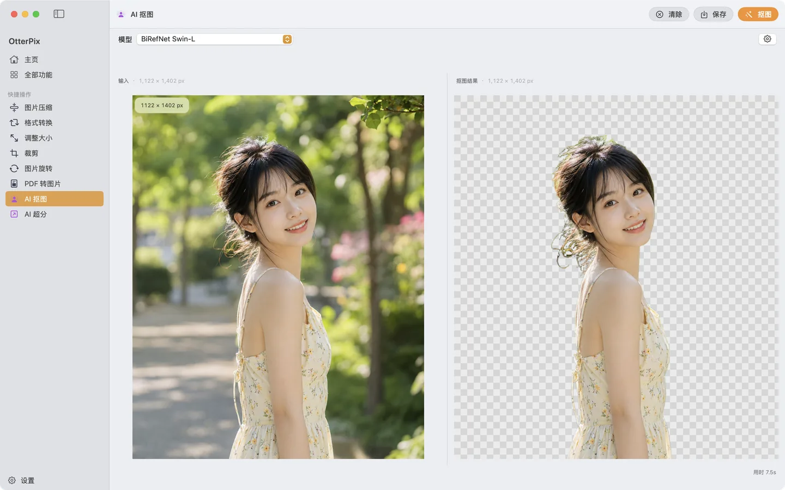

[English](../../en/ai/ai-cutout.md) · **简体中文** · [繁體中文](../../zh-Hant/ai/ai-cutout.md) · [Deutsch](../../de/ai/ai-cutout.md)

---

# AI 抠图

**AI 抠图**——App Store 商品页上称“AI 智能抠图”——一键去除照片背景，把主体（包括发丝和细碎边缘）留在透明背景上，输出保持原图完整分辨率。

## 一览

| | |
|---|---|
| **可用性** | Pro——免费版每天 1 次免费使用 |
| **运行方式** | 设备端；内置引擎无需下载，可下载的画质档一次下载（约 170 MB / 约 795 MB）后离线运行 |
| **输入** | 单张图片 |
| **输出** | 与原图同像素尺寸的透明 PNG |
| **流水线步骤** | 有（Pro）——见[流水线](../pipeline.md) |

所有处理都在你的 Mac 上完成，图片不会被上传——App 只在你主动下载 AI 模型和 App Store 购买验证时联网。

## 如何抠出主体

1. 打开 OtterPix，点击 **AI 抠图**——它在**全部功能**工具库的 AI 区。
2. 把照片拖到拖放区，或点击浏览文件。
3. 在**模型**菜单里选一个画质档（见选项）。可下载的档位首次使用时下载一次；之后抠图完全不需要联网。
4. 点击**抠图**。几秒钟后，**抠图结果**窗格里就是你的主体，背景换成透明棋盘格。
5. 检查边缘——发丝是试金石——然后按**保存**（⌘S），选择透明 PNG 的保存位置。

## 选项

### 模型

| 档位 | 应用原文 |
|---|---|
| **内置** | “无需下载 · 使用 macOS Vision 框架”——即点即用，适合轮廓干净的主体 |
| 轻量 | “轻量版本，约 170 MB。”——处理棘手边缘时明显更强 |
| 旗舰 | “旗舰画质，约 795 MB。”——为最难的场景准备：飞散的发丝、皮毛、半透明边缘 |

同一张照片换档重跑仍算当天同一次免费使用——发现丢了一缕头发，就试更高一档。

## 提示与限制

- **输出保持完整分辨率。** 抠图结果按原图像素尺寸保存，带真实透明通道——放进任何设计工具、幻灯片或商品页都能干净合成。
- **保存为 PNG。** JPEG 没有透明通道；这个工具的天然输出就是 PNG。
- **流水线里的顺序很重要。** 在[流水线](../pipeline.md)中，AI 抠图步骤会警告：“输出带透明通道。后续步骤必须保留 alpha(PNG/WebP/AVIF，不能是 JPEG；不能接 AI 超分)。”把输出节点设为 PNG/WebP/AVIF，并让 AI 抠图排在链条靠后的位置——JPEG 输出或后接 AI 超分步骤都会把透明度压平。
- **主体单一明确时效果最好。** 模型寻找的是显著主体；多个同等分量主体的繁杂场景会分散它的注意力。

## 疑难解答

| 现象 | 原因 | 解决办法 |
|---|---|---|
| “模型尚未下载。请在设置中下载。” | 所选的可下载档位不在磁盘上 | 点错误提示里的**打开设置**下载（也在**设置 → AI** 里） |
| “图中未检测到主体。” | 场景里没有明显的显著主体 | 按错误提示的建议换一个可下载的画质档，或先裁剪到贴近主体 |
| “本功能今日免费次数已用完” | “每个 AI 功能每天各有 1 次免费，本功能将在午夜恢复。” | 等待重置或升级。当天的照片重跑仍免费 |
| 发丝/毛发边缘粗糙 | 内置或轻量档到了能力上限 | 换旗舰档重跑——同一张照片，同一次免费 |
| 后续处理后透明度没了 | 被保存或再导出成了 JPEG | 全程保持 PNG/WebP/AVIF |
| 还是解决不了 | — | [提交 Issue](https://github.com/nanguoyu/OtterPix-app/issues/new/choose) |

## 相关页面

- [流水线](../pipeline.md) — 批量抠图（Pro）与透明度规则
- [AI 擦除](ai-eraser.md) — 移除某个物体，但保留背景
- [常见问题 — 免费与 Pro](../faq.md#免费与-pro)

---

**反馈** — Bug 请到 [Issues](https://github.com/nanguoyu/OtterPix-app/issues/new/choose) 报告；使用问题请到 [Discussions](https://github.com/nanguoyu/OtterPix-app/discussions) 提问。
