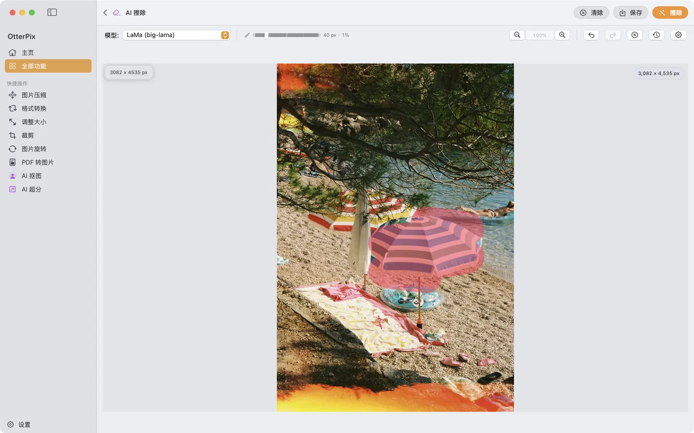

[English](../../en/ai/ai-eraser.md) · **简体中文** · [繁體中文](../../zh-Hant/ai/ai-eraser.md) · [Deutsch](../../de/ai/ai-eraser.md)

---

# AI 擦除

**AI 擦除**——App Store 商品页上称“AI 物体擦除”——从照片里移除不想要的东西：在游客、电线、垃圾桶上涂一笔，涂过的区域会用相匹配的背景补上。工作流天生就是迭代式的：擦除、检查、补涂、再擦除。

## 一览

| | |
|---|---|
| **可用性** | Pro——免费版每天 1 次免费使用（按照片计——同一张照片反复迭代仍是免费的这一次） |
| **运行方式** | 设备端；一次性下载模型（约 200 MB）后离线运行 |
| **输入** | 单张图片 + 你涂的蒙版 |
| **输出** | 涂抹区域已被填充的照片 |
| **流水线步骤** | 无——擦除需要对每张照片手工涂抹 |

所有处理都在你的 Mac 上完成，图片不会被上传——App 只在你主动下载 AI 模型和 App Store 购买验证时联网。

## 如何擦除物体

工具自带的提示就是完整流程：“在要擦除的部分上涂抹，然后点击擦除(或按 Cmd-Return)。”

1. 打开 OtterPix，点击 **AI 擦除**。首次使用时应用会下载一次擦除模型（约 200 MB）——之后离线工作。
2. 把照片拖进窗口，或点击浏览文件。
3. 选中**笔刷工具**（B），调好笔刷大小——电线用小笔刷，人用大笔刷。把要去掉的东西完整涂住，边缘再留一点余量。
4. 点击**擦除**（或按 ⌘⏎）。片刻之后，**结果**窗格里涂抹的区域就被相匹配的背景填上了。
5. 检查。如果还剩个影子、一只脚或一圈淡淡的轮廓，只把残留处涂上，再点一次**擦除**——每一遍都在上一遍的基础上继续。
6. 对下一个物体重复，直到画面干净。**撤销**（⌘Z）收回失手的一遍；**还原为原图**从头再来。
7. 按**保存**（⌘S），选择清理后照片的保存位置。原文件保持不变。

## 选项

- **笔刷工具**（B） — 拖动涂抹蒙版；数值以图片像素为单位显示笔刷大小。
- **抓手工具**（H） — 放大状态下拖动平移画布；**适合窗口**（⌘0）恢复视图。
- **清除蒙版** — 抹掉当前涂抹，重新开始选取。
- **撤销**（⌘Z） / **重做**（⇧⌘Z） — 以每次擦除为单位。
- **还原为原图** — 回到未处理的照片。

## 提示与限制

- **迭代不额外计费。** 每天的免费次数按“载入的照片”计，不按点击计——同一张照片上涂抹、擦除、补涂、再擦除，都在同一次免费里。
- **把影子也涂上。** 人去掉了影子还在，是最经典的穿帮——人和影子一起涂。
- **均匀背景上的独立物体擦得最干净。** 路面、草地、天空、墙面：填充效果利落。物体背后缺少确定细节的地方——文字、人脸、密集图案——填充是“编”出来的，可能发虚或扭曲。分几次小范围处理。
- **余量很重要。** 沿物体边缘多涂一点，填充才有过渡空间；蒙版贴得太紧会留下光晕。

## 疑难解答

| 现象 | 原因 | 解决办法 |
|---|---|---|
| “请先在要移除的区域涂抹，再点击擦除。” | 蒙版是空的 | 先把物体涂上，再点**擦除** |
| 模型未下载的错误提示 | 擦除模型还不在磁盘上 | 用工具齿轮菜单里的下载入口，或**设置 → AI** |
| “本功能今日免费次数已用完” | “每个 AI 功能每天各有 1 次免费，本功能将在午夜恢复。” | 等待重置或升级。当天的照片仍可继续免费迭代 |
| 原物体处留下鬼影或涂抹痕 | 填充可参考的上下文太少，或蒙版涂得太紧 | **撤销**，加大余量重涂，分几次小范围擦除 |
| 还是解决不了 | — | [提交 Issue](https://github.com/nanguoyu/OtterPix-app/issues/new/choose) |

## 相关页面

- [AI 隐私模糊](ai-anonymize.md) — 把人隐去，而不是移除
- [AI 抠图](ai-cutout.md) — 保留主体，去掉背景
- [常见问题 — 免费与 Pro](../faq.md#免费与-pro)

---

**反馈** — Bug 请到 [Issues](https://github.com/nanguoyu/OtterPix-app/issues/new/choose) 报告；使用问题请到 [Discussions](https://github.com/nanguoyu/OtterPix-app/discussions) 提问。
