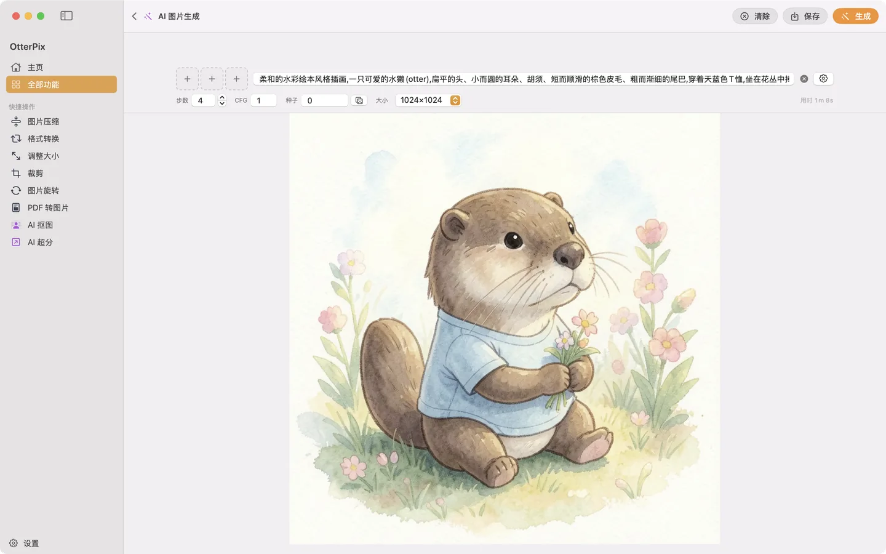

[English](../../en/ai/ai-generation.md) | **简体中文** | [繁體中文](../../zh-Hant/ai/ai-generation.md) | [Deutsch](../../de/ai/ai-generation.md)

---

# AI 图片生成

**AI 图片生成**从一段文字提示生成图片，全程在你的 Mac 上完成。可选的参考图能把结果引向你手里已有的某种风格、主体或构图。

## 一览

| | |
|---|---|
| **可用性** | 免费 |
| **运行方式** | 设备端；下载模型后离线运行——它是应用里最大的下载，总计数 GB |
| **输入** | 一段文字提示，可选最多 3 张参考图 |
| **输出** | 按你选定尺寸生成的图片 |
| **流水线步骤** | 无 |
| **建议配置** | 16 GB 及以上内存 |

图像处理和 AI 推理都在你的 Mac 上完成。图片、生成提示词、OCR 内容和使用情况遥测数据绝不会上传。OtterPix 可能会为 StoreKit、启动时仅用于模型下载路由的 Cloudflare 边缘国家代码查询、首次使用模型商店时刷新只包含下载 URL 的小型清单，以及你主动发起的模型下载而联网。

**地区说明：** 通过中国大陆区 Mac App Store 分发的 OtterPix 版本不提供 AI 图片生成与 AI 文字识别。其余全部功能（包括五项 Pro AI 功能）在 OtterPix 上架的所有地区均可使用。详见[服务条款](https://otterpix.app/zh/terms)。

## 如何生成图片

1. 打开 OtterPix，点击 **AI 图片生成**。
2. 输入提示词——输入框请你“描述你想要的图像”。具体胜过含糊：主体、风格、光线、场景。“试试这些”一栏提供现成的起点。
3. 可选：添加**参考图**——“拖入或点击添加参考图（最多 3 张，可选）”。有参考图时，提示词描述的是如何变换或融合它们。
4. 在操作区选择**模型精度**和**文本编码器精度**；旁边会显示所选配置的真实占用大小。
5. 从预设里选输出尺寸，或选**自定义尺寸**并输入**宽度**和**高度**——锁链图标会在你输入时锁定纵横比。
6. 首次使用时点击**下载并生成**（配置就绪后显示**生成**）。同一个下载及控制会同步显示在**设置 → AI**，两处都能暂停、继续或取消；下载完成后会自动开始生成。
7. 按**保存**（⌘S）留下结果。

## 选项

### 参考图

最多三张。一张参考图引导风格或主体；多张可以融合（“描述如何融合这些图”）。槽位就地管理——鼠标悬停在已填的槽位上即可移除。

### 尺寸

预设尺寸覆盖常见场景；**自定义尺寸**接受精确像素值，附带纵横比锁定开关。

### 模型与精度

生成模型为 Flux 2 Klein 4B。Transformer 与文本编码器精度属于当前任务，直接放在操作区，并显示所选配置的磁盘占用。齿轮面板只保留高级 VAE 选项和**管理模型…**入口；删除与跨功能磁盘维护统一放在**设置 → AI**。

### 高级参数

想精细控制时，工具开放了几项生成参数，界面里配有直白的解释——细化步数（步数越多质量越高、速度越慢）、提示词的遵循程度，以及种子（相同的种子、提示词和参数会复现同一张图；骰子按钮随机换一个）。

## 提示与限制

- **写具体。** “灯塔的水彩插画，黄昏，暖光，柔和纸纹”胜过“好看的灯塔图”。
- **以分钟计，不是秒。** 生成是应用里最重的负载，耗时随 Mac 芯片和输出尺寸变化。16 GB 及以上内存的建议正是针对这项负载。
- **这个下载是大头。** 所选组件总计数 GB。暂停、取消、断网或重启应用后都会保留部分数据；不完整目录只显示为“继续”，绝不会冒充已安装。删除统一在**设置 → AI**。
- **种子让结果可复现。** 固定种子迭代同一个提示词；随机种子用来探索。

## 疑难解答

| 现象 | 原因 | 解决办法 |
|---|---|---|
| 应用里根本没有这个功能 | 应用下载自中国大陆区 Mac App Store | 见[常见问题](../faq.md#地区可用性与支持)——这是商店可用性问题，不是 Bug |
| 设置过程中断 | 所选组件尚未完整下载 | 在生成页或**设置 → AI**继续；已保留的数据不会从头下载 |
| 生成期间 Mac 变卡 | 生成天然是计算和内存双密集的负载 | 等运行结束或点**取消**；关掉吃内存的应用；建议 16 GB 及以上内存 |
| 还是解决不了 | — | [提交 Issue](https://github.com/nanguoyu/OtterPix-app/issues/new/choose) |

## 相关页面

- [AI 超分](ai-upscale.md) — 把生成的图片放大 4 倍
- [常见问题 — 地区可用性与支持](../faq.md#地区可用性与支持)
- [快速上手](../getting-started.md) — 系统要求

---

**反馈** — Bug 请到 [Issues](https://github.com/nanguoyu/OtterPix-app/issues/new/choose) 报告；使用问题请到 [Discussions](https://github.com/nanguoyu/OtterPix-app/discussions) 提问。
