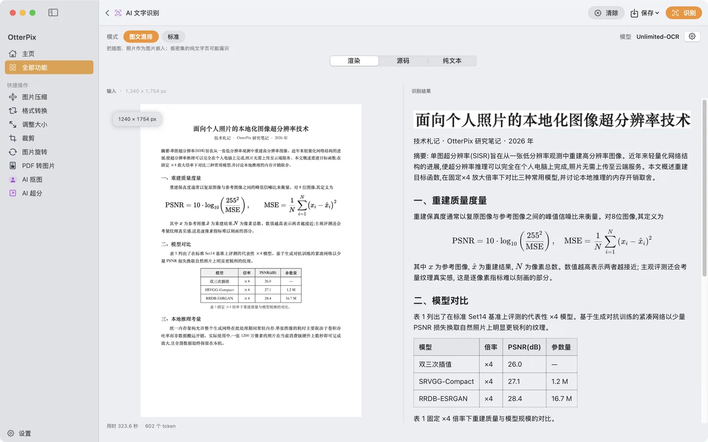

[English](../../en/ai/ai-ocr.md) | **简体中文** | [繁體中文](../../zh-Hant/ai/ai-ocr.md) | [Deutsch](../../de/ai/ai-ocr.md)

---

# AI 文字识别

**AI 文字识别**把文档变成可用的文字。用应用卡片上的话说：“论文、扫描件、PDF → 带表格公式的 Markdown，全程本地。”喂给它一页扫描件、一张文档照片或一份多页 PDF，拿回结构化的 Markdown——标题、表格、公式和插图都保留。

## 一览

| | |
|---|---|
| **可用性** | 免费 |
| **运行方式** | 设备端；一次性下载模型后离线运行 |
| **输入** | 文档图片（扫描件、拍摄的页面）或 PDF |
| **输出** | Markdown 或纯文本——可复制、可导出 |
| **流水线步骤** | 无 |

图像处理和 AI 推理都在你的 Mac 上完成。图片、生成提示词、OCR 内容和使用情况遥测数据绝不会上传。OtterPix 可能会为 StoreKit、启动时仅用于模型下载路由的 Cloudflare 边缘国家代码查询、首次使用模型商店时刷新只包含下载 URL 的小型清单，以及你主动发起的模型下载而联网。

**地区说明：** 通过中国大陆区 Mac App Store 分发的 OtterPix 版本不提供 AI 图片生成与 AI 文字识别。其余全部功能（包括五项 Pro AI 功能）在 OtterPix 上架的所有地区均可使用。详见[服务条款](https://otterpix.app/zh/terms)。

## 如何识别文档

1. 打开 OtterPix，点击 **AI 文字识别**。空状态一句话说明一切：“拖入文档或 PDF 开始。”
2. 拖入文档图片或 PDF。PDF 会显示页数（“12 页 PDF”）和**页码范围**控件——识别全部页面或某个范围。
3. 选择**模式**（见下方选项）。
4. 点击**识别**。进度按页显示（“正在解析第 3 / 12 页”），长文档可随时**暂停**和**继续**。
5. 在三种视图里查看结果：**渲染**（排好版的文档，插图在内）、**源码**（原始 Markdown）和**纯文本**。
6. 把文字带走：**复制全部**、**导出为 Markdown (.md)** 或**导出为纯文本 (.txt)**。从渲染视图复制，粘贴出来的是包含插图的完整独立文档。

## 选项

### 模式

| 模式 | 适合 |
|---|---|
| **图文混排** | 默认。把插图、照片作为图片嵌入，适合论文、报告和图文页面；极密集的纯文字页可能漏识 |
| **标准** | 适合密集页面的文字、表格和公式，是试卷与表单的备用模式；复杂插图会略过 |

识别模式和输出视图是两回事。**渲染**、**源码**、**纯文本**只改变已完成
结果的显示/导出方式，切换视图不会重新运行模型。

### PDF 页面选择

**页码范围**控件支持全部页面或起止范围——从长 PDF 里只抽一章时很有用。

### 设置

工具设置里有**模型**一行（应用的说明：“本地文档识别。下载一次，完全在你的 Mac 上运行。”）和**最大 token 数**——它限制每页最多生成多少文字，遇到又长又密的文档就调高。

## 提示与限制

- **为文档而生。** 论文、扫描件、文字截图、PDF。它不是通用的拍照识字工具——路牌、表情包和商品图超出设计范围，输出可能不可靠。
- **表格和公式以 Markdown 输出**，可直接粘进笔记应用、wiki 或编辑器。
- **应用会自查。** 如果某些页面识别得可疑地空，会出现警告条：“部分页面几乎没识别出内容——可能更适合另一种模式。”——一键即可用另一种模式重跑。
- **超长页面可能触到输出上限。** 看到“输出已达到 … token 上限”的提示时，在工具设置里调高**最大 token 数**再重跑。

## 疑难解答

| 现象 | 原因 | 解决办法 |
|---|---|---|
| “OCR 模型尚未下载。” | 首次使用——识别模型还不在磁盘上 | 点错误提示里的**打开设置**下载（也在**设置 → AI** 里） |
| “部分页面几乎没识别出内容——可能更适合另一种模式。” | 所选模式不适应那些页面的版式 | 用警告条上的按钮以另一种模式重跑同一文档 |
| 输出在文档中途截断 | 达到了每页 token 上限 | 在工具设置里调高**最大 token 数**，再**识别**一次 |
| 照片识别出乱七八糟的内容 | 输入不是文档——是场景照片或表情包 | 换成文档类输入；这才是工具的设计用途 |
| 还是解决不了 | — | [提交 Issue](https://github.com/nanguoyu/OtterPix-app/issues/new/choose) |

## 相关页面

- [PDF 转图片](../tools/pdf-and-qr.md) — 把 PDF 页面渲染成图片，而不是提取文字
- [常见问题 — 地区可用性与支持](../faq.md#地区可用性与支持)
- [快速上手](../getting-started.md)

---

**反馈** — Bug 请到 [Issues](https://github.com/nanguoyu/OtterPix-app/issues/new/choose) 报告；使用问题请到 [Discussions](https://github.com/nanguoyu/OtterPix-app/discussions) 提问。
