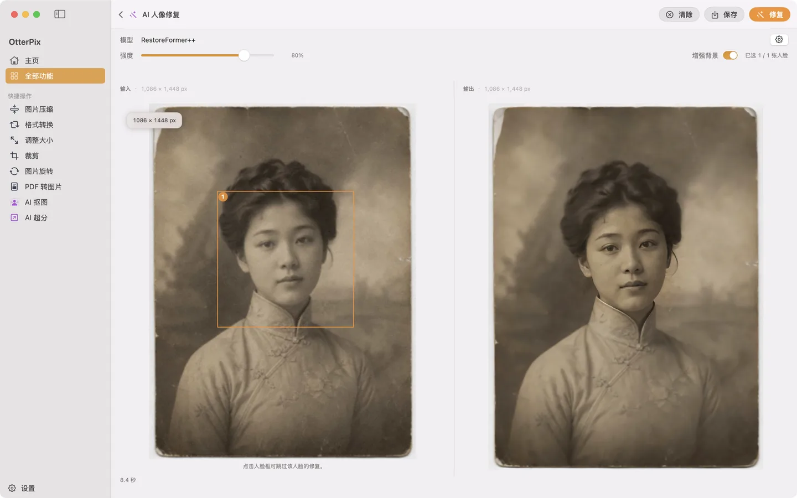

[English](../../en/ai/ai-restore.md) · **简体中文** · [繁體中文](../../zh-Hant/ai/ai-restore.md) · [Deutsch](../../de/ai/ai-restore.md)

---

# AI 人像修复

**AI 人像修复**——App Store 商品页上称“AI 人脸修复”——让老照片里模糊、低质量的人脸重新变清晰。它有意只处理人脸：检测框之外的一切保持扫描原样，所以你始终清楚哪里被改动了。

## 一览

| | |
|---|---|
| **可用性** | Pro——免费版每天 1 次免费使用 |
| **运行方式** | 设备端；一次性下载模型（约 280 MB）后离线运行 |
| **输入** | 一张有清晰可见人脸的照片 |
| **输出** | 面部特征已锐化的照片；其余部分保持不变 |
| **流水线步骤** | 无——选脸和调强度需要交互 |

图像处理和 AI 推理都在你的 Mac 上完成。图片、生成提示词、OCR 内容和使用情况遥测数据绝不会上传。OtterPix 可能会为 StoreKit、启动时仅用于模型下载路由的 Cloudflare 边缘国家代码查询、首次使用模型商店时刷新只包含下载 URL 的小型清单，以及你主动发起的模型下载而联网。

## 它做什么——又刻意不做什么

应用在工具设置里把边界写得很直白：“仅锐化面部特征。不修复划痕、霉斑、褪色或背景。下载后可离线运行。”如果照片的问题是物理损伤而不是人脸发虚，这不是对的工具——但对最经典的场景（一张扫描件里祖辈的面孔已经快看不清了），它正是对的那一个。

## 如何修复人脸

1. 打开 OtterPix，在 AI 区点击 **AI 人像修复**。
2. 把扫描的照片拖到拖放区，或点击浏览文件。
3. OtterPix 自动检测每一张人脸并用编号方框标出——方框就是 AI 将要处理的区域。顶部计数（“已选 3 / 3 张人脸”）；点某个方框可以把那张脸排除在外（“点击人脸框可跳过该人脸的修复。”），再点一下重新纳入。
4. 点击**修复**。首次使用时 OtterPix 下载一次人脸修复模型（约 280 MB）；此后每次运行都离线。
5. 结果出现后，拖动**强度**滑杆直到融合效果合适。预览即时更新——无需重新运行修复。
6. 按**保存**（⌘S），选择修复副本的保存位置。原始扫描永远不会被修改。

## 选项

### 强度

修复后的人脸叠加在原脸上的比重。拉满最锐利；调低保留更多原片气质。调整是即时的——模型不会重跑。

### 增强背景

默认关闭。开启后，会在人脸修复之前先对整张图片做一遍整体增强——适合发虚或低分辨率的原件。有两点要知道，来自应用自己的说明：对有物理损伤（划痕、霉斑）的照片，它可能让损伤*更*明显而不是减轻；它还需要一个独立的小模型（约 5 MB），可在本工具的设置里下载。

## 提示与限制

- **合影正是设计场景。** 所有人脸一次运行全部修复，各有各的编号方框——想保持原样的脸点掉即可。
- **扫描分辨率越高越好。** 可用的细节越多，修复结果越自然。手里只有小图时，先修复，再用 [AI 超分](ai-upscale.md)放大。
- **头发、衣物和背景保持扫描原样** ——编号方框标出的是被处理的区域；框外一切不变（除非开了**增强背景**）。
- **同一张照片迭代免费。** 调**强度**、勾选人脸、重跑同一张照片，都在当天同一次免费使用之内。

## 疑难解答

| 现象 | 原因 | 解决办法 |
|---|---|---|
| “在该图片中未检测到人脸。请换一张人脸清晰可见的照片再试。” | 侧脸、墨镜、严重遮挡或人脸太小都会让检测失败 | 换一张人脸清晰、大致朝前的照片；脸太小就先裁剪放大 |
| 模型未下载的错误提示 | 人脸模型（约 280 MB）——或开启**增强背景**后它那个独立的约 5 MB 模型——不在磁盘上 | 点错误提示里的**打开设置**；两个模型在本工具的设置面板里都有下载按钮 |
| “本功能今日免费次数已用完” | “每个 AI 功能每天各有 1 次免费，本功能将在午夜恢复。” | 等待重置或升级。当天的照片仍可继续免费调整 |
| 开了增强背景后划痕更扎眼了 | 整体增强把物理损伤也一起锐化了 | 关掉**增强背景**——应用的说明警告的正是这一点 |
| 修出来的脸太“光滑” | 原件质量很低时拉满强度所致 | 调低**强度**滑杆——即时重新合成 |
| 还是解决不了 | — | [提交 Issue](https://github.com/nanguoyu/OtterPix-app/issues/new/choose) |

## 相关页面

- [AI 超分](ai-upscale.md) — 放大修复后的扫描件
- [AI 擦除](ai-eraser.md) — 移除画面其他位置的灰尘斑点或杂物
- [常见问题 — AI 模型](../faq.md#ai-模型)

---

**反馈** — Bug 请到 [Issues](https://github.com/nanguoyu/OtterPix-app/issues/new/choose) 报告；使用问题请到 [Discussions](https://github.com/nanguoyu/OtterPix-app/discussions) 提问。
