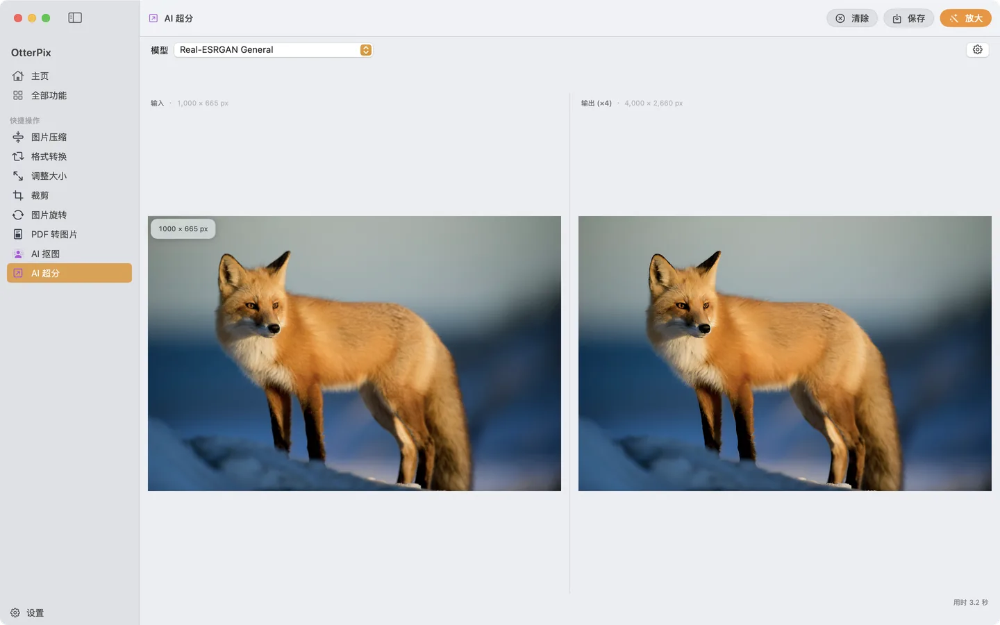

[English](../../en/ai/ai-upscale.md) | **简体中文** | [繁體中文](../../zh-Hant/ai/ai-upscale.md) | [Deutsch](../../de/ai/ai-upscale.md)

---

# AI 超分

**AI 超分**——App Store 商品页上称“AI 高清放大”——把图片放大到原始宽高的 4 倍（像素数量的 16 倍），放大的同时重建细节，而不是简单拉伸像素。

## 一览

| | |
|---|---|
| **可用性** | Pro——免费版每天 1 次免费使用 |
| **运行方式** | 设备端；一次性下载模型后离线运行（每个模型 2.5–67 MB） |
| **输入** | 单张图片 |
| **输出** | 宽高各 4 倍的图片 |
| **流水线步骤** | 有（Pro）——见[流水线](../pipeline.md) |

图像处理和 AI 推理都在你的 Mac 上完成。图片、生成提示词、OCR 内容和使用情况遥测数据绝不会上传。OtterPix 可能会为 StoreKit、启动时仅用于模型下载路由的 Cloudflare 边缘国家代码查询、首次使用模型商店时刷新只包含下载 URL 的小型清单，以及你主动发起的模型下载而联网。

## 如何放大

1. 打开 OtterPix，点击 **AI 超分**。
2. 把照片拖到拖放区，或点击选择文件。
3. 在**模型**菜单里选一种模式。首次使用时 OtterPix 会下载该模式的文件——都很小，2.5 MB 到 67 MB 之间——此后离线运行。
4. 点击**放大**。结果出现在**输出 (×4)** 窗格里，并显示本次运行用时。
5. 对比两个窗格——**输入**和**输出**上方的像素尺寸角标把提升写得明明白白：输入 1,000 × 665 px，输出 4,000 × 2,660 px。
6. 按**保存**（⌘S），选择放大副本的保存位置。原图保持不变。

## 选项

### 模型

四种模式，各自是一个小体积下载。菜单里的描述就是应用原文：

| 模式 | 应用原文 |
|---|---|
| 通用照片 | “5 MB，较快，适合普通照片” |
| 最高质量 | “67 MB，最高质量，下载较大” |
| 动漫 / 插画 | “18 MB，适配二次元 / 插画静图” |
| 动漫视频帧 | “2.5 MB，体积最小，适合动漫视频帧” |

日常照片从通用模式开始；打印输出换最高质量模式；线稿、平涂色块和动画导出的帧用动漫模式。同一张照片换个模式重新运行，仍算当天同一次免费使用。

## 提示与限制

- **角标就是凭据。** 窗格上方的像素尺寸角标给出精确的输入输出尺寸——算打印尺寸时很有用（按约 300 DPI 计，一张 1,000 px 宽的图放大 4 倍后，可打印宽度从约 3.3 英寸提高到约 13 英寸）。
- **大图耗时更长。** 大尺寸输入会分块处理，进度读数按块计数；一切仍在本地运行。
- **照片内容效果最好；小字不行。** 超分最擅长毛发、皮肤、织物、风景。太小或本已无法辨认的文字不会因此变得可读。
- **透明度会保留：** 透明图片放大后仍是透明的，透明通道会随新尺寸一起放大。

## 疑难解答

| 现象 | 原因 | 解决办法 |
|---|---|---|
| “模型还未下载。请打开 AI 设置并点击下载。” | 所选模式的模型不在磁盘上 | 点错误提示里的**打开设置**下载（也可经**设置 → AI** 到达） |
| “本功能今日免费次数已用完” | “每个 AI 功能每天各有 1 次免费，本功能将在午夜恢复。” | 等待重置，或升级 Pro。当天已运行过的那张照片仍可继续免费调整 |
| 结果被抹得太平滑 | 模式不匹配（比如用照片模式处理线稿） | 换一种**模型**模式——同一张照片，同一次免费 |
| 还是解决不了 | — | [提交 Issue](https://github.com/nanguoyu/OtterPix-app/issues/new/choose) |

## 相关页面

- [AI 人像修复](ai-restore.md) — 先修脸，再放大
- [流水线](../pipeline.md) — AI 超分作为批量步骤（Pro）
- [常见问题 — 免费与 Pro](../faq.md#免费与-pro)

---

**反馈** — Bug 请到 [Issues](https://github.com/nanguoyu/OtterPix-app/issues/new/choose) 报告；使用问题请到 [Discussions](https://github.com/nanguoyu/OtterPix-app/discussions) 提问。
