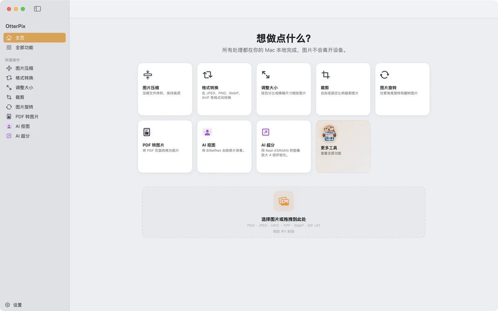

[English](../en/getting-started.md) · **简体中文** · [繁體中文](../zh-Hant/getting-started.md) · [Deutsch](../de/getting-started.md)

---

# 快速上手

从下载安装到完成第一次编辑，这一页就够了。

## 我的 Mac 能运行吗？

- **macOS 14（Sonoma）或更高版本。**
- **Apple 芯片（M1 或更新）。** 不支持 Intel Mac——AI 功能专为 Apple 芯片的统一内存架构而构建。
- **如果使用 AI 功能，需要为模型预留磁盘空间。** AI 功能在首次使用时下载各自的模型——最小的超分模型只有几 MB，图片生成模型则有数 GB。基础工具完全不需要下载。
- **使用 AI 图片生成建议 16 GB 及以上内存。** 其余功能在任何 Apple 芯片 Mac 上都能流畅运行。

## 安装

[在 Mac App Store 下载 OtterPix](https://apps.apple.com/app/id6772468615)。下载免费，十个基础工具加 AI 文字识别、AI 图片生成都免费使用——无需账号，无需注册。

## 界面导览

**侧边栏。** 固定导航入口是**主页**、**全部功能**和**自动化**；下方是可自定义的**快捷操作**，**设置**固定在侧边栏底部。

- **主页**以“想做点什么？”开场——常用工具的任务卡片加一个拖放区。
- **全部功能**是完整的工具库：每个工具一张卡片，顶部**搜索**框可以筛选，底部停靠着**处理流水线**。当某个 Pro AI 工具当天的免费次数还没用时，它的卡片上会显示琥珀色的**今日免费**角标。
- **自动化**是 Pro 文件夹监控工作区：授权一个输入文件夹并选择已保存的流水线预设，新到文件即可自动处理。
- **快捷操作**是你自己定义的快捷入口。可以在**设置**里挑选要显示哪些功能——用应用自己的话说：“选择哪些功能作为快捷操作显示在侧边栏和主页。”
- **设置**包含四个标签页：**通用**、**导出**、**AI**（模型下载与存储）和**关于**。

**拖放区。** 几乎每个工具都以同一种方式开始：“**选择图片或拖拽到此处**”——“或按 ⌘V 粘贴”。主页的拖放区列出了主要格式——PNG · JPEG · HEIC · TIFF · WebP · GIF +51——拖进来的图片会被送到对应的工具。

## 第一次编辑：压缩一张照片

1. 在**主页**点击**图片压缩**。
2. 把照片拖到拖放区（或按 ⌘V 粘贴）。
3. 选择一个**压缩预设**——**小体积**、**均衡**或**高质量**。预览上方的读数在保存前就告诉你结果：原大小 → 新大小，以及“原大小占比”的百分比。
4. 点击**保存**（⌘S），选择压缩副本的保存位置。原文件保持原样。

这就是整个应用的使用节奏：拖入、调整、保存。每个工具都是如此。

## AI 功能

AI 工具（超分、抠图、擦除、隐私模糊、人像修复、文字识别、图片生成）会在首次使用时下载所选模型组件，之后可离线工作。任务相关的模型与质量直接显示在各功能页；**设置 → AI** 同步显示可续传下载，并统一负责删除和磁盘管理。模型大小从最小超分模型的几 MB 到图片生成的数 GB 不等。

## 自动化

Pro 用户可以用**自动化**监控已授权的文件夹，在新文件到达时自动运行已保存的流水线预设。受支持的工具和预设也可通过快捷指令（App Intents）或 AppleScript 调用；无论从哪个入口使用，都遵循相同的 Pro 权益和地区可用性规则。

## 免费与 Pro

| | 你能得到 |
|---|---|
| **免费** | 全部十个基础工具、流水线、AI 文字识别、AI 图片生成——外加每个 Pro AI 工具每天 1 次免费使用 |
| **Pro** | 不限次数的 AI 超分、AI 抠图、AI 擦除、AI 隐私模糊、AI 人像修复，以及不限张数的含 AI 步骤的流水线批量处理 |

每天的免费次数按“载入的照片”计，而不是按点击次数计——同一张图片当天可以反复调整、反复运行，都算这一次。某个工具的免费次数用完后，它的卡片会显示解锁页，计数在午夜重置。

Pro 提供包月订阅、包年订阅和一次性买断三种方式。当前价格见 [Mac App Store](https://apps.apple.com/app/id6772468615)；订阅可随时在 [Apple 账户的订阅页面](https://apps.apple.com/account/subscriptions)管理或取消。

## 隐私

所有图像处理和 AI 推理都在你的 Mac 上完成。图片、生成提示词、OCR 内容和使用情况遥测数据绝不会上传。OtterPix 会为 StoreKit、启动时仅用于选择模型下载镜像的 Cloudflare 边缘国家代码查询、首次使用模型商店时刷新只包含下载 URL 的小型清单，以及你主动发起的模型下载而联网。详情见[隐私政策](https://otterpix.app/zh/privacy)。

## 获取帮助

- [常见问题](faq.md)一页汇总了高频问题的答案。
- 功能出问题了 → [提交 Issue](https://github.com/nanguoyu/OtterPix-app/issues/new/choose)。
- 不确定怎么操作 → [Discussions → Q&A](https://github.com/nanguoyu/OtterPix-app/discussions/categories/q-a)。

## 相关页面

- [格式转换与图片压缩](tools/convert-and-compress.md)
- [流水线](pipeline.md)
- [常见问题](faq.md)

---

**反馈** — Bug 请到 [Issues](https://github.com/nanguoyu/OtterPix-app/issues/new/choose) 报告；使用问题请到 [Discussions](https://github.com/nanguoyu/OtterPix-app/discussions) 提问。
