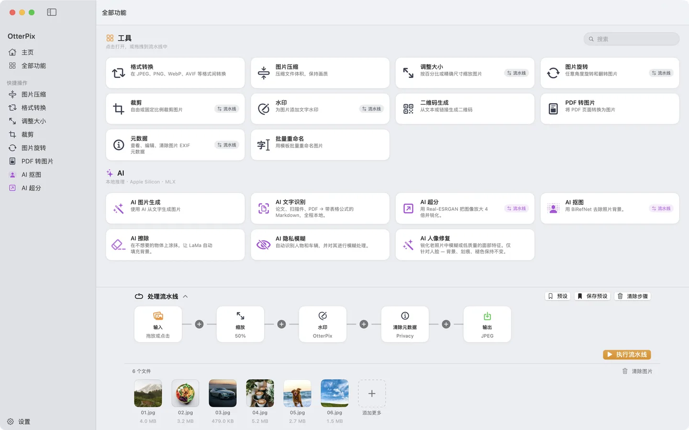

[English](../en/pipeline.md) | **简体中文** | [繁體中文](../zh-Hant/pipeline.md) | [Deutsch](../de/pipeline.md)

---

# 流水线

**处理流水线**把多个工具串成一条工作流，对一整批图片依次执行——一次运行就能给整个文件夹的照片缩放、加水印、清除元数据，再把这条链保存为预设，下次一键复用。

## 一览

| | |
|---|---|
| **可用性** | 免费。免费版：每条流水线限 1 个 Pro 步骤，且含 Pro 步骤时仅限 1 张图片 |
| **运行方式** | 在你的 Mac 上——离线运行，不上传任何内容 |
| **输入** | 任意数量的图片 |
| **输出** | 处理后的副本保存到你选择的位置；原文件保持原位 |
| **位置** | **全部功能**——流水线停靠在工具库底部 |

## 什么是流水线

流水线是一条从左到右的链：**输入**节点、若干处理步骤、一个**输出**节点。每个启用的步骤会按顺序作用于每张图片。**输出**节点——而不是某个步骤——决定整批图片的**输出格式**（PNG、JPEG、TIFF、BMP、HEIC、WebP、AVIF）和**质量**，所以格式转换与压缩天然是每次运行的一部分，不占用链上的位置。

## 可用步骤

| 步骤 | 说明 |
|---|---|
| **缩放** | 按百分比或精确尺寸——见[调整大小](tools/resize-crop-rotate.md) |
| **旋转** | 固定角度与翻转——见[图片旋转](tools/resize-crop-rotate.md) |
| **裁剪** | 按纵横比与对齐方式裁剪——见[裁剪](tools/resize-crop-rotate.md) |
| **水印** | 文字水印，可调字体、颜色、角度、不透明度、密度——见[水印](tools/watermark.md) |
| **清除元数据** | 去除 EXIF/GPS——见[元数据](tools/metadata.md) |
| **AI 超分** | Pro——见 [AI 超分](ai/ai-upscale.md) |
| **AI 抠图** | Pro——见 [AI 抠图](ai/ai-cutout.md) |

这就是全部步骤。AI 擦除、AI 隐私模糊、AI 人像修复、AI 文字识别和 AI 图片生成是交互式工具——它们需要你对每张图涂抹、点击或输入——所以不作为流水线步骤。输出格式与压缩质量在**输出**节点上设置，也不是步骤。

## 搭建流水线

1. 点击侧边栏的**全部功能**。**处理流水线**停靠在底部——点击它的标题栏展开。
2. 把图片拖到**输入**节点上（“拖放或点击”）。要处理整个文件夹，可以在访达里打开它、选中其中的图片再拖进来，或者把文件夹拖到菜单栏的 OtterPix 图标上（只取第一层的图片，最多 500 张）。每张图片都会出现在链条下方的缩略图条里，横条上会显示数量（“3 个步骤，6 张图片”）。
3. 添加步骤：点击节点之间的 **+**，或者把工具库里任何带**流水线**角标的卡片直接向下拖进链条。空流水线自己也这样提示：“从上方画廊向下拖拽工具，或点击节点间的 + 按钮”。
4. 点击某个步骤设置它的参数——选项与独立工具完全一致。步骤可以调整顺序（**左移** / **右移**）、临时停用（**禁用**）或移除（**删除**）。
5. 在**输出**节点上为整批图片选择**输出格式**和**质量**。
6. 点击**执行流水线**。运行中进度显示“第 3/6 张…”，结束时显示“完成：6 / 6 成功”。处理后的副本保存到输出位置；原文件永远不会被覆盖。

## 预设

点击**保存预设**，给这条链起一个**预设名称**，它就存进了**预设**列表。下周再用：**预设** → **加载**，把新图片拖到输入节点，**执行流水线**。预设就是把五步的例行操作变成一次点击。

## 批量行为

图片数量没有固定上限——流水线就是为整个文件夹设计的。一切都在本地运行，批量越大耗时按比例越长。如果某一张图片处理失败，运行会继续，结束后的汇总会告诉你成功了多少张。

## 透明度提示

**AI 抠图**会产生透明背景，而丢失透明度的路径应用会直接警告——步骤自己的原话是：“输出带透明通道。后续步骤必须保留 alpha(PNG/WebP/AVIF，不能是 JPEG；不能接 AI 超分)。”所以：把**输出格式**设为 PNG（或 WebP/AVIF），并把 AI 抠图步骤放在链条靠后的位置。

## 免费版限制

- 应用内的提示是：“免费版:含 Pro 步骤的管线仅限 1 张图。升级可批量处理。”免费版的流水线最多包含**一个** Pro 步骤（**AI 超分**或 **AI 抠图**），并且只要链上有 Pro 步骤，一次只能处理 1 张图片。
- 运行这个 Pro 步骤消耗的正是该工具当天的免费次数，与独立工具共用。
- 免费版加载已保存的预设时，会跳过其中的 Pro 步骤——想把当天的免费次数用在流水线上，请手动添加该 Pro 步骤。
- 订阅用户没有步骤和批量数量限制。

## 疑难解答

| 现象 | 原因 | 解决办法 |
|---|---|---|
| AI 步骤提示模型尚未下载 | 该步骤的模型还没有下载 | 打开对应的工具（AI 超分 / AI 抠图）在里面下载，或前往**设置 → AI** |
| “免费版:含 Pro 步骤的管线仅限 1 张图。升级可批量处理。” | 链上有 Pro 步骤时的免费版数量上限 | 一次处理一张、移除 Pro 步骤，或升级 |
| 水印被裁掉或变模糊 | 水印步骤排在裁剪或缩放步骤之前 | 把水印移到裁剪/缩放之后——这种情况应用会直接给出警告 |
| 结果丢失了透明度 | JPEG 输出、或 AI 抠图之后接了 AI 超分，都会把透明度压平 | 输出选 PNG/WebP/AVIF，并让 AI 抠图保持在链条靠后的位置 |
| 还是解决不了 | — | [提交 Issue](https://github.com/nanguoyu/OtterPix-app/issues/new/choose) |

## 相关页面

- [AI 超分](ai/ai-upscale.md)
- [AI 抠图](ai/ai-cutout.md)
- [快速上手](getting-started.md)

---

**反馈** — Bug 请到 [Issues](https://github.com/nanguoyu/OtterPix-app/issues/new/choose) 报告；使用问题请到 [Discussions](https://github.com/nanguoyu/OtterPix-app/discussions) 提问。
