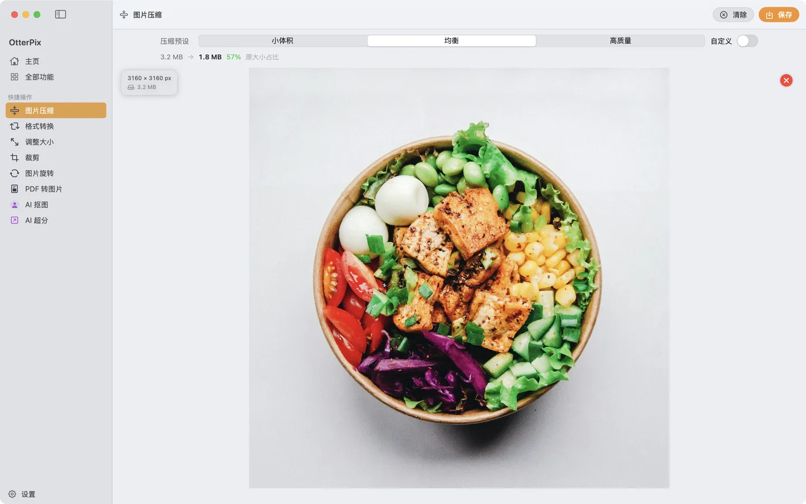
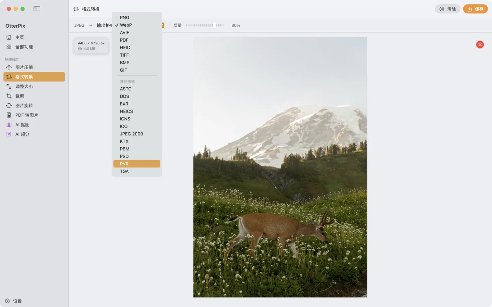

[English](../../en/tools/convert-and-compress.md) | **简体中文** | [繁體中文](../../zh-Hant/tools/convert-and-compress.md) | [Deutsch](../../de/tools/convert-and-compress.md)

---

# 格式转换与图片压缩

OtterPix 使用频率最高的两个工具，放在一页讲，因为它们解决的是同一个日常问题的两面：**格式转换**改变文件“是什么”（HEIC → JPEG、PNG → WebP），**图片压缩**改变它占多大空间。两者都免费、都支持批量，也都不会动你的原文件。

## 一览

| | |
|---|---|
| **可用性** | 免费 |
| **运行方式** | 在你的 Mac 上——离线运行，不上传任何内容 |
| **输入** | 单张图片或整批（PNG、JPEG、HEIC、TIFF、WebP、GIF 等） |
| **输出** | 转换/压缩后的副本，保存到你选择的位置 |
| **流水线** | 格式与质量在流水线的**输出**节点上设置——见[流水线](../pipeline.md) |

## HEIC 转 JPEG

最经典的场景：iPhone 拍出的 `.heic` 照片，Windows 电脑、上传表单或冲印服务不认。

1. 打开 OtterPix，点击**格式转换**。
2. 把 HEIC 照片拖到拖放区——一张或一整批都行。也可以点击浏览文件，或按 ⌘V 粘贴。
3. 选择 **JPEG** 作为输出格式。选择器顶部直接列出 JPEG、PNG、WebP、AVIF、HEIC、TIFF、BMP 这些常用格式；**其他格式**区是你的 Mac 能写出的更多小众格式。
4. 调整**质量**滑杆——它只在 JPEG 这类有损格式下出现——越高保留细节越多，越低文件越小。
5. 按**保存**（⌘S），选择转换后副本的保存位置。原来的 HEIC 文件保持原样。

### 格式

- **写出：** JPEG、PNG、WebP、AVIF、HEIC、TIFF、BMP——外加**其他格式**区里你的 Mac 能编码的一切。
- **读取：** 范围大得多——主页拖放区标着 PNG、JPEG、HEIC、TIFF、WebP、GIF +51，GIF 和绝大多数格式都能作为转换的*输入*。
- 导出的图片会保留原图的拍摄日期、相机信息、地点、版权和色彩配置文件，方向始终是正的。WebP 和 AVIF 不带元数据。
- 动图 GIF 或 PDF 这类多页文件只使用第一帧或第一页；要转换 PDF 的所有页面，请使用 [PDF 转图片](pdf-and-qr.md)。

## 压缩图片

1. 点击**图片压缩**，拖入一张照片——或一整批，此时底部会出现缩略图条。
2. 选一个**压缩预设**：**小体积**、**均衡**或**高质量**。三档从左到右按“文件最小 → 画质最好”排列，并且会对每张图片自适应，而不是套一个固定数值。
3. 想精确控制就切到**自定义**，拖动**质量**滑杆。
4. 看预览上方的读数：原大小 → 新大小，外加“原大小占比”百分比。如果一张图已经小到没什么可压的，OtterPix 会直说——“已是最优，保留原图”——而不是把它压得更大。
5. 点击**保存**（⌘S）——批量时用**全部处理**——然后选择压缩文件的保存位置。

### 选项

- **预设 vs 自定义** — 预设对每张图自适应；**自定义**则把同一个**质量**值应用到整批。
- **PNG 输入** — “PNG 使用无损压缩，无需调整质量参数”：PNG 会被无损重新打包，像素不变，所以没有质量滑杆。

## 提示与限制

- **质量与体积是实打实的取舍。** 对有损格式来说，质量参数决定丢弃多少精细细节。读数的意义就在于保存前先看到真实数字，而不是靠猜。
- **透明度：JPEG 会压平。** JPEG 没有透明通道——把透明 PNG 转成 JPEG 会填充背景。需要透明时请留在 PNG、WebP 或 AVIF。
- **同等画质下 WebP/AVIF 通常比 JPEG 更小。** WebP 兼容性广；AVIF 往往压得更小，但一些老应用打不开。
- **能小多少取决于图片本身。** 细节丰富的照片和简单图形压缩表现不同，已经优化过的文件可能几乎不再缩小——每张图的读数才是真相。
- **压缩不等于清除元数据。** 需要去掉 GPS 或 EXIF 时请用[元数据](metadata.md)工具——元数据的去除应该是一个明确的步骤，而不是副作用。
- **转换和压缩一起批量做：** [流水线](../pipeline.md)在**输出**节点上设置格式与质量，一次运行就能对整个文件夹完成缩放、加水印、转格式加压缩。

## 疑难解答

| 现象 | 原因 | 解决办法 |
|---|---|---|
| “质量设置对 … 格式无效” | 所选输出格式是无损格式 | 属正常现象——想调质量就选有损格式（JPEG/WebP/HEIC/AVIF） |
| “已是最优，保留原图” | 再压缩反而会让文件变大 | 无需处理——OtterPix 保留了更小的原图 |
| 结果比原文件还大 | 对已优化过的文件用了很高的质量设置 | 选**小体积**，或调低**自定义**质量 |
| 透明区域变成了白色/黑色 | 输出格式是 JPEG | 改为 PNG、WebP 或 AVIF |
| 还是解决不了 | — | [提交 Issue](https://github.com/nanguoyu/OtterPix-app/issues/new/choose) |

## 相关页面

- [流水线](../pipeline.md) — 通过输出节点批量转换 + 压缩
- [调整大小、裁剪与图片旋转](resize-crop-rotate.md)
- [常见问题](../faq.md)

---

**反馈** — Bug 请到 [Issues](https://github.com/nanguoyu/OtterPix-app/issues/new/choose) 报告；使用问题请到 [Discussions](https://github.com/nanguoyu/OtterPix-app/discussions) 提问。
