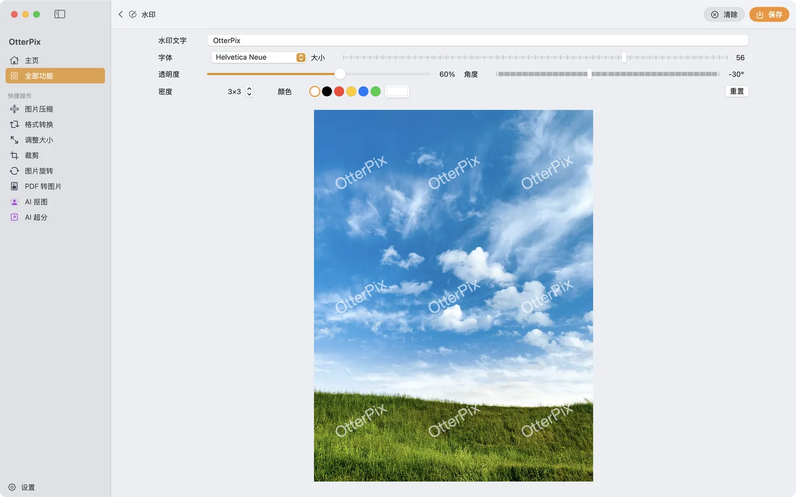

[English](../../en/tools/watermark.md) · **简体中文** · [繁體中文](../../zh-Hant/tools/watermark.md) · [Deutsch](../../de/tools/watermark.md)

---

# 水印

**水印**为一张照片或一整批照片加上文字——名字、品牌或版权信息——每一处调整都实时预览。

## 一览

| | |
|---|---|
| **可用性** | 免费 |
| **运行方式** | 在你的 Mac 上——离线运行，不上传任何内容 |
| **输入** | 单张图片或整批 |
| **输出** | 加水印后的副本，保存到你选择的位置；原文件不受影响 |
| **流水线步骤** | 有——见[流水线](../pipeline.md) |

## 如何添加文字水印

1. 打开 OtterPix，点击**水印**。
2. 把一张照片——或一整批——拖到拖放区。
3. 在**水印文字**栏输入名字、品牌或 ID。
4. 在**字体**菜单里挑一款字体。**常用**区一键可选、清晰可靠；**全部字体**列出你 Mac 上安装的每一款字体。
5. 用内联色块设置**颜色**——白色或黑色几乎适合任何照片——需要精确的品牌色就点旁边的取色器打开完整调色板。然后调整**大小**、**透明度**、**角度**和**密度**；预览实时更新。
6. 按**保存**（⌘S），选择加水印副本的保存位置。载入了一批时，**全部处理**会用同一套设置导出每张照片。

## 选项

### 文字与字体

**字体**菜单的**常用**区在拉丁字体之外也包含中日韩字体——只要你的 Mac 装了某种语言的字体，就能用它打水印。**全部字体**则展示所有已安装字体。

### 颜色

六个内联色块覆盖常见情况；旁边的取色器芯片可打开完整的 macOS 调色板，用于精确的品牌色。

### 位置与覆盖

- **透明度** — 水印显示得多明显。50–60% 左右能在亮部和暗部都保持文字可读，又不至于喧宾夺主。
- **角度** — 让文字倾斜；−30° 左右的斜排既清晰可读，又更难通过裁剪去除。
- **密度** — 在单个水印和平铺整幅画面的重复图案之间切换。

## 提示与限制

- **单个水印 vs 平铺：** 用途不同。单个水印低调，但容易被裁掉；斜向平铺覆盖整个画面，裁掉一个还有其余——防盗用更适合平铺。
- **对比度决定可读性。** 按每张照片微调透明度——画面繁杂的照片经得起更重的水印，干净的照片则相反，实时预览立刻给你答案。
- **在流水线里批量做。** 反复出现的工作流可以在[流水线](../pipeline.md)里加一个**水印**步骤，对整个文件夹一次跑完——缩放、转格式都在同一趟。注意把水印步骤放在裁剪和缩放*之后*；排在前面时应用会警告（“水印在缩放之前添加，缩放后可能变模糊”）。
- **仅支持文字水印。** 此工具渲染文字，不支持盖图片/Logo 文件。

## 疑难解答

| 现象 | 原因 | 解决办法 |
|---|---|---|
| 亮部照片上水印几乎看不见 | 透明度低 + 浅色文字压在浅色背景上 | 调高**透明度**，或把**颜色**换成黑色 |
| 批量里有些照片缺水印 | 单个水印会随每张图的尺寸和构图缩放 | 逐张检查预览，或改用平铺**密度**获得均匀覆盖 |
| 流水线里水印被裁掉或变模糊 | 水印步骤排在裁剪/缩放之前 | 把水印步骤移到链条末尾 |
| 还是解决不了 | — | [提交 Issue](https://github.com/nanguoyu/OtterPix-app/issues/new/choose) |

## 相关页面

- [流水线](../pipeline.md) — 一次给整个文件夹加水印
- [调整大小、裁剪与图片旋转](resize-crop-rotate.md)
- [元数据](metadata.md) — 分享前顺手清除 EXIF

---

**反馈** — Bug 请到 [Issues](https://github.com/nanguoyu/OtterPix-app/issues/new/choose) 报告；使用问题请到 [Discussions](https://github.com/nanguoyu/OtterPix-app/discussions) 提问。
