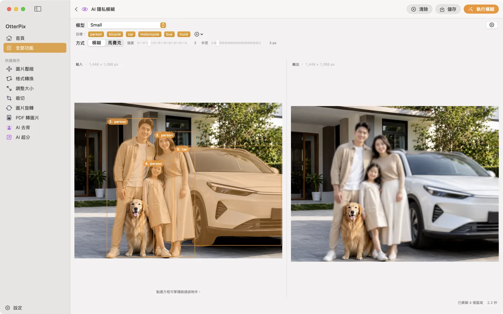

[English](../../en/ai/ai-anonymize.md) | [简体中文](../../zh-Hans/ai/ai-anonymize.md) | **繁體中文** | [Deutsch](../../de/ai/ai-anonymize.md)

---

# AI 隱私模糊

**AI 隱私模糊**——App Store 介紹頁上稱為「AI 打碼」——偵測照片中的人物與車輛，以五種樣式之一加以遮蓋，人臉與車牌一併蓋住，同時讓你精確決定誰、什麼可以保持原樣。

## 一覽

| | |
|---|---|
| **取得方式** | Pro——免費版每天 1 次免費使用 |
| **執行位置** | 裝置端；模型一次性下載（約 138 MB）後即離線執行 |
| **輸入** | 單張圖片 |
| **輸出** | 所選偵測對象已依所選樣式遮蓋的照片 |
| **流程步驟** | 無——決定誰保持清晰是互動操作 |

影像處理和 AI 推論都在你的 Mac 上完成。圖片、生成提示詞、OCR 內容和使用情況遙測資料絕不會上傳。OtterPix 可能會為 StoreKit、啟動時僅用於模型下載路由的 Cloudflare 邊緣國家代碼查詢、首次使用模型商店時更新只包含下載 URL 的小型清單，以及你主動發起的模型下載而連線。

## 如何為照片打碼

1. 開啟 OtterPix，在工具庫的 AI 區點選 **AI 隱私模糊**。
2. 把照片拖入**輸入**窗格。
3. 點選**執行模糊**。裝置端 AI 找出畫面中的人物與車輛，為每個偵測對象編號，並在**輸出**窗格顯示模糊後的結果。
4. 選一種**方式**：**模糊**、**馬賽克**、**六邊形馬賽克**、**純色**或**彩虹塊**。**半徑**會把每個偵測對象周圍的遮蓋範圍向外擴大；其餘控制項隨樣式而變（見下文）。
5. 點選輸入圖上任何一個編號方框，即可豁免那個人或那輛車——輸出立即重新合成，不需重跑模型。再點一次恢復模糊。就像浮層提示說的：「點選方框可單獨保持該物件不變。」
6. 點選**儲存**（⌘S），選擇打碼後的副本要存到哪裡。原始檔案保持原樣。

## 選項

### 方式

| 方式 | 效果 | 控制項 |
|---|---|---|
| **模糊** | 柔和、有攝影感 | **強度**、**半徑** |
| **馬賽克** | 經典方格像素化 | **強度**、**半徑** |
| **六邊形馬賽克** | 六邊形格子的像素化 | **強度**、**半徑** |
| **純色** | 以你選的顏色整塊填滿，預設完全不透明 | **顏色**、**不透明度**、**半徑** |
| **彩虹塊** | 在每個偵測對象上鋪一塊彩虹色格子 | **半徑** |

**模糊**讓畫面保持平靜；兩種馬賽克與**純色**明白宣告「這裡被蓋掉了」，適合車牌與任何文件類內容；**彩虹塊**則更活潑。切換樣式會沿用既有的偵測結果，目標選擇與豁免的方框都維持不變。無論選哪種，都要確保人或車牌真正無法辨認——調整是即時重新合成的，微調不花任何成本。

### 目標

**目標：**晶片列可整類切換——只模糊人、只模糊車，或反過來。**更多目標…**打開完整選單，分成八組：**人物**、**車輛**、**動物**、**戶外**、**隨身物品**、**運動器材**、**電子產品**、**室內**——需要時也能遮蓋筆電、背包或寵物。

### 逐一控制

類別晶片定規則，編號方框做例外。「除了我全部模糊」或「除了我的車全部模糊」只要幾秒：先全部偵測，再點自己的方框豁免。

## 秘訣與限制

- **人多的照片要點準。** 人物彼此重疊時，OtterPix 會把你的點選解析到游標實際落在的那個人身上——請點在人身上，不是旁邊。
- **遮蓋涵蓋整個偵測範圍。** 被遮蓋的人包含臉；被遮蓋的車包含車牌。
- **發布前再檢查一次。** 偵測是很強的第一遍，但不是定論——特別小、被裁到邊緣或嚴重遮擋的對象可能漏網。零星的漏網之魚交給搭檔工具 [AI 消除](ai-eraser.md)：塗掉、整個移除。
- **僅限靜態圖片。** AI 隱私模糊處理圖片，不處理影片。影片請先輸出要發布的影格，再逐張打碼。
- **儲存的圖片不帶身分資訊。** 儲存時會套用[後設資料](../tools/metadata.md)工具的**隱私**預設，地點、相機身分與創作者資訊都不會跟著圖片出去。
- **讀數確認覆蓋範圍**——「已遮蓋 3 個區域」明確告訴你有多少偵測對象被處理。

## 疑難排解

| 你看到的 | 原因 | 解法 |
|---|---|---|
| 「請至少選擇一個要模糊的類別。」 | 所有目標類別都被關掉了 | 在**目標：**列（或**更多目標…**）重新啟用一個類別 |
| 模型尚未下載的錯誤 | 偵測模型（約 138 MB）還不在磁碟上 | 點錯誤提示裡的**開啟設定**下載（也在**設定 → AI**） |
| 「本功能今日免費次數已用完」 | 「每個 AI 功能每天各有 1 次免費，本功能將在午夜恢復。」 | 等待重置，或升級。今天的照片仍可免費繼續調整 |
| 有人或車牌沒被偵測到 | 太小、被裁到邊緣，或被嚴重遮擋 | 先不要豁免任何對象再檢查一次；殘餘的用 [AI 消除](ai-eraser.md)收尾 |
| 還是卡住 | — | [開一個 Issue](https://github.com/nanguoyu/OtterPix-app/issues/new/choose) |

## 另請參閱

- [AI 消除](ai-eraser.md)——把對象整個移除，而不是模糊
- [後設資料](../tools/metadata.md)——分享前也把 GPS 清掉
- [常見問題——隱私與網路](../faq.md#隱私與網路)

---

**意見回饋**——錯誤請到 [Issues](https://github.com/nanguoyu/OtterPix-app/issues/new/choose) 回報；問題請到 [Discussions](https://github.com/nanguoyu/OtterPix-app/discussions) 發問。
