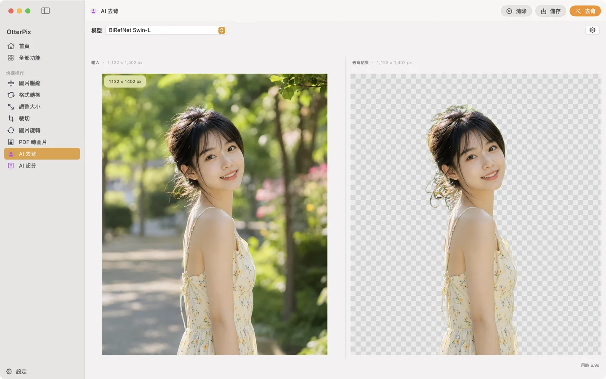

[English](../../en/ai/ai-cutout.md) | [简体中文](../../zh-Hans/ai/ai-cutout.md) | **繁體中文** | [Deutsch](../../de/ai/ai-cutout.md)

---

# AI 去背

**AI 去背**一鍵去除照片背景，把主體——連髮絲與細緻邊緣一起——保留在透明背景上，並維持來源圖片的完整解析度。

## 一覽

| | |
|---|---|
| **取得方式** | Pro——免費版每天 1 次免費使用 |
| **執行位置** | 裝置端；內建引擎不需下載，可下載的品質檔一次抓取（約 170 MB／約 795 MB）後離線執行 |
| **輸入** | 單張圖片 |
| **輸出** | 與來源同像素尺寸的透明 PNG |
| **流程步驟** | 有（Pro）——見[處理流程](../pipeline.md) |

影像處理和 AI 推論都在你的 Mac 上完成。圖片、生成提示詞、OCR 內容和使用情況遙測資料絕不會上傳。OtterPix 可能會為 StoreKit、啟動時僅用於模型下載路由的 Cloudflare 邊緣國家代碼查詢、首次使用模型商店時更新只包含下載 URL 的小型清單，以及你主動發起的模型下載而連線。

## 如何為主體去背

1. 開啟 OtterPix，點選 **AI 去背**——它在**全部功能**工具庫的 AI 區。
2. 把照片拖到拖放區，或點選瀏覽。
3. 在**模型**選單挑一個品質檔（見選項）。可下載的檔位在首次使用時抓取一次；之後去背完全不需要網路。
4. 點選**去背**。幾秒後，**去背結果**窗格會顯示放在透明棋盤格上的主體。
5. 檢查邊緣——髮絲是試金石——然後按**儲存**（⌘S），選擇透明 PNG 要存到哪裡。

## 選項

### 模型

| 檔位 | App 內的描述 |
|---|---|
| **內建** | 「無需下載，使用 macOS Vision 框架」——即開即用，適合輪廓乾淨的主體 |
| 輕量 | 「輕量版本，約 170 MB。」——處理棘手邊緣時明顯升級 |
| 旗艦 | 「旗艦畫質，約 795 MB。」——為最難的情境而生：飛散的髮絲、毛髮、半透明邊緣 |

同一張照片換檔位重跑，仍算同一次每日免費使用——少了一縷頭髮，就往上換一檔試試。

## 秘訣與限制

- **輸出保留完整解析度。** 去背結果以來源圖片的像素尺寸儲存，帶真正的 alpha 色版——在任何設計工具、簡報或商店平台上都能乾淨合成。
- **存成 PNG。** JPEG 沒有透明背景；這個工具的天然輸出格式是 PNG。
- **流程中的順序有影響。** 在[處理流程](../pipeline.md)裡，AI 去背步驟會警告：「輸出帶透明通道。後續步驟必須保留 alpha(PNG/WebP/AVIF，不能是 JPEG；不能接 AI 超分)。」把輸出節點設為 PNG/WebP/AVIF，並讓 AI 去背排在鏈的後段——JPEG 輸出或排在其後的 AI 超分步驟都會壓平透明背景。
- **單一明確主體效果最好。** 模型會找出最顯著的主體；多個同等重要主體的繁忙場景可能讓它分心。

## 疑難排解

| 你看到的 | 原因 | 解法 |
|---|---|---|
| 「模型尚未下載。」 | 所選的可下載檔位不在磁碟上 | 點錯誤提示裡的**開啟設定**下載（也在**設定 → AI**） |
| 「圖中未偵測到主體。」 | 場景裡沒有明顯的顯著主體 | 換一個可下載的品質檔——錯誤提示正是這麼建議的——或先裁切到主體附近 |
| 「本功能今日免費次數已用完」 | 「每個 AI 功能每天各有 1 次免費，本功能將在午夜恢復。」 | 等待重置，或升級。今天的照片重跑仍免費 |
| 髮絲／毛髮邊緣粗糙 | 內建或輕量檔位到了極限 | 用旗艦檔重跑——同一張照片，同一次免費使用 |
| 後續處理後透明背景不見了 | 被存成或再輸出成 JPEG | 全程保持 PNG/WebP/AVIF |
| 還是卡住 | — | [開一個 Issue](https://github.com/nanguoyu/OtterPix-app/issues/new/choose) |

## 另請參閱

- [處理流程](../pipeline.md)——批次去背（Pro）與透明背景規則
- [AI 消除](ai-eraser.md)——移除物體、保留背景
- [常見問題——免費與 Pro](../faq.md#免費與-pro)

---

**意見回饋**——錯誤請到 [Issues](https://github.com/nanguoyu/OtterPix-app/issues/new/choose) 回報；問題請到 [Discussions](https://github.com/nanguoyu/OtterPix-app/discussions) 發問。
