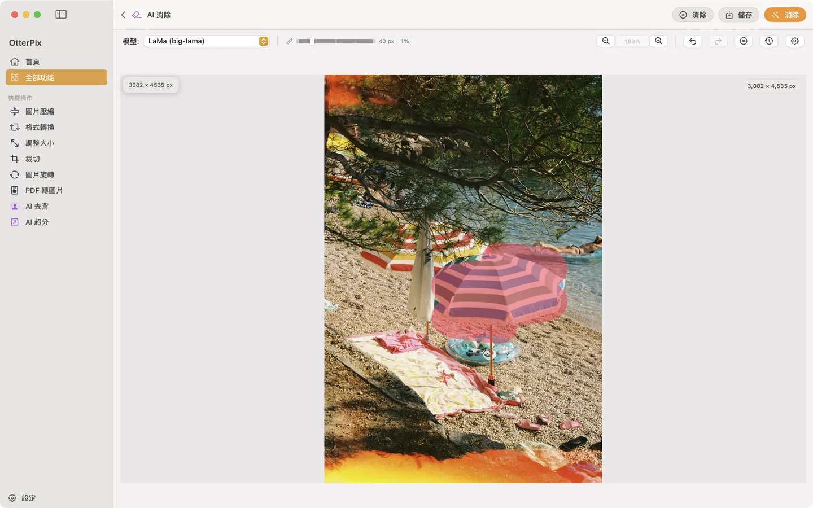

[English](../../en/ai/ai-eraser.md) · [简体中文](../../zh-Hans/ai/ai-eraser.md) · **繁體中文** · [Deutsch](../../de/ai/ai-eraser.md)

---

# AI 消除

**AI 消除**把照片裡不想要的東西抹掉：塗過路人、電線、垃圾桶——塗抹的區域會用相符的背景補起來。這個工作流天生就是迭代式的：消除、檢查、補塗、再消除。

## 一覽

| | |
|---|---|
| **取得方式** | Pro——免費版每天 1 次免費使用（按照片計——同一張照片反覆修仍是免費） |
| **執行位置** | 裝置端；模型一次性下載（約 200 MB）後即離線執行 |
| **輸入** | 單張圖片＋你塗的遮罩 |
| **輸出** | 塗抹區域已被填補的照片 |
| **流程步驟** | 無——每張照片都需要你的手工塗抹 |

所有處理都在你的 Mac 上完成，圖片不會被上傳——App 只在你主動下載 AI 模型和 App Store 購買驗證時連線。

## 如何消除一個物體

工具自己的提示就是完整流程：「在要消除的部分上塗抹，然後點選消除(或按 Cmd-Return)。」

1. 開啟 OtterPix，點選 **AI 消除**。首次使用時 App 會下載一次消除模型（約 200 MB）——之後離線運作。
2. 把照片拖進視窗，或點選瀏覽。
3. 選**筆刷工具**（B），設定筆刷大小——細的塗電線，大的塗人。把要消掉的東西整個塗滿，邊緣多留一點餘量。
4. 點選**消除**（或按 ⌘⏎）。片刻之後，塗抹區域會在**結果**窗格中被相符的背景補上。
5. 檢查。若殘留影子、一隻腳或淡淡輪廓，就只塗那塊殘餘再點一次**消除**——每一輪都在前一輪的基礎上疊加。
6. 換下一個物體，重複到畫面乾淨為止。**還原**（⌘Z）撤回失手的一輪；**還原為原圖**讓你從頭來過。
7. 按**儲存**（⌘S），選擇清理後的照片要存到哪裡。原始檔案保持原樣。

## 選項

- **筆刷工具**（B）——拖曳塗抹遮罩；大小讀數以圖片像素顯示筆刷尺寸。
- **抓手工具**（H）——放大時拖曳平移畫布；**適合視窗**（⌘0）重置檢視。
- **清除遮罩**——抹掉目前的塗抹，重新選取。
- **還原**（⌘Z）／**重做**（⇧⌘Z）——以每輪消除為單位。
- **還原為原圖**——回到未動過的照片。

## 秘訣與限制

- **反覆修不用錢。** 每日免費次數按載入的照片計算，不是按點選次數——在同一張照片上塗、消、補、再消，都算同一次免費使用。
- **把影子一起塗進去。** 人消掉了、影子還在，是最經典的穿幫——兩個都刷掉。
- **均勻背景上的獨立物體消得最乾淨。** 路面、草地、天空、牆面：填補俐落。物體背後缺乏可依據的細節時——文字、人臉、密集圖樣——填補是推測出來的，可能顯得鬆軟或扭曲。分成幾輪小範圍處理。
- **餘量很重要。** 物體周圍多塗一點，填補才有空間融合；遮罩貼太緊會留下光暈。

## 疑難排解

| 你看到的 | 原因 | 解法 |
|---|---|---|
| 「請先在要移除的區域塗抹，再點選消除。」 | 遮罩是空的 | 先塗好物體，再點**消除** |
| 模型尚未下載的錯誤 | 消除模型還不在磁碟上 | 用工具齒輪選單裡的下載，或前往**設定 → AI** |
| 「本功能今日免費次數已用完」 | 「每個 AI 功能每天各有 1 次免費，本功能將在午夜恢復。」 | 等待重置，或升級。今天的照片仍可免費繼續修 |
| 物體原位置出現鬼影或塗抹痕 | 填補可參考的背景太少，或遮罩貼太緊 | **還原**，加大餘量重塗，分幾輪小範圍消除 |
| 還是卡住 | — | [開一個 Issue](https://github.com/nanguoyu/OtterPix-app/issues/new/choose) |

## 另請參閱

- [AI 隱私模糊](ai-anonymize.md)——把人遮住，而不是移除
- [AI 去背](ai-cutout.md)——保留主體、去除背景
- [常見問題——免費與 Pro](../faq.md#免費與-pro)

---

**意見回饋**——錯誤請到 [Issues](https://github.com/nanguoyu/OtterPix-app/issues/new/choose) 回報；問題請到 [Discussions](https://github.com/nanguoyu/OtterPix-app/discussions) 發問。
