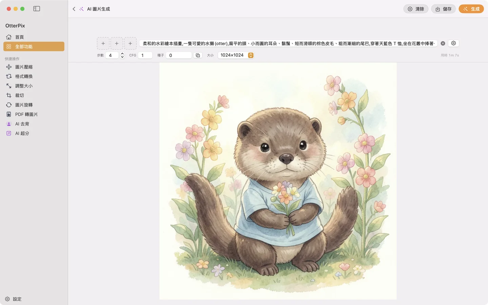

[English](../../en/ai/ai-generation.md) | [简体中文](../../zh-Hans/ai/ai-generation.md) | **繁體中文** | [Deutsch](../../de/ai/ai-generation.md)

---

# AI 圖片生成

**AI 圖片生成**——App Store 介紹頁上稱為「AI 文字生成圖片」——從文字描述生成圖片，全程在你的 Mac 上。可選的參考圖能把結果導向你手上已有的風格、主體或構圖。

## 一覽

| | |
|---|---|
| **取得方式** | 免費 |
| **執行位置** | 裝置端；模型下載後即離線執行——App 內最大的一組下載，總計數 GB |
| **輸入** | 一段文字提示，外加最多 3 張可選參考圖 |
| **輸出** | 你指定尺寸的生成圖片 |
| **流程步驟** | 無 |
| **建議配備** | 16 GB 以上記憶體 |

影像處理和 AI 推論都在你的 Mac 上完成。圖片、生成提示詞、OCR 內容和使用情況遙測資料絕不會上傳。OtterPix 可能會為 StoreKit、啟動時僅用於模型下載路由的 Cloudflare 邊緣國家代碼查詢、首次使用模型商店時更新只包含下載 URL 的小型清單，以及你主動發起的模型下載而連線。

**地區說明：** 透過中國大陸區 Mac App Store 發行的 OtterPix 版本不提供 AI 圖片生成與 AI 文字辨識。其餘全部功能（包括五項 Pro AI 功能）在 OtterPix 上架的所有地區均可使用。詳見[服務條款](https://otterpix.app/zh-Hant/terms)。

## 如何生成一張圖片

1. 開啟 OtterPix，點選 **AI 圖片生成**。
2. 輸入你的提示——欄位邀你「描述你想要的影像」。具體勝過空泛：主體、風格、光線、場景。「試試這些」一列提供了現成的起點。
3. 需要時加入**參考圖**——「拖入或點選新增參考圖（最多 3 張，可選）」。有參考圖時，提示描述的是如何轉換或融合它們。
4. 在操作區選擇**模型精度**與**文字編碼器精度**；旁邊會顯示所選設定的實際容量。
5. 從預設尺寸中挑一個輸出尺寸，或選**自訂尺寸**並輸入**寬度**與**高度**——鏈條圖示會在你輸入時鎖定長寬比。
6. 首次使用時點選**下載並生成**（設定就緒後顯示**生成**）。同一個下載與控制會同步顯示在**設定 → AI**，兩處都能暫停、繼續或取消；下載完成後會自動開始生成。
7. 按**儲存**（⌘S）保留結果。

## 選項

### 參考圖

最多三張。一張參考圖引導風格或主體；多張可以融合（「描述如何融合這些圖」）。圖位就地管理——把游標移到已填的圖位上即可移除。

### 尺寸

預設尺寸涵蓋常見情境；**自訂尺寸**接受精確的像素值，附長寬比鎖定開關。

### 模型與精度

生成模型是 Flux 2 Klein 4B。Transformer 與文字編碼器精度屬於目前工作，直接放在操作區，並顯示所選設定的磁碟容量。齒輪面板只保留進階 VAE 選項與**管理模型…**入口；刪除和跨功能空間管理統一放在**設定 → AI**。

### 進階參數

想要更細的控制，工具開放了幾個生成參數，介面裡都有白話說明——精修步數（步數越多品質越高但越慢）、對提示的遵循程度，以及種子（相同種子＋相同提示＋相同設定會重現同一張圖；骰子按鈕重新隨機）。

## 秘訣與限制

- **寫具體一點。** 「黃昏燈塔的水彩插畫，暖光，柔和紙紋」勝過「好看的燈塔圖」。
- **以分鐘計，不是秒。** 生成是 App 裡最重的工作負載，耗時隨你的 Mac 晶片與輸出尺寸而變。16 GB 以上記憶體的建議正是針對這項工作。
- **這是最大的一組下載。** 所選元件總計數 GB。暫停、取消、斷線或重新開啟 App 後都會保留部分資料；不完整目錄只顯示為「繼續」，不會冒充已安裝。刪除統一在**設定 → AI**。
- **種子讓結果可重現。** 固定種子來打磨同一個提示；隨機化種子來探索。

## 疑難排解

| 你看到的 | 原因 | 解法 |
|---|---|---|
| App 裡完全找不到這個功能 | 從中國大陸區 Mac App Store 下載 | 見[常見問題](../faq.md#地區供應與支援)——這是商店供應範圍的問題，不是錯誤 |
| 設定過程中斷 | 所選元件尚未完整下載 | 在生成頁或**設定 → AI**繼續；已保留的資料不會從頭下載 |
| 生成期間 Mac 變慢 | 生成天生就是計算與記憶體密集的工作 | 讓它跑完或按**取消**；關掉吃記憶體的 App；建議 16 GB 以上記憶體 |
| 還是卡住 | — | [開一個 Issue](https://github.com/nanguoyu/OtterPix-app/issues/new/choose) |

## 另請參閱

- [AI 超分](ai-upscale.md)——把生成的圖片放大 4 倍
- [常見問題——地區供應與支援](../faq.md#地區供應與支援)
- [快速上手](../getting-started.md)——系統需求

---

**意見回饋**——錯誤請到 [Issues](https://github.com/nanguoyu/OtterPix-app/issues/new/choose) 回報；問題請到 [Discussions](https://github.com/nanguoyu/OtterPix-app/discussions) 發問。
