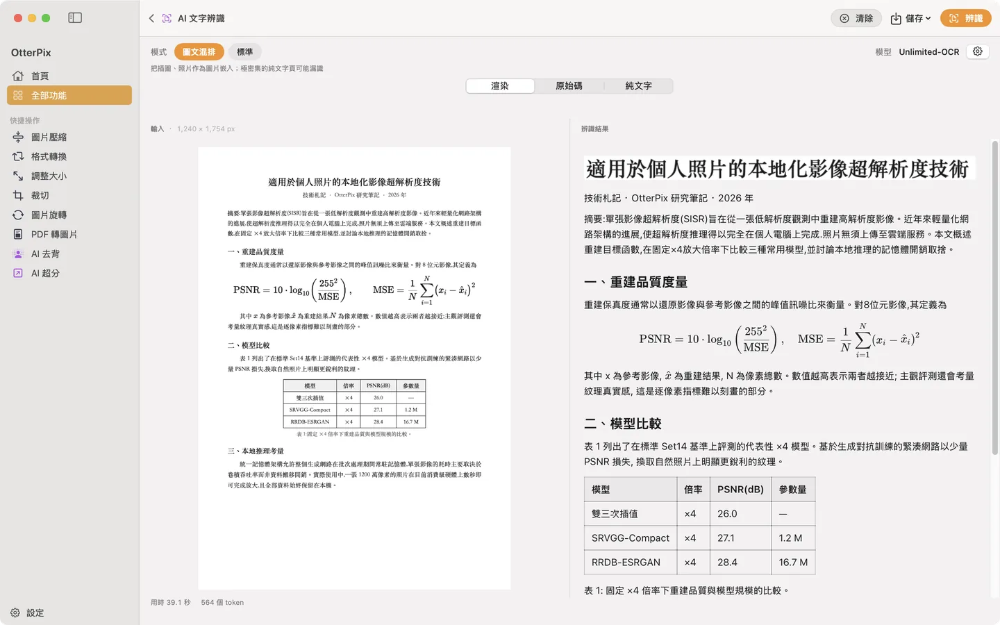

[English](../../en/ai/ai-ocr.md) · [简体中文](../../zh-Hans/ai/ai-ocr.md) · **繁體中文** · [Deutsch](../../de/ai/ai-ocr.md)

---

# AI 文字辨識

**AI 文字辨識**把文件變成可以直接使用的文字。用 App 自己的話說：「論文、掃描檔、PDF → 帶表格公式的 Markdown，全程本地。」餵它一頁掃描件、一張文件照片或一份多頁 PDF，取回結構化的 Markdown——標題、表格、公式與插圖都保留。

## 一覽

| | |
|---|---|
| **取得方式** | 免費 |
| **執行位置** | 裝置端；模型一次性下載後即離線執行 |
| **輸入** | 文件圖片（掃描件、頁面照片）或 PDF |
| **輸出** | Markdown 或純文字——可拷貝或匯出 |
| **流程步驟** | 無 |

影像處理和 AI 推論都在你的 Mac 上完成。圖片、生成提示詞、OCR 內容和使用情況遙測資料絕不會上傳。OtterPix 可能會為 StoreKit、啟動時僅用於模型下載路由的 Cloudflare 邊緣國家代碼查詢、首次使用模型商店時更新只包含下載 URL 的小型清單，以及你主動發起的模型下載而連線。

**地區說明：** 透過中國大陸區 Mac App Store 發行的 OtterPix 版本不提供 AI 圖片生成與 AI 文字辨識。其餘全部功能（包括五項 Pro AI 功能）在 OtterPix 上架的所有地區均可使用。詳見[服務條款](https://otterpix.app/zh-Hant/terms)。

## 如何辨識一份文件

1. 開啟 OtterPix，點選 **AI 文字辨識**。空白狀態一句話講完：「拖入文件或 PDF 開始。」
2. 拖入文件圖片或 PDF。若是 PDF，工具會顯示頁數（「12 頁 PDF」）與**頁碼範圍**控制——辨識全部頁面或一個範圍。
3. 選一種**模式**（見下方選項）。
4. 點選**辨識**。進度按頁顯示（「正在解析第 3 / 12 頁」），長文件可**暫停**與**繼續**。
5. 在三種檢視中審閱結果：**渲染**（排版後的文件，插圖在內）、**原始碼**（原始 Markdown）與**純文字**。
6. 把文字帶走：**拷貝全部**、**匯出為 Markdown (.md)**，或**匯出為純文字 (.txt)**。從渲染檢視拷貝，貼出的是一份自帶插圖的完整文件。

## 選項

### 模式

| 模式 | 適用情境 |
|---|---|
| **圖文混排** | 預設。把插圖、照片作為圖片嵌入，適合論文、報告與圖文頁面；極密集的純文字頁可能漏識 |
| **標準** | 適合密集頁面的文字、表格與公式，是試卷和表單的備用模式；複雜插圖會略過 |

辨識模式與輸出檢視是兩回事。**渲染**、**原始碼**、**純文字**只改變已完成
結果的顯示／匯出方式，切換檢視不會重新執行模型。

### PDF 頁面選擇

**頁碼範圍**控制接受全部頁面或起始／結束範圍——想從長 PDF 裡只抽一章時特別好用。

### 設定

工具設定裡有**模型**列（用 App 的話說：「本地文件辨識。下載一次，完全在你的 Mac 上執行。」）與**最大 token 數**——它限制每頁生成的文字量，辨識長篇密集文件時可調高。

## 秘訣與限制

- **為文件而生。** 論文、掃描件、文字截圖、PDF。它不是通用的照片文字閱讀器——路牌、迷因圖與商品照超出它的設計範圍，輸出可能不可靠。
- **表格與公式以 Markdown 輸出**，可直接貼進筆記 App、wiki 或編輯器。
- **App 會自我檢查。** 若部分頁面辨識結果可疑地空白，會出現警告橫幅：「部分頁面幾乎沒辨識出內容——可能更適合另一種模式。」——並附一鍵以另一種模式重跑。
- **超長頁面可能碰到輸出上限。** 若看到「輸出已達到 token 上限 — 可在設定中調高以取得更多內容。」，就到工具設定調高**最大 token 數**再跑一次。

## 疑難排解

| 你看到的 | 原因 | 解法 |
|---|---|---|
| 「OCR 模型尚未下載。」 | 首次使用——辨識模型還不在磁碟上 | 點錯誤提示裡的**開啟設定**下載（也在**設定 → AI**） |
| 「部分頁面幾乎沒辨識出內容——可能更適合另一種模式。」 | 所選模式吃不下那些頁面的版式 | 用橫幅上的按鈕以另一種模式重跑同一份文件 |
| 輸出在文件中途被截斷 | 到達每頁 token 上限 | 在工具設定調高**最大 token 數**，然後再次**辨識** |
| 照片辨識出亂七八糟的內容 | 輸入不是文件——是場景照片或迷因圖 | 改用文件類輸入；這才是工具的設計對象 |
| 還是卡住 | — | [開一個 Issue](https://github.com/nanguoyu/OtterPix-app/issues/new/choose) |

## 另請參閱

- [PDF 轉圖片](../tools/pdf-and-qr.md)——把 PDF 頁面轉成圖片，而不是抽取文字
- [常見問題——地區供應與支援](../faq.md#地區供應與支援)
- [快速上手](../getting-started.md)

---

**意見回饋**——錯誤請到 [Issues](https://github.com/nanguoyu/OtterPix-app/issues/new/choose) 回報；問題請到 [Discussions](https://github.com/nanguoyu/OtterPix-app/discussions) 發問。
