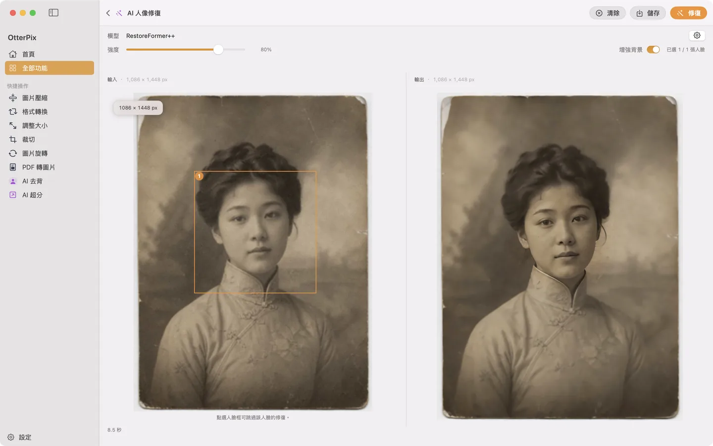

[English](../../en/ai/ai-restore.md) | [简体中文](../../zh-Hans/ai/ai-restore.md) | **繁體中文** | [Deutsch](../../de/ai/ai-restore.md)

---

# AI 人像修復

**AI 人像修復**——App Store 介紹頁上稱為「AI 老照片修復」——把老照片裡模糊、低品質的人臉重新拉回清晰。它刻意只處理人臉：偵測到的人臉之外一切保持掃描原樣，所以你永遠知道哪裡被改動了。

## 一覽

| | |
|---|---|
| **取得方式** | Pro——免費版每天 1 次免費使用 |
| **執行位置** | 裝置端；模型一次性下載（約 280 MB）後即離線執行 |
| **輸入** | 一張有清楚人臉的照片 |
| **輸出** | 人臉特徵已銳化的照片；其餘部分保持不變 |
| **流程步驟** | 無——選臉與強度都是互動操作 |

影像處理和 AI 推論都在你的 Mac 上完成。圖片、生成提示詞、OCR 內容和使用情況遙測資料絕不會上傳。OtterPix 可能會為 StoreKit、啟動時僅用於模型下載路由的 Cloudflare 邊緣國家代碼查詢、首次使用模型商店時更新只包含下載 URL 的小型清單，以及你主動發起的模型下載而連線。

## 它做什麼——以及刻意不做什麼

App 在工具設定裡把邊界講得明白：「僅銳化面部特徵。不修復劃痕、黴斑、褪色或背景。下載後可離線執行。」如果照片的問題是物理損傷而不是人臉發糊，這不是對的工具——但對最經典的情境（一張掃描件，爺爺奶奶的臉已經快看不清了），它正是為此而生。

## 如何修復人臉

1. 開啟 OtterPix，在 AI 區點選 **AI 人像修復**。
2. 把掃描的照片拖到拖放區，或點選瀏覽。
3. OtterPix 自動偵測每一張人臉，各以編號方框標出——方框就是 AI 要處理的區域。標題列會計數（「已選 3 / 3 張人臉」）；點選任一方框可把那張臉排除（「點選人臉框可跳過該人臉的修復。」），再點一次重新納入。
4. 點選**修復**。首次使用時，OtterPix 會下載一次人像修復模型（約 280 MB）；之後每次執行都離線。
5. 結果出現後，拖動**強度**滑桿直到融合看起來自然。預覽即時更新——不需要重跑修復。
6. 按**儲存**（⌘S），選擇修復後的副本要存到哪裡。你的原始掃描永遠不會被修改。

## 選項

### 強度

修復後的人臉疊在原圖上的濃度。滿強度給出最銳利的五官；較低數值保留更多原有的味道。調整是即時的——模型不會重跑。

### 增強背景

預設關閉。開啟後，會先對整張圖跑一遍整體增強，再做人臉修復——對模糊或低解析度的原件有幫助。有兩件事要知道，出自 App 自己的說明：對有物理損傷（劃痕、黴斑）的照片，它可能讓損傷*更*明顯而不是減輕；而且它需要自己的一個小模型（約 5 MB），可在本工具的設定裡下載。

## 秘訣與限制

- **合照正是它的主場。** 所有人臉一趟修完，每張臉都有自己的編號方框——想保持原樣的就把它排除。
- **掃描解析度越高越好。** 修復可依據的細節越多，結果越自然。如果手上只有小圖，先修復，再用 [AI 超分](ai-upscale.md)放大。
- **頭髮、衣著與背景保持掃描原樣**——編號方框就是被處理的區域；框外一切不變（除非開了**增強背景**）。
- **同一張照片反覆修是免費的。** 調**強度**、切換人臉、對同一張照片重跑，都在同一次每日免費使用之內。

## 疑難排解

| 你看到的 | 原因 | 解法 |
|---|---|---|
| 「在該圖片中未偵測到人臉。請換一張人臉清晰可見的照片再試。」 | 側臉、太陽眼鏡、嚴重遮擋或人臉太小，偵測失手 | 換一張人臉清楚、大致正面的照片；人臉太小就先裁近一點 |
| 模型尚未下載的錯誤 | 人臉模型（約 280 MB）——或開啟**增強背景**時，其獨立的約 5 MB 模型——不在磁碟上 | 點錯誤提示裡的**開啟設定**；兩個模型在本工具的設定面板裡都有下載按鈕 |
| 「本功能今日免費次數已用完」 | 「每個 AI 功能每天各有 1 次免費，本功能將在午夜恢復。」 | 等待重置，或升級。今天的照片仍可免費繼續修 |
| 開了增強背景，劃痕反而更明顯 | 整體增強會連物理損傷一起銳化 | 關掉**增強背景**——App 的說明警告的正是這一點 |
| 修出來的臉太光滑 | 對品質很差的原件用了滿強度 | 調低**強度**滑桿——它會即時重新合成 |
| 還是卡住 | — | [開一個 Issue](https://github.com/nanguoyu/OtterPix-app/issues/new/choose) |

## 另請參閱

- [AI 超分](ai-upscale.md)——把修復後的掃描放大
- [AI 消除](ai-eraser.md)——移除畫面其他地方的灰塵斑點或雜物
- [常見問題——AI 模型](../faq.md#ai-模型)

---

**意見回饋**——錯誤請到 [Issues](https://github.com/nanguoyu/OtterPix-app/issues/new/choose) 回報；問題請到 [Discussions](https://github.com/nanguoyu/OtterPix-app/discussions) 發問。
