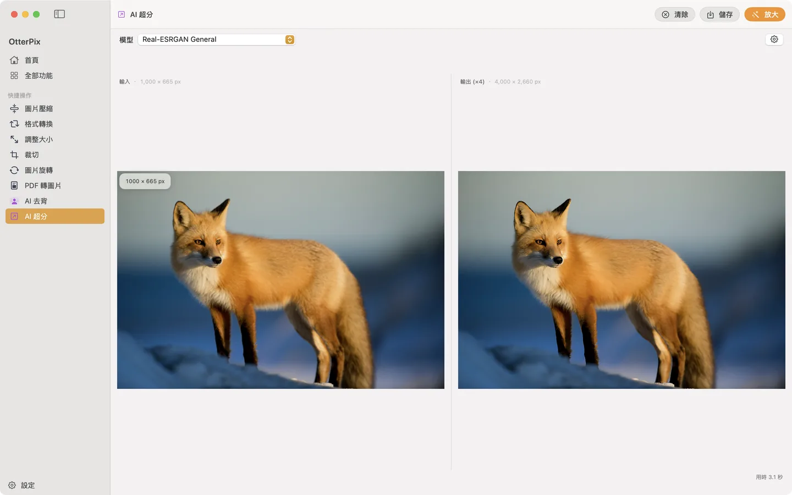

[English](../../en/ai/ai-upscale.md) · [简体中文](../../zh-Hans/ai/ai-upscale.md) · **繁體中文** · [Deutsch](../../de/ai/ai-upscale.md)

---

# AI 超分

**AI 超分**——App Store 介紹頁上稱為「AI 超解析」——把圖片放大到原始寬高的 4 倍——像素數量十六倍——放大的同時重建細節，而不是單純拉伸像素。

## 一覽

| | |
|---|---|
| **取得方式** | Pro——免費版每天 1 次免費使用 |
| **執行位置** | 裝置端；模型一次性下載後即離線執行（每個模型 2.5–67 MB） |
| **輸入** | 單張圖片 |
| **輸出** | 寬高各放大 4 倍的圖片 |
| **流程步驟** | 有（Pro）——見[處理流程](../pipeline.md) |

影像處理和 AI 推論都在你的 Mac 上完成。圖片、生成提示詞、OCR 內容和使用情況遙測資料絕不會上傳。OtterPix 可能會為 StoreKit、啟動時僅用於模型下載路由的 Cloudflare 邊緣國家代碼查詢、首次使用模型商店時更新只包含下載 URL 的小型清單，以及你主動發起的模型下載而連線。

## 如何放大

1. 開啟 OtterPix，點選 **AI 超分**。
2. 把照片拖到拖放區，或點選挑一個檔案。
3. 在**模型**選單裡挑一個模式。首次使用時，OtterPix 會下載該模式的檔案一次——它們都很小，2.5 MB 到 67 MB 之間——之後就離線執行。
4. 點選**放大**。結果會出現在**輸出 (×4)** 窗格，並附上本次執行的耗時。
5. 對照兩個窗格——**輸入**與**輸出**上方的像素尺寸徽章把收益寫得一清二楚：輸入 1,000 × 665 px，輸出 4,000 × 2,660 px。
6. 按**儲存**（⌘S），選擇放大後的副本要存到哪裡。原始檔案保持原樣。

## 選項

### 模型

四個模式，各自是一個小下載。選單用 App 自己的話介紹它們：

| 模式 | App 內的描述 |
|---|---|
| 一般照片 | 「5 MB · 較快，適合普通照片」 |
| 最高品質 | 「67 MB · 最高品質，下載較大」 |
| 動漫／插畫 | 「18 MB · 適合二次元 / 插畫靜圖」 |
| 動漫影片影格 | 「2.5 MB · 體積最小，適合動漫影片影格」 |

日常照片從一般模式開始；要印刷就換最高品質模式，線稿、平塗色與動畫影格則交給兩個動漫模式。同一張照片換模式重跑，仍算同一次每日免費使用。

## 秘訣與限制

- **徽章就是收據。** 窗格上方的像素尺寸徽章顯示精確的輸入與輸出大小——算列印尺寸時特別好用（以約 300 DPI 計，4 倍放大能把 1,000 px 寬的圖從約 3.3 吋可印放大到約 13 吋）。
- **大圖耗時較久。** 大尺寸輸入會分塊處理，進度讀數會逐塊計數；一切仍在本機執行。
- **照片類內容效果最好；小字救不回來。** 放大最擅長毛髮、皮膚、織物、風景。太小或本來就無法辨認的文字不會因此變得可讀。
- **透明背景：** 放大會壓平 alpha——需要透明結果時，請在放大*之後*再跑 [AI 去背](ai-cutout.md)。

## 疑難排解

| 你看到的 | 原因 | 解法 |
|---|---|---|
| 「模型還未下載。」 | 所選模式的模型不在磁碟上 | 點錯誤提示裡的**開啟設定**下載（也可經由**設定 → AI**） |
| 「本功能今日免費次數已用完」 | 「每個 AI 功能每天各有 1 次免費，本功能將在午夜恢復。」 | 等待重置，或升級 Pro。今天已經跑過的那張照片仍可免費繼續調整 |
| 結果看起來過度平滑 | 模式不對（例如用照片模式跑線稿） | 換一個**模型**模式——同一張照片，同一次免費使用 |
| 還是卡住 | — | [開一個 Issue](https://github.com/nanguoyu/OtterPix-app/issues/new/choose) |

## 另請參閱

- [AI 人像修復](ai-restore.md)——先把人臉修清晰，再放大
- [處理流程](../pipeline.md)——AI 超分作為批次步驟（Pro）
- [常見問題——免費與 Pro](../faq.md#免費與-pro)

---

**意見回饋**——錯誤請到 [Issues](https://github.com/nanguoyu/OtterPix-app/issues/new/choose) 回報；問題請到 [Discussions](https://github.com/nanguoyu/OtterPix-app/discussions) 發問。
