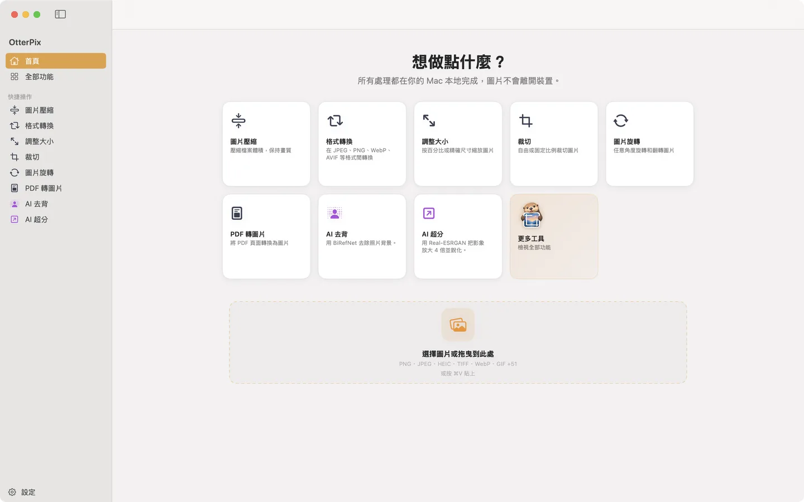

[English](../en/getting-started.md) | [简体中文](../zh-Hans/getting-started.md) | **繁體中文** | [Deutsch](../de/getting-started.md)

---

# 快速上手

從下載到完成第一次編輯，你需要知道的都在這裡。

## 我的 Mac 能執行嗎？

- **macOS 14（Sonoma）或更新版本。**
- **Apple 晶片（M1 或更新）。** 不支援 Intel Mac——AI 功能是針對 Apple 晶片的統一記憶體架構打造的。
- **若使用 AI 功能，需要保留模型的磁碟空間。** 各 AI 功能在首次使用時下載模型——最小的超分模型只有幾 MB，圖片生成模型則達數 GB。基本工具完全不需要下載。
- **AI 圖片生成建議 16 GB 以上記憶體。** 其他所有功能在任何 Apple 晶片 Mac 上都能流暢執行。

## 安裝

[在 Mac App Store 下載 OtterPix](https://apps.apple.com/app/id6772468615)。下載免費，十個基本工具加上 AI 文字辨識與 AI 圖片生成都可免費使用——不需帳號、不需註冊。

## 視窗導覽

**側邊欄。** 固定導覽項目是**首頁**、**全部功能**和**自動化**；下方是可自訂的**快捷操作**，**設定**固定在側邊欄底部。

- **首頁**以「想做點什麼？」迎接你——最常用工具的任務卡片，加上一個拖放區。
- **全部功能**是完整的工具庫：每個工具一張卡片、一個**搜尋**欄可即時過濾，**處理流程**停靠在底部。Pro AI 卡片在當日免費次數尚未用掉時，會掛著琥珀色的**今日免費**徽章。
- **自動化**是 Pro 資料夾監控工作區：授權一個輸入資料夾並選擇已儲存的處理流程預設，新到檔案即可自動處理。
- **快捷操作**是你自己的捷徑。在**設定**裡可以挑選要顯示哪些功能——如 App 所述：「選擇哪些功能作為快捷操作顯示在側邊欄和首頁。」
- **設定**有四個分頁：**一般**、**匯出**、**AI**（模型下載與儲存空間）、**關於**。

**拖放區。** 幾乎每個工具都以同一句話開場：「**選擇圖片或拖曳到此處**」——「或按 ⌘V 貼上」。首頁的拖放區列出主要格式——PNG、JPEG、HEIC、TIFF、WebP、GIF +51——並把你拖入的檔案自動送往合適的工具。

## 你的第一次編輯：壓縮一張照片

1. 在**首頁**點選**圖片壓縮**。
2. 把照片拖到拖放區（或按 ⌘V 貼上）。
3. 在**壓縮預設**中挑一檔——**小體積**、**均衡**或**高品質**。預覽上方的讀數會在儲存前先告訴你結果：原始大小 → 新大小，以及「原大小佔比」的百分比。
4. 點選**儲存**（⌘S），選擇壓縮副本要存到哪裡。你的原始檔案保持原樣。

這就是整個 App 的操作骨架：拖入、調整、儲存。每個工具都遵循同一套節奏。

## AI 功能

各 AI 工具（超分、去背、消除、隱私模糊、人像修復、文字辨識、圖片生成）會在首次使用時下載所選模型元件，之後可離線運作。工作相關的模型與品質直接顯示在各功能頁；**設定 → AI** 同步顯示可續傳下載，並統一負責刪除與磁碟管理。體積從最小超分模型的幾 MB 到圖片生成的數 GB 不等。

## 自動化

Pro 使用者可用**自動化**監控已授權的資料夾，在新檔案到達時自動執行已儲存的處理流程預設。支援的工具與預設也可透過「捷徑」（App Intents）或 AppleScript 呼叫；無論從哪個入口使用，都遵循相同的 Pro 權益與地區供應規則。

**活動記錄**列出最近的執行（只儲存在這部 Mac 上，最多 100 筆），並寫明哪些檔案失敗以及原因。在**設定 → 一般**中開啟**顯示選單列圖示**後，關閉視窗時 OtterPix 會繼續在選單列中執行，監控的資料夾照常處理；隱藏圖示時，關閉最後一個視窗會結束 OtterPix，並停止資料夾自動化。

## 免費與 Pro

| | 你能得到什麼 |
|---|---|
| **免費** | 全部十個基本工具、處理流程、AI 文字辨識、AI 圖片生成——外加每個 Pro AI 工具每天各 1 次免費使用 |
| **Pro** | 不限次數的 AI 超分、AI 去背、AI 消除、AI 隱私模糊、AI 人像修復，以及不設上限的 AI 步驟批次流程 |

每日免費次數是按載入的照片計算，不是按點選次數——同一張圖片在當天可以反覆調整，都算同一次。當某個工具的免費次數用完，它的卡片會顯示付費牆，直到午夜計數重置。

Pro 提供月訂閱、年訂閱，或一次性買斷。目前定價請見 [Mac App Store](https://apps.apple.com/app/id6772468615)；訂閱可隨時在你的 [Apple 帳號訂閱頁面](https://apps.apple.com/account/subscriptions)管理或取消。

## 隱私

所有影像處理和 AI 推論都在你的 Mac 上完成。圖片、生成提示詞、OCR 內容和使用情況遙測資料絕不會上傳。OtterPix 會為 StoreKit、啟動時僅用於選擇模型下載鏡像的 Cloudflare 邊緣國家代碼查詢、首次使用模型商店時更新只包含下載 URL 的小型清單，以及你主動發起的模型下載而連線。詳情：[隱私政策](https://otterpix.app/zh-Hant/privacy)。

## 哪裡可以取得協助

- [常見問題](faq.md)在一頁裡回答了最常見的疑問。
- 東西壞了 → [開一個 Issue](https://github.com/nanguoyu/OtterPix-app/issues/new/choose)。
- 不確定怎麼操作 → [Discussions → Q&A](https://github.com/nanguoyu/OtterPix-app/discussions/categories/q-a)。

## 另請參閱

- [格式轉換與圖片壓縮](tools/convert-and-compress.md)
- [處理流程](pipeline.md)
- [常見問題](faq.md)

---

**意見回饋**——錯誤請到 [Issues](https://github.com/nanguoyu/OtterPix-app/issues/new/choose) 回報；問題請到 [Discussions](https://github.com/nanguoyu/OtterPix-app/discussions) 發問。
