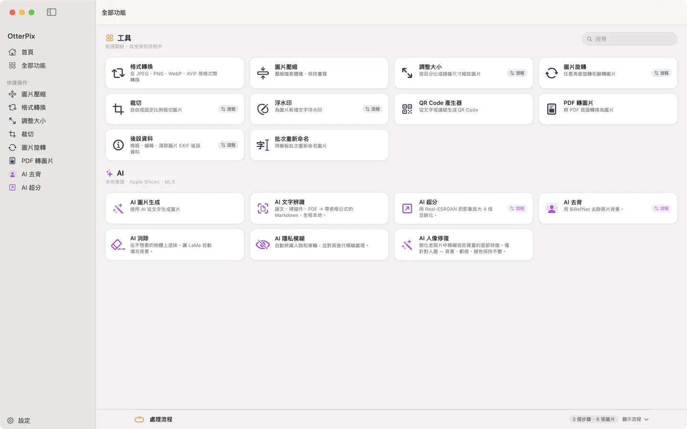

[English](../en/pipeline.md) | [简体中文](../zh-Hans/pipeline.md) | **繁體中文** | [Deutsch](../de/pipeline.md)

---

# 處理流程

**處理流程**把多個工具串成一條工作流，一次套用到整批圖片——同一趟就能把一整個資料夾的照片縮放、加浮水印、清除後設資料，再把這條鏈存成預設，下次一鍵重用。

## 一覽

| | |
|---|---|
| **取得方式** | 免費。免費版：每條流程限一個 Pro 步驟，且含 Pro 步驟時僅限 1 張圖 |
| **執行位置** | 你的 Mac——離線執行，不上傳任何內容 |
| **輸入** | 任意數量的圖片 |
| **輸出** | 處理後的副本存到你選擇的位置；原始檔案保持原位 |
| **位置** | **全部功能**——流程停靠在工具庫底部 |

## 流程是什麼

一條流程是一個由左到右的鏈：**輸入**節點、你的處理步驟、**輸出**節點。每個啟用的步驟會依序套用到每一張圖片。**輸出格式**（PNG、JPEG、TIFF、BMP、HEIC、WebP、AVIF）與**品質**由**輸出**節點決定，而不是一個步驟——所以轉檔與壓縮永遠是這一趟的一部分，卻不佔用鏈上的位置。

## 可用的步驟

| 步驟 | 說明 |
|---|---|
| **縮放** | 按百分比或精確尺寸——見[調整大小](tools/resize-crop-rotate.md) |
| **旋轉** | 固定角度與翻轉——見[圖片旋轉](tools/resize-crop-rotate.md) |
| **裁切** | 依比例與對齊方式裁切——見[裁切](tools/resize-crop-rotate.md) |
| **浮水印** | 文字浮水印，可調字型、顏色、角度、不透明度、密度——見[浮水印](tools/watermark.md) |
| **清除後設資料** | 清除 EXIF/GPS——見[後設資料](tools/metadata.md) |
| **AI 超分** | Pro——見 [AI 超分](ai/ai-upscale.md) |
| **AI 去背** | Pro——見 [AI 去背](ai/ai-cutout.md) |

以上就是完整清單。AI 消除、AI 隱私模糊、AI 人像修復、AI 文字辨識與 AI 圖片生成是互動式工具——每張圖都需要你塗抹、點選或輸入——所以不是流程步驟。輸出格式與壓縮品質也不是步驟，而是在**輸出**節點上設定。

## 建立一條流程

1. 點選側邊欄的**全部功能**。**處理流程**停靠在底部——點選該列（**顯示流程**）將它展開。
2. 把圖片拖到**輸入**節點（「拖放或點選」）。要處理整個資料夾，可在 Finder 中開啟它、選取其中的圖片再拖進來，或把資料夾拖到選單列的 OtterPix 圖示上（只取第一層的圖片，最多 500 張）。每張圖片會出現在鏈下方的縮圖列，底部列同時計數（「3 個步驟、6 張圖片」）。
3. 加入步驟：點選節點之間的 **+**，或把任何帶**流程**徽章的工具卡片直接拖進鏈裡。空白流程自己也會提示：「從上方畫廊向下拖曳工具，或點選節點間的 + 按鈕」。
4. 點選任一步驟設定其參數——與獨立工具的選項相同。步驟可以重新排序（**左移** / **右移**）、暫時停用（**停用**）或移除（**刪除**）。
5. 在**輸出**節點上為整批圖片選擇**輸出格式**與**品質**。
6. 點選**執行流程**。執行時進度顯示「第 3/6 張…」，結束時顯示「完成：6 / 6 成功」。處理後的副本存到輸出位置；原始檔案永遠不會被覆寫。

## 預設

點選**儲存預設**，為這條鏈取一個**預設名稱**，它就會存放在**預設**之下。下週：**預設** → **載入**，把新圖片拖到輸入節點，**執行流程**。預設就是把五步例行公事變成一鍵作業的方法。

## 批次行為

沒有固定的圖片數量上限——流程本來就是為整個資料夾設計的。一切都在本機執行，批次越大只是耗時按比例增加。若某一張圖片失敗，執行會繼續，摘要會告訴你成功了幾張。

## 透明背景提示

**AI 去背**會產生透明背景，之後的每個步驟都會保留它，AI 超分也一樣。唯一會弄丟它的是 JPEG 輸出，所以請把**輸出格式**設為 PNG（或 WebP/AVIF）。

## 免費版限制

- App 內的提示：「免費版:含 Pro 步驟的管線僅限 1 張圖。升級可批次處理。」免費版的流程可以包含**一個** Pro 步驟（**AI 超分**或 **AI 去背**），且只要鏈上有 Pro 步驟，批次就限制為單張圖片。
- 執行該 Pro 步驟會消耗與獨立工具相同的每日免費次數。
- 免費版載入已儲存的預設時，會略過其中的 Pro 步驟——想把當日免費次數花在它上面，請手動把該步驟加回來。
- 訂閱者沒有步驟與批次上限。

## 疑難排解

| 你看到的 | 原因 | 解法 |
|---|---|---|
| AI 步驟顯示「模型尚未下載」 | 該步驟的模型還沒抓下來 | 開啟對應的工具（AI 超分 / AI 去背）在那裡下載模型，或前往**設定 → AI** |
| 「免費版:含 Pro 步驟的管線僅限 1 張圖。」 | 鏈上有 Pro 步驟時的免費版限制 | 一次跑一張、移除該 Pro 步驟，或升級 |
| 浮水印被裁掉或變模糊 | 浮水印步驟排在裁切或縮放之前 | 把浮水印移到裁切/縮放之後——App 在這種情況下會顯示警告 |
| 結果丟失了透明背景 | **輸出格式**是 JPEG，它不支援透明背景 | 輸出改用 PNG/WebP/AVIF |
| 還是卡住 | — | [開一個 Issue](https://github.com/nanguoyu/OtterPix-app/issues/new/choose) |

## 另請參閱

- [AI 超分](ai/ai-upscale.md)
- [AI 去背](ai/ai-cutout.md)
- [快速上手](getting-started.md)

---

**意見回饋**——錯誤請到 [Issues](https://github.com/nanguoyu/OtterPix-app/issues/new/choose) 回報；問題請到 [Discussions](https://github.com/nanguoyu/OtterPix-app/discussions) 發問。
