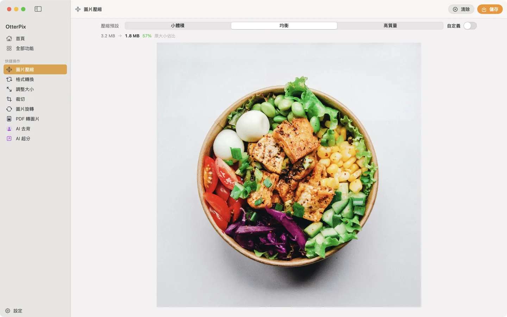
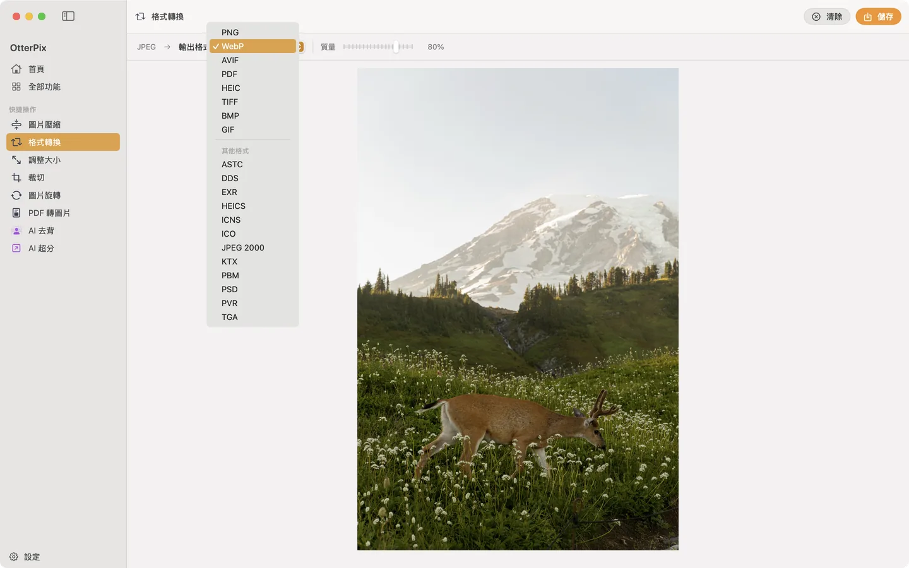

[English](../../en/tools/convert-and-compress.md) | [简体中文](../../zh-Hans/tools/convert-and-compress.md) | **繁體中文** | [Deutsch](../../de/tools/convert-and-compress.md)

---

# 格式轉換與圖片壓縮

OtterPix 最常被用到的兩個工具，放在同一頁講，因為它們從兩個方向解決同一個日常問題：**格式轉換**改變檔案「是什麼」（HEIC → JPEG、PNG → WebP），**圖片壓縮**改變它佔多少空間。兩者都免費、都支援批次，也都不會動到你的原始檔案。

## 一覽

| | |
|---|---|
| **取得方式** | 免費 |
| **執行位置** | 你的 Mac——離線執行，不上傳任何內容 |
| **輸入** | 單張圖片或整批（PNG、JPEG、HEIC、TIFF、WebP、GIF 等） |
| **輸出** | 轉換／壓縮後的副本，存到你選擇的位置 |
| **流程** | 格式與品質在流程的**輸出**節點上設定——見[處理流程](../pipeline.md) |

## HEIC 轉 JPEG

最經典的情境：iPhone 照片存成 `.heic`，Windows 電腦、上傳表單或沖印服務卻不收。

1. 開啟 OtterPix，點選**格式轉換**。
2. 把 HEIC 照片拖到拖放區——單檔或整批都可以。也可以點選瀏覽，或按 ⌘V 貼上。
3. 選擇 **JPEG** 作為輸出格式。選單頂部直接列出 JPEG、PNG、WebP、AVIF、HEIC、TIFF、BMP 這些常用格式；**其他格式**收錄你的 Mac 能寫出的較少見格式。
4. 調整**品質**滑桿——它只在 JPEG 這類有損格式時出現——越高保留越多細節，越低檔案越小。
5. 按**儲存**（⌘S），選擇轉換後的副本要存到哪裡。你的 HEIC 原始檔案保持原樣。

### 格式

- **可寫出：** JPEG、PNG、WebP、AVIF、HEIC、TIFF、BMP——加上**其他格式**區裡你的 Mac 能編碼的其他格式。
- **可讀取：** 範圍大得多——首頁拖放區標示 PNG、JPEG、HEIC、TIFF、WebP、GIF +51，所以 GIF 和大多數其他格式都能當作轉換的*輸入*。
- 大多數操作會保留色彩描述檔與 EXIF 方向。

## 壓縮圖片

1. 點選**圖片壓縮**，拖入一張照片——或一整批，底部會出現縮圖列。
2. 在**壓縮預設**中挑一檔：**小體積**、**均衡**或**高品質**。三檔由左到右從檔案最小排到品質最細，並且會針對每張圖片自動調整，而不是套一個固定數值。
3. 想要精確的等級，就切換到**自訂**並拖動**品質**滑桿。
4. 看預覽上方的讀數：原始大小 → 新大小，加上「原大小佔比」的百分比。如果某張圖已經小到沒有壓縮空間，OtterPix 會直接告訴你——「已是最佳，保留原圖」——而不是把它越壓越大。
5. 點選**儲存**（⌘S）——批次則用**全部處理**——並選擇壓縮後的檔案要存到哪裡。

### 選項

- **壓縮預設 vs 自訂**——預設會逐張自適應；**自訂**則把同一個**品質**數值套用到整批。
- **PNG 輸入**——「PNG 使用無失真壓縮，無需調整品質參數」：PNG 會在不改動任何像素的情況下重新打包，所以不會出現品質滑桿。

## 秘訣與限制

- **品質與體積是真實的取捨。** 對有損格式而言，品質設定決定丟棄多少細節。讀數的存在就是讓你在儲存前確認實際數字，而不是靠猜。
- **透明背景：JPEG 會壓平。** JPEG 沒有 alpha 色版——把透明 PNG 轉成 JPEG 會填上背景色。在意透明背景就留在 PNG、WebP 或 AVIF。
- **同等品質下 WebP/AVIF 通常比 JPEG 小。** WebP 支援廣泛；AVIF 往往壓得更小，但部分較舊的 App 打不開。
- **能小多少取決於圖片本身。** 細節豐富的照片與簡單圖形的壓縮表現不同，已經最佳化過的檔案可能幾乎不縮——讀數會告訴你每張圖的真相。
- **壓縮不等於移除後設資料。** 如果 GPS 或 EXIF 必須清掉，請用[後設資料](metadata.md)工具——移除應該是一個明確的步驟，而不是副作用。
- **兩件事一次批次做完：** [處理流程](../pipeline.md)在**輸出**節點上設定格式與品質，所以一個資料夾可以在同一趟裡縮放、加浮水印、轉檔、壓縮。

## 疑難排解

| 你看到的 | 原因 | 解法 |
|---|---|---|
| 「品質設定對 … 格式無效」 | 選擇的輸出格式是無失真格式 | 屬正常行為——想要品質旋鈕就選有損格式（JPEG/WebP/HEIC/AVIF） |
| 「已是最佳，保留原圖」 | 再壓縮反而會讓檔案變大 | 不需處理——OtterPix 保留了較小的原始檔 |
| 結果比原始檔還大 | 對已最佳化的檔案設了過高的品質 | 選**小體積**，或調低**自訂**品質 |
| 透明區域變成白色／黑色 | 輸出格式是 JPEG | 改轉 PNG、WebP 或 AVIF |
| 還是卡住 | — | [開一個 Issue](https://github.com/nanguoyu/OtterPix-app/issues/new/choose) |

## 另請參閱

- [處理流程](../pipeline.md)——透過輸出節點批次轉檔＋壓縮
- [調整大小、裁切與圖片旋轉](resize-crop-rotate.md)
- [常見問題](../faq.md)

---

**意見回饋**——錯誤請到 [Issues](https://github.com/nanguoyu/OtterPix-app/issues/new/choose) 回報；問題請到 [Discussions](https://github.com/nanguoyu/OtterPix-app/discussions) 發問。
