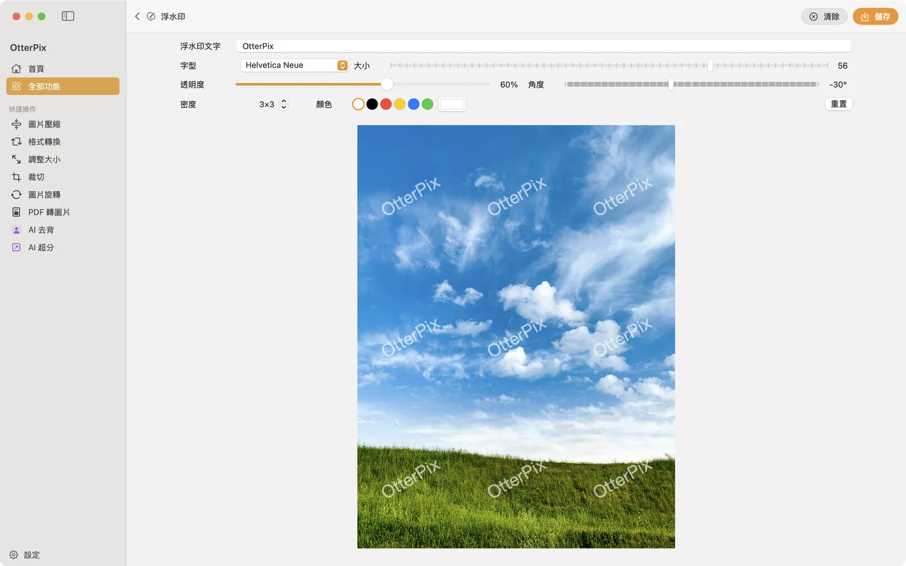

[English](../../en/tools/watermark.md) | [简体中文](../../zh-Hans/tools/watermark.md) | **繁體中文** | [Deutsch](../../de/tools/watermark.md)

---

# 浮水印

**浮水印**把文字——名字、品牌或版權宣告——加到單張照片或一整批圖片上，每一項調整都即時預覽。

## 一覽

| | |
|---|---|
| **取得方式** | 免費 |
| **執行位置** | 你的 Mac——離線執行，不上傳任何內容 |
| **輸入** | 單張圖片或整批 |
| **輸出** | 加上浮水印的副本，存到你選擇的位置；原始檔案不受影響 |
| **流程步驟** | 有——見[處理流程](../pipeline.md) |

## 如何加上文字浮水印

1. 開啟 OtterPix，點選**浮水印**。
2. 把一張照片——或一整批——拖到拖放區。
3. 在**浮水印文字**欄位輸入你的名字、品牌或帳號。
4. 從**字型**選單挑一個字型。**常用**區把可靠、易讀的選擇放在一步之遙；**全部字型**列出你 Mac 上安裝的每一個字型。
5. 用內建色塊設定**顏色**——白色或黑色幾乎適合任何照片——或打開旁邊的完整檢色器找精確的品牌色。接著調整**大小**、**透明度**、**角度**與**密度**；預覽即時更新。
6. 按**儲存**（⌘S），選擇加了浮水印的副本要存到哪裡。載入整批時，**全部處理**會以相同設定輸出每一張照片。

## 選項

### 文字與字型

**字型**選單的**常用**區在拉丁字型之外也收錄了 CJK 字型——只要你的 Mac 有某個語言的字型，就能用它打浮水印。**全部字型**則開放所有已安裝的字型。

### 顏色

六個內建色塊涵蓋常見情境；旁邊的檢色器晶片可打開完整的 macOS 色彩面板，取得精確的品牌色。

### 位置與覆蓋

- **透明度**——浮水印顯示的強度。50–60% 左右能讓文字在亮部與暗部都保持可讀，又不至於壓過照片本身。
- **角度**——讓文字傾斜；像 −30° 這樣的斜角讀起來清楚，也更難用裁切移除。
- **密度**——在單一浮水印與鋪滿整個畫面的重複圖樣之間切換。

## 秘訣與限制

- **單一浮水印 vs 鋪滿圖樣：兩者任務不同。** 單一浮水印低調，但容易被裁掉；斜向鋪滿的圖樣覆蓋整個畫面，裁掉一個還剩其他——保護力更好。
- **對比決定可讀性。** 每張照片各自微調透明度——畫面繁忙的照片能承受較重的浮水印，乾淨的照片則相反，即時預覽立刻給你答案。
- **在流程裡批次處理。** 反覆出現的工作流，就在[處理流程](../pipeline.md)裡加一個**浮水印**步驟，整個資料夾一趟跑完——縮放與轉檔也能同趟完成。記得把浮水印步驟放在裁切與縮放*之後*；若排在前面，App 會提出警告（「浮水印在縮放之前新增，縮放後可能變模糊」）。
- **僅限文字浮水印。** 這個工具只渲染文字，不支援蓋上圖片／Logo 檔案。
- **有損格式以 95% 品質儲存，** 不受設定中預設品質的影響。

## 疑難排解

| 你看到的 | 原因 | 解法 |
|---|---|---|
| 亮部照片上的浮水印幾乎看不見 | 低透明度＋淺色文字疊在淺色背景上 | 調高**透明度**，或把**顏色**換成黑色 |
| 批次中部分圖片的浮水印不見了 | 單一浮水印會隨每張圖的尺寸與構圖縮放 | 逐張檢查預覽，或改用鋪滿式的**密度**取得一致覆蓋 |
| 流程輸出的浮水印被裁掉或變模糊 | 浮水印步驟排在裁切／縮放之前 | 把浮水印步驟移到鏈的最後 |
| 還是卡住 | — | [開一個 Issue](https://github.com/nanguoyu/OtterPix-app/issues/new/choose) |

## 另請參閱

- [處理流程](../pipeline.md)——整個資料夾一趟加完浮水印
- [調整大小、裁切與圖片旋轉](resize-crop-rotate.md)
- [後設資料](metadata.md)——分享前清除 EXIF

---

**意見回饋**——錯誤請到 [Issues](https://github.com/nanguoyu/OtterPix-app/issues/new/choose) 回報；問題請到 [Discussions](https://github.com/nanguoyu/OtterPix-app/discussions) 發問。
